# Luna

<p align="center">
  <picture>
    <source media="(prefers-color-scheme: dark)" srcset="docs/assets/luna-hero-dark.svg">
    
  </picture>
</p>

<p align="center">
  <a href="https://github.com/SATUNIX/luna/actions/workflows/ci.yml"></a>
  <a href="https://www.bestpractices.dev/projects/15949"></a>
  <a href="CHANGELOG.md"></a>
  <a href="LICENSE"></a>
  <a href="package.json"></a>
  <a href="package.json"></a>
</p>

**Luna** is an opinionated distribution of the [pi coding agent](https://github.com/earendil-works/pi):
a permission gate for tool calls, governed delegation to sub-agents, verification, durable memory,
bounded recovery, a status bar, and an installer that ties them together as **profiles**. It is
one pi package, installed once.

<p align="center">
  <a href="https://satunix.github.io/luna/"><b>Website</b></a> ·
  <a href="https://satunix.github.io/luna/docs/">Documentation</a> ·
  <a href="docs/getting-started.md">Getting started</a> ·
  <a href="https://github.com/SATUNIX/luna/releases">Releases</a> ·
  <a href="CHANGELOG.md">Changelog</a>
</p>

**Renamed.** This project was previously published as **pi-system**; it is now **Luna**. The pi
package is still named `@satunix/pi-system`, so install commands, settings entries and environment
variables are unchanged.

> **Beta.** This is a public beta. It is tested, but it is not a stable release: expect rough
> edges, read [Beta status](docs/beta.md) for what is and is not covered, and report problems in
> the [issue tracker](https://github.com/SATUNIX/luna/issues/new/choose). The tool firewall is a guard rail, not a sandbox
> ([Security model](docs/security.md)).

## Install

Requirements: Node.js 22.19 or newer, git, and pi.

```sh
npm install -g @earendil-works/pi-coding-agent
pi install git:github.com/SATUNIX/luna@v0.3.0-beta.2
pi
```

The first time pi starts with Luna, it applies the `balanced` profile and asks you to `/reload`.
Sign in to a model provider with `/login` if pi reports no models. Details, other channels and
troubleshooting: [Getting started](docs/getting-started.md), [Installation](docs/INSTALL.md).

Upgrading from a private-GitLab install? See [Migration](docs/migration.md): install the public Luna
package and run its installer, which keeps your profile and hand edits and never contacts the retired
source. (An old checkout cannot migrate itself.)

## How it works

**Every tool call meets the gate.** The tool firewall parses each call into its effects and tiers
it: routine work is allowed, riskier calls ask you, critical ones are denied, and every decision
goes to the audit record. It is a guard rail, not a sandbox ([Security model](docs/security.md),
[Autonomy gate](docs/autonomy-gate.md)).

<p align="center">
  <picture>
    <source media="(prefers-color-scheme: dark)" srcset="docs/assets/luna-firewall-dark.svg">
    
  </picture>
</p>

**Delegation stays bounded.** A lead agent hands sub-agents a bounded question and integrates
what comes back. `delegation-guard` decides what each child loads, reserves its budget before it
starts (and refuses one over budget), and checks inside the child that its protections loaded
([Agent orchestration](docs/agent-orchestration.md)).

<p align="center">
  <picture>
    <source media="(prefers-color-scheme: dark)" srcset="docs/assets/luna-delegation-dark.svg">
    
  </picture>
</p>

**Nothing counts as done unverified.** `/verify` and the agent's `verify_completion` tool run the
project's check command and an isolated, read-only reviewer against the definition of done, and
record the verdict. A failure goes back for a fix, and a review that did not run never reads as a
pass (`verify-gate`, in every profile but `quick`; [Concepts](docs/concepts.md)).

<p align="center">
  <picture>
    <source media="(prefers-color-scheme: dark)" srcset="docs/assets/luna-verify-dark.svg">
    
  </picture>
</p>

## Use

| Want to | Do |
|---|---|
| Open the control centre | `/kit`, `/helpers` or `alt+m` ([Control centre](docs/control-center.md)) |
| Switch profile | `/profile` (picker) or `/profile lite` |
| Choose how hard the agent works and how much it delegates | `/effort` or `/effort thorough` ([Effort](docs/effort.md)) |
| See what pi, Luna and packages can update to | `/update` ([Updates](docs/updates.md)) |
| Review or revoke remembered approvals | `/firewall list`, `/firewall revoke <id>` ([Security](docs/security.md)) |
| Change the status bar | `/footer light`, `/footer default`, `/footer heavy` ([Status bar](docs/status-bar-and-costs.md)) |
| Open the local web console | `/console` ([Web console](docs/web-console.md)) |

## Profiles

A profile chooses which extensions, skills and prompts load, and the firewall mode. Switching is
verified, with configuration rollback on reported failures. Whole-update crash recovery and
concurrent profile switches have limits described in [Updates](docs/updates.md). Lists and counts are
generated in the [capability matrix](docs/capability-matrix.md).

<p align="center">
  <picture>
    <source media="(prefers-color-scheme: dark)" srcset="docs/assets/luna-profiles-dark.svg">
    
  </picture>
</p>

| Profile | For |
|---|---|
| `quick` | Fast edits with the safety guards and checkpoints, no ceremony. |
| `balanced` | Everyday work with verification and context helpers (the default). |
| `long-horizon` | Multi-hour work: goals, task graph, branches, delegation. |
| `autonomous` | Long-running sessions, including unattended runs ([Autonomous runs](docs/autonomy.md)). |
| `self-improving` | Research use: adds memory services, dual review and skill mining (experimental). |
| `pentest` | Authorised security engagements: strict firewall policy, scope and rules of engagement. |
| `lite` | Small local models and short contexts. |

## Autonomous runs

For work that should continue without you at the keyboard, the autonomous runner executes a task
inside a hardened container, with an explicit boundary you approve first. It needs a container
engine and is optional. See [Autonomous runs](docs/autonomy.md).

## Repository layout

The workspace layout is for development; users install Luna as one pi package.

| Package | What it is |
|---|---|
| [`packages/core/`](packages/core) | Installer, verification gate, registry, release tooling, schemas, policies. |
| [`packages/extensions/`](packages/extensions) | First-party extensions (`src/`) and vendored ones (`third_party/`). |
| [`packages/kit/`](packages/kit) | Skills, prompts, profiles, themes, agent definitions, workflows. |
| [`packages/web-ui/`](packages/web-ui) | The local web console (token-authenticated, loopback by default). |
| [`packages/autonomy/`](packages/autonomy) | The autonomous run engine and its container boundary (private, not published). |
| [`packages/container/`](packages/container) | Container image, compose files and MCP servers for the pentest deployment. |

## Develop

```sh
npm ci --ignore-scripts
npm run verify          # schema, type-check, self-containment lint, policy and docs drift
npm run test:security   # firewall, delegation, secret-guard and web-console security suites
npm test                # everything CI runs (the same as npm run check:all)
npm run coverage        # the same, with line and branch coverage measured
```

`AGENTS.md` is what the shipped agent reads about using Luna; `CLAUDE.md` is for people and
agents developing this repository. Start the documentation at [`docs/index.md`](docs/index.md) and
see [`CONTRIBUTING.md`](CONTRIBUTING.md) to add an extension. Security reports: [`SECURITY.md`](SECURITY.md).

## Feedback and contributing

- **Bugs and feature requests:** open an issue from the templates at
  [GitHub](https://github.com/SATUNIX/luna/issues/new/choose).
- **Vulnerabilities:** report privately; see [`SECURITY.md`](SECURITY.md).
- **Code and documentation:** pull requests against `main`, following
  [`CONTRIBUTING.md`](CONTRIBUTING.md) and the [code of conduct](CODE_OF_CONDUCT.md).
- **Reference:** commands, tools, environment variables and configuration schemas are in the
  [interface reference](docs/reference.md).

Licence: MIT, © SATUNIX. Vendored third-party code is credited in
[`THIRD_PARTY_NOTICES.md`](THIRD_PARTY_NOTICES.md).

This GitHub repository is where Luna is developed and released; pull requests are welcome
(see [`CONTRIBUTING.md`](CONTRIBUTING.md)). The GitLab mirror and private-lineage export pipeline are archived.
See [repository topology](docs/repository-topology.md) for the release and contribution flow.
