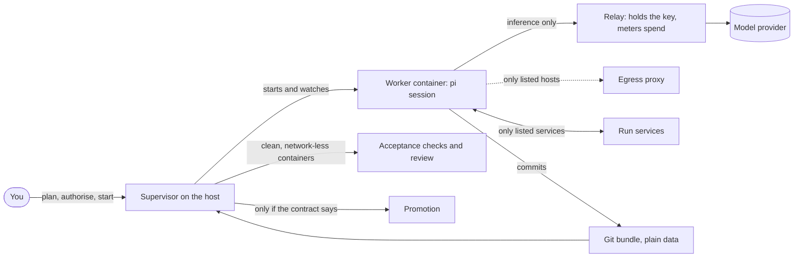
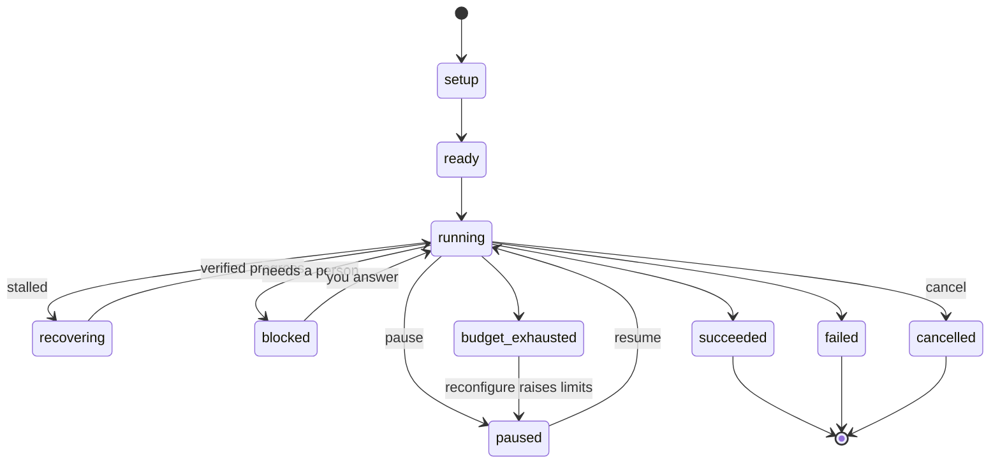

# Autonomous runs

`packages/autonomy` runs a task with the kit's agent **without you at the keyboard**: implement
something to a specification, build and deploy it against services inside the run, or improve a
repository in reviewed cycles. Each run happens inside a hardened container boundary that you read
and authorise first, is bounded by a budget in money, steps and time, judges its own success only
by checks the supervisor runs, and ends in one of four distinct outcomes.

It is optional and separate from interactive use. It needs a container engine, an image built for
it and a model provider key. Interactive work never needs any of these.

> **Status: beta.** The engine, its contract and its boundary are covered by offline suites and by a
> test on a real container engine, but no full run against a real model provider was made for this
> release. See [What has been verified](#what-has-been-verified).

## The idea

A run is one **contract** (`run.json`), one **supervisor** on the host that owns it, and a
**worker**: a `pi` session in a container that can reach only what the contract lists.



The supervisor never trusts the worker's word. It runs the **acceptance checks** itself, in clean
containers with no network, from definitions in the run directory that the worker never sees;
worker-written tests and reports are inputs to review, not proof. Success needs every required
check to pass in a trusted evaluation **and** the independent review to approve.

## The boundary

Every container the supervisor starts has these properties, and they cannot be configured away.
The supervisor also re-checks the finished `run` argument list against them before it executes
(`packages/autonomy/lib/containment.ts`), so a bug in an argument builder cannot start a
privileged container, one holding the engine socket, or an image other than the worker image and
the contract's `permissions.network.serviceImages` (`tests/autonomy-boundary-smoke.ts`):

- non-root, read-only root filesystem, all capabilities dropped, `no-new-privileges`, and pids,
  memory and CPU limits;
- on an **internal** network: no route off the host and no DNS beyond container names (only the
  relay and the egress proxy face outward, and only toward fixed destinations);
- never privileged, never on the host network, never sharing a host namespace;
- no container-engine socket, no home directory and no credential store mounted.

What a worker can do beyond that is exactly what the contract lists, and `plan` prints it before
anything runs:

| Path | Allowed | How it is enforced |
|---|---|---|
| **Model inference** | Only through the relay | The relay forwards to one fixed upstream, for the run's models only, holds the real key (received on stdin, never in a worker mount or environment), and meters spend from the upstream's reported cost. It refuses other paths and models, and refuses requests beyond the budget as a backstop. |
| **The internet** | Only hosts and ports in `permissions.network.egress` | Through the egress proxy, which resolves DNS itself, validates every address (no loopback, private, link-local, metadata or reserved ranges, in any spelling), connects to the validated address, never inspects TLS, does not follow redirects and audits every decision. With no `egress`, there is none: no package downloads, no LAN. |
| **Run services** | Only those the contract declares | Databases, web servers or queues from an allowlisted image list, started by the supervisor on the run's own network, with health checks. Deploying "in the zone" means to these. |
| **Files** | The worker writes to `/work`, its own state and a tmpfs | Changes are accepted only under `permissions.writeAreas`. The contract, checks and held-out tests are supervisor-held. |
| **Credentials** | Names only, delivered only to the service that declares them | A credential value never appears in a contract (credential-shaped strings are rejected), a worker environment or a check. |
| **Promotion** | Only what `promotion` says | `none` by default: nothing leaves the run directory. `local-branch` fast-forwards a branch in a local repository. `push` fast-forwards a listed remote and asks you first unless you turn that off. The worker never promotes. |

### Unattended operation, and how it stays inside the zone

With `permissions.unattended.authorised`, the worker runs the kit's tool firewall in
[unattended mode](autonomy-gate.md#unattended-mode): in-zone actions run without prompts, hard
denials stay, and anything that would need authority outside the zone fails closed. The supervisor
gives the worker `PI_KIT_UNATTENDED=1`, `PI_KIT_UNATTENDED_BOUNDARY=container` and a read-only,
sanitised copy of the contract at `/run/contract.json`; the firewall activates only when all of
that agrees, and cannot be switched on from inside a session. With `autoApprove`, the worker's
approval dialogs are answered automatically; a question that needs a person **blocks the run**
instead.

The firewall trusts the supervisor's statement that the boundary is a container. It cannot verify
it, which is why the boundary probe runs before every start and resume, and why the host-side
containment check exists. What the firewall does check is that the contract's provenance is seen
from the initial user namespace, so the user and mount (and PID) namespaces a user can create
without root count for nothing (`tests/firewall-unattended-smoke.ts`). A consequence: a worker
under a rootless engine, including the default rootless Podman, is in such a namespace and is not
unattended; it runs under the normal headless rules. The boundary probe also reports whether the
worker shares PID 1's namespaces (`packages/autonomy/tests/boundary-probe.ts`).

### Authorisation is bound to the boundary

`start` shows the resolved boundary and a **digest** (a SHA-256 over every security-relevant field:
what the run may write, reach, spend, run, promote and check). It proceeds only if you confirm at a
terminal, or the contract carries an `authorisation` block whose digest equals the current one.
Change anything that widens what a run may touch and the digest changes, so an old authorisation no
longer applies; changing the title, the specification or the backlog does not, so one authorised
configuration can be reused. A digest mismatch always refuses. With no terminal, a flag alone is
not consent: without a matching authorisation, `start --yes` still refuses.

The authorisation record is a consent and integrity record, not a signature: whoever can write the
contract file can write it. The supervisor runs on the host from a checkout outside the worker's
writable area, so the worker cannot change the contract, the digest, the check definitions or the
supervisor's own code.

## Quick start

From a shell, or from inside pi with `/autonomy` in the `autonomous` profile (below):

```sh
node packages/autonomy/cli.ts templates                       # what kinds of run exist
node packages/autonomy/cli.ts init --template implement --out run.json \
    --spec "A small HTTP API for todos" --check unit="node --test tests/"
node packages/autonomy/cli.ts plan --config run.json          # the boundary, its digest, problems
node packages/autonomy/cli.ts start --config run.json         # confirm the boundary; then it runs
node packages/autonomy/cli.ts status --run <run>              # or `status` for every run
node packages/autonomy/cli.ts export --run <run>              # results, evidence, usage, the work
```

Every command accepts `--json` and then prints exactly one JSON object (`{ ok: true, ... }` or
`{ ok: false, error, code }`). Exit codes: 0 ok; 1 error; 2 usage or invalid contract; 3 refused
(authorisation, duplicate run, lock, illegal state). A foreground `start` or `resume` ends 0
succeeded, 10 failed, 11 cancelled, 12 budget exhausted, 13 parked (blocked, paused or signalled).
`--detach` starts the supervisor in the background and returns its pid.

Working examples are in `packages/autonomy/examples/`.

### From inside pi

The `autonomy-run` extension, in the `autonomous` profile, adds `/autonomy`:

```
/autonomy templates | init <template> [flags] | plan <run.json> | start <run.json>
/autonomy status [run] | pause | cancel | resume | steer | promote | export | reconfigure
```

It is a **command, not a tool**: the model has no tool that starts, authorises, steers, promotes or
reconfigures a run. (A model with a shell tool can run the CLI itself; see "Limits" below for what
the firewall does about that.) `start` shows the boundary and its digest and asks you to confirm it; confirming records the
authorisation for exactly that digest and starts the run in the background. Without a screen it
refuses unless the contract already carries a matching authorisation, made earlier at a terminal
with `plan --authorise`. `cancel`, `promote`, `reconfigure` and `resume --approve` ask first. See
`packages/extensions/src/autonomy-run/README.md`.

## The run contract

One JSON document, `schemaVersion: 1` (`packages/autonomy/schema/run-contract.schema.json`). It is
validated by dependency-free code so the supervisor runs on plain Node, and the suite checks the
two agree. The rules are **fail closed**: unknown top-level keys, and unknown or malformed keys
under `permissions`, `generations`, `promotion` and `authorisation`, are errors; anything absent defaults to the
closed choice (no egress, no services, no unattended approval, no promotion), never a wider one.

| Field | What it says |
|---|---|
| `run`, `template` | The run id (`a-z0-9-`, 3 to 41 characters) and its template. |
| `objective` | `title`, and `spec` or `specFile`; an optional `backlog` of items with their own acceptance. |
| `inputs` | `repository` (a local path or URL and a ref, or none for an empty start) and read-only `references`. |
| `acceptance` | `checks` (each `id`, `run`, `timeoutMinutes`, `required`), `overlay` (held-out files the supervisor copies over the clone before checking), `review` (independent approval required). |
| `permissions` | `writeAreas`, `network.egress`, `network.services` and `serviceImages`, `credentials.names`, `outputs`, `unattended`. |
| `model`, `providerSettings` | Provider, worker, manager and review models, upstream and key name. The key value is never in the contract. |
| `effort` | An [effort](effort.md) tier and cap for the run (default E3). It is fixed at start. |
| `budget` | `totalUsd`, `perStepUsd`, `maxSteps`, `maxMinutes` (active time). Every run is bounded by money, steps and time; none may be omitted. |
| `recovery` | `softNudges` (default 2), `hardRestarts` (default 1), `maxAttemptsPerStep` (default 8); finite templates only (see Recovery and budgets). |
| `generations` | Memento mode, off by default; see [Generations](#generations). |
| `promotion` | `policy` (`none`, `local-branch`, `push`), `destinations`, `requiresOperatorApproval` (default true). |
| `runtime` | Engine (`podman` or `docker`), image, memory, CPUs, pids and the git identity for commits. |
| `authorisation` | Written by `plan --authorise` or an interactive `start`: the boundary digest, who and when. |

## Templates

| Template | Kind | What it does |
|---|---|---|
| `implement` | finite | Build or change something to a specification until the acceptance checks pass and the independent review approves. |
| `deploy` | finite | Like `implement`, plus run-scoped services the supervisor starts on the run's internal network, so the worker can build, deploy and test against them. Nothing leaves the zone. |
| `self-improve` | cycling | Repeated review, plan, improve and verify cycles on a repository, each merged into one integration branch only when it completes, passes the checks and passes a merge review (see below). Optional: one template among several. |

A template supplies prompts and defaults; everything that must not vary (lifecycle, lock,
boundary, budgets, acceptance, recovery, promotion, evidence) belongs to the engine.

## The lifecycle



The outcomes are never conflated: **succeeded** (every required check passed in a trusted
evaluation and the required review approved), **failed** (with a reason such as
`boundary_violation`, `recovery_exhausted`, `step_attempts_exhausted`, `review_rejected`,
`final_gate_red`), **cancelled** (an operator ended it) and **budget_exhausted** (money, steps or
active minutes ran out). **blocked** is not terminal: a genuinely external blocker or an approval
needs a person, and `resume --answer` (or `--approve`, `--deny`) continues it.

Exactly one supervisor owns a run at a time. A lock file holds its pid, process start time, host and
a heartbeat; a duplicate `start` refuses, and after a crash the next supervisor takes the stale lock
over, removes the orphaned containers and continues. When several supervisors find the same stale
lock at once, exactly one takes it over and the others refuse: a taker must first create an
exclusive claim file for that lock, and moves the lock aside only if it is still the one it judged
stale; a claim left by a crashed taker is cleared once it is older than the stale threshold
(`tests/autonomy-lifecycle-smoke.ts`). A silent but live owner is never taken over
automatically, because two supervisors on one run would repeat side effects.

## Recovery and budgets

**Recovery is bounded for `implement` and `deploy`** (`tests/autonomy-run-smoke.ts`). When a run stops making verified progress (no check newly passing and the
accepted head not moving inside the write areas), it climbs a ladder: soft nudges (a steering message
in the same session), then hard restarts (a fresh session on the same workspace, briefed from verified
state), then the run **fails** as `recovery_exhausted`. Counters persist across a supervisor crash and
reset only on verified progress; `maxAttemptsPerStep` bounds the turns spent on one target for the
life of the run. Recovery never resets spending, extends a budget or widens scope, and the hard
limits are not decided by it. The generic `recovery.softNudges`, `hardRestarts` and
`maxAttemptsPerStep` settings, including changes through `reconfigure`, do **not** apply to
`self-improve`; it uses `templateOptions.limits` and the cycle manager instead.
`tests/autonomy-selfimprove-smoke.ts` pins the independent restart allowance with generic recovery
set to zero.

**Budgets are hard.** The relay meters the provider's reported cost for every response, the
manager's and reviewer's calls included; the run stops as `budget_exhausted` at the money, step or
active-minute limit. `reconfigure` is the **only** way effort or limits change for an existing run:
it cannot touch permissions, network, credentials, promotion, the image or the acceptance definitions
(those are the authorised boundary; changing them means a new run), it asks for confirmation, and it
is logged in the run's state.

**Effort inside a run.** The worker's effort tier is pinned from the contract and capped, so an
in-session `/effort` cannot exceed the cap and its children never exceed their parent; see
[Effort](effort.md).

## Promotion and results

Nothing leaves the run directory unless the contract's promotion policy says so, and `export` is
always available:

- `none`: use `export` to take out the results, evidence, usage, decisions and the work.
- `local-branch`: fast-forward a branch in a local repository. No remote is contacted.
- `push`: fast-forward push to a listed remote branch, after your approval (`promote`) unless
  `requiresOperatorApproval` is false.

Every promotion step is idempotent and recorded as started before and done after; a run resumed after
a crash checks the destination's real ref before repeating anything, so a resume never publishes twice.
Public deployment, production changes and anything outside the zone are never done by a worker.

## The `self-improve` template

The original behaviour of this package, now one template: repeated cycles on a repository, each a
fresh pi session that reviews, plans, improves and verifies, and every cycle that completes, passes
the acceptance checks and passes a merge review is fast-forwarded into one integration branch
(`pi-autonomy/integration` by default, never `main`), from which the next cycle starts. Nothing is
force-pushed, and by default nothing leaves the machine: promotion is `local-branch` unless you choose
`push` (`tests/autonomy-selfimprove-smoke.ts`).

- **A cycle ends** once its report is on the branch. A live session that settles without one gets
  two reminders, then a manager decision (`tests/autonomy-smoke.ts`). Acceptance runs on the
  accepted head in a clean clone with no network; the head is tagged (`tests/autonomy-selfimprove-smoke.ts`).
- **Dead sessions recover on the next tick**, whether the exit code is zero, non-zero or unknown.
  Up to `templateOptions.limits.autoRestartsPerCycle` automatic restarts (default 3; 0 disables)
  continue the same workspace with a briefing, without spending manager calls. The allowance
  persists across pause/resume and supervisor restart; exhaustion closes the cycle as partial with
  `auto_restarts_exhausted`. Live sessions retain the idle/no-commit triggers. Hard cycle time,
  spend and run stops take priority (`tests/autonomy-smoke.ts`, `tests/autonomy-selfimprove-smoke.ts`).
- **Close-out salvage** avoids another model session just to write a report. On worker exit with
  accepted commits and no report, the host runs the acceptance gate. A green gate produces
  `steps/NN/salvaged-report.json` with the head and a minimal partial report from the git log;
  it makes no claim about the worker's mode or completion. The report is host evidence, outside
  the worker branch, and is exported with the step artefacts. It never counts as "nothing found".
  The full diff still passes control-path/size checks and an independent merge review, even if
  ordinary cycle review is disabled. Red or empty work is not salvaged and uses the bounded restart
  path (`tests/autonomy-selfimprove-smoke.ts`).
- **The merge review** is a separate model call from the host that answers `MERGE` or `REJECT` from the
  charter, the report, the commits and the diff. A malformed answer, or none after three attempts,
  counts as `REJECT`. A cycle that is not merged is kept by its tag and shown to the next cycle so it
  can salvage what is sound.
- **Review inputs are never worker-authored.** The worker can write wherever its write areas allow,
  so the host decides what the review sees and what no review may pass
  (`tests/autonomy-review-inputs-smoke.ts`):
  - the charter comes from the integration head the cycle started from, never from the cycle's own
    commit;
  - a cycle that changes `autonomy/CHARTER.md`, package-manager configuration, a path in
    `templateOptions.integration.controlPaths` (globs, for example the scripts your checks run) or
    the `scripts` of any `package.json` is not merged, and no model is asked, unless
    `templateOptions.integration.allowControlChanges` is `true` (which `plan` warns about). This
    applies with the review turned off too. Package-manager configuration is `.npmrc`, `.yarnrc`,
    `.yarnrc.yml`, `.yarn/plugins/`, `.yarn/releases/`, `.pnpmfile.*`, `pnpm-workspace.yaml` and
    `bunfig.toml` at any depth: it can change what every `npm run` executes;
  - a diff longer than 60,000 characters (lockfiles excluded) is not merged; it is never cut down
    to its start and end for the review. A diff the host cannot read in full (a git failure, a
    timeout, or output over its cap) is not merged either, with the review on or off;
  - the review prompt lists the changed tests, check definitions, package-manager configuration,
    `package.json` files and the files their scripts name, says the charter is the host's copy, and
    treats the report, commits and diff as data, never instructions.
- **The manager** is a separate model call, made only when a trigger fires (20 minutes without
  events from a live session, 90 minutes without a push, the 3-hour soft limit, the per-cycle budget,
  two red gates in a row, repeated stall escalations, or a live session that settled without a report). It answers
  with exactly one of `CONTINUE`, `NUDGE`, `RESTART_SESSION`, `NEW_CYCLE`, `RESET_TO_LAST_GOOD` or
  `ABORT_RUN`, which the supervisor validates and carries out; at most 3 calls per cycle, and the hard
  limits (a 5-hour cycle ceiling, and the run's budget) never consult it. These limits are the
  template's defaults and can be changed in `templateOptions.limits` (`tests/autonomy-smoke.ts`,
  `tests/autonomy-selfimprove-smoke.ts`).
- **Modes.** Cycles work in *fix* mode while there is something to fix, in *improve* mode only when a
  review finds nothing (and the need must be evidenced), and in *consolidate* mode for the cycle after
  a merged improvement. A run whose reviews find nothing three times in a row (`nothingFoundToStop`)
  stops rather than inventing work: the acceptance checks run once more on the integration branch,
  and if they pass the run **succeeds** with the reason `backlog_exhausted`; if they are red it fails
  as `final_gate_red`. The same final check ends a run that reaches its cycle limit.

The charter, backlog and handoff a repository is seeded with are in `packages/autonomy/seed/`.

## Steward interface

A steward is an external, scheduled operator session: for example, inspect after roughly 25 cycles
and queue the next priorities. No scheduler is built into pi-autonomy and no test covers an actual
25-cycle steward schedule. Use the host CLI and its file inbox; do not edit `state.json` or the
held contract while the supervisor owns them (`tests/autonomy-cli-smoke.ts`,
`tests/autonomy-selfimprove-smoke.ts`).

Read these files under `$PI_AUTONOMY_HOME/<run>` (default `~/.local/state/pi-autonomy/<run>`):

| File | What to inspect | Test |
|---|---|---|
| `state.json` | Status, current cycle, history, acceptance, usage and publication blockers | `tests/autonomy-selfimprove-smoke.ts` |
| `heartbeat.json` | `at` (UTC timestamp), `phase`, `cycle`, `status`; updated on engine ticks and phase boundaries, with a final parked/terminal status | `tests/autonomy-selfimprove-smoke.ts` |
| `supervisor.log` | Session restarts, merge decisions, stop reason and push failures | `tests/autonomy-selfimprove-smoke.ts` |
| `meter/*.jsonl` | Inference usage and spend | `tests/autonomy-run-smoke.ts` |
| `steps/NN/summary.json`, `cycle.json`, `review.json`, check evidence | Per-step outcome, committed head, gate and independent review | `tests/autonomy-selfimprove-smoke.ts` |
| `steps/NN/salvaged-report.json` | Host close-out when the worker died before its report | `tests/autonomy-selfimprove-smoke.ts` |

Suggested monitoring policy: flag a work heartbeat older than **2 minutes or four ticks**, whichever
is longer (`runtime.mirrorSeconds` sets the tick interval). This is an investigation threshold, not
a kill or takeover instruction, and no test pins a real-time watchdog. Acceptance and host git
operations can legitimately run without ticks: allow the sum of the check timeouts during
acceptance, and up to three five-minute review calls plus retry delays during merge review. The
lock's timer heartbeat proves lock ownership only; it does not prove the engine is advancing.
A stale engine heartbeat with a fresh lock heartbeat can identify a hung-but-alive supervisor.
There is no automatic phase watchdog or self-parking deadline. Stop the old supervisor before
resuming a wedged run; the lock refuses concurrent ownership (`tests/autonomy-lifecycle-smoke.ts`).

Commands (`node packages/autonomy/cli.ts` is equivalent to the `pi-autonomy` executable):

```sh
pi-autonomy status --run <run> --json
pi-autonomy export --run <run> --out <directory> --json
pi-autonomy steer --run <run> --message "Focus the current work on recovery"
pi-autonomy backlog --run <run> --message "Check compaction recovery with evidence"
pi-autonomy reconfigure --run <run> --budget-usd 100
pi-autonomy pause --run <run>
pi-autonomy cancel --run <run> --reason "End the experiment"
pi-autonomy resume --run <run> --detach
```

`status --json`, `export`, `steer`, `reconfigure`, `pause/cancel` and `resume` are pinned by
`tests/autonomy-cli-smoke.ts` (the top-level help lists the available flags). `backlog --message` enqueues a file-based control online or offline; items appear
under **Steward backlog for this cycle** in the next cycle prompt, are retained with their delivered
cycle in state, and are replayed when that cycle resumes. It does not interrupt the current worker
and is available only for self-improve (`tests/autonomy-cli-smoke.ts`,
`tests/autonomy-selfimprove-smoke.ts`). Backlog text is operator authority: keep the run directory
host-owned and out of worker mounts.

For a file-only stop, create **`STOP`** in the run directory. At the next control checkpoint the
worker is stopped, committed work is synced, the current cycle is retained, status becomes
`paused`, and the supervisor tears down and exits; a queued unpause cannot override STOP. A STOP
already present before setup cancels without launching the run. Remove STOP before `resume`.
Acceptance or review already in progress reaches its next safe checkpoint first. Signals also
park active runs; unexpected supervisor exceptions record the error and park before exiting
(`tests/autonomy-selfimprove-smoke.ts`). This cannot interrupt a blocked host call; use the stale
heartbeat policy to investigate such a supervisor.

For unattended publication, explicitly authorise a `push` destination on an experimental integration
branch (for example `integration/luna`), with `requiresOperatorApproval: false`. Every host
publication/promotion push first calls the repository's `packages/core/prepush-scan.ts` library on
commits the destination does not already hold, including all tags about to be published. It fetches
fresh destination refs, excludes known published main/master history, and reads exceptions from the
supervisor-held source base, never worker changes. Findings (locations only), mixed exception/content
changes, or scan errors refuse the push; automatic cycles continue locally with
`state.selfImprove.publishBlocker`/`publishError`, and explicit promotion records `promotion.error`.
The worker has no push credentials and never performs host promotion; host pushes stay fast-forward
only (`tests/autonomy-selfimprove-smoke.ts`, `tests/autonomy-smoke.ts`; scanner rules:
`tests/prepush-scan-smoke.ts`). Approval-gated publication remains held for `promote`. Disabling tag
publication avoids publishing rejected attempts, but the integration branch is still public as soon
as it is pushed (`tests/autonomy-selfimprove-smoke.ts`). Exports and run logs are local operator
evidence and are not made safe for public posting by the commit scan.

## Setting up

1. **A container engine.** The default is `podman` (rootless: no daemon, no `docker` group, and an
   escape gets your user's rights rather than root's). Docker works with `"runtime": {"engine":
   "docker"}`, but membership of the `docker` group is root-equivalent; do not run the supervisor with
   `sudo`.
2. **A provider key.** For the default `openrouter` provider, `OPENROUTER_API_KEY` in the supervisor's
   environment. The supervisor hands it to the relay on stdin; it never enters a worker container or a
   log. `openai-compatible` takes `providerSettings.upstream` and `apiKeyEnv`. The relay sends that key
   to that host, so `plan` says in words which variable (or `pi` login) goes to which host, the
   variable, login and extra headers are part of the boundary digest, a `pi` login is used only for its
   own provider's upstream, and a variable that names another service's credential (for example
   `GITHUB_TOKEN` or `AWS_*`) is refused.
3. **The image**, built from local git objects with no credentials in it:

   ```sh
   git fetch --tags origin
   packages/autonomy/build-image.sh --kit-ref v<version> --base-ref origin/main
   ```

   `--kit-ref` is the kit release the worker runs. Without it the script uses the release tag of the
   checkout's `package.json` version (`v<version>`), so a build never quietly bakes an older kit, and it
   stops before building when that tag is not in the clone (`tests/autonomy-build-image-smoke.ts`).
   Before the release tag exists, pass a branch such as `origin/main`. `--base-ref` optionally prebakes that repository's dependencies for offline
   installs. Add toolchains your tasks need in a derived image and name it in `runtime.image`.
4. Run the supervisor from a checkout of `main`, not from the branch a worker is changing.

## Generations

With `generations.enabled`, a finite run (`implement` or `deploy`) works in time-boxed
**generations** ("Memento mode"): when a generation's box runs out, its worker writes a short
notebook, is stopped, and a fresh worker continues in the same workspace from that notebook. It is
off by default, and `self-improve` refuses it. The engine side is pinned by
`tests/autonomy-generations-smoke.ts` (`npm run smoke:autonomy-generations`, on the fake runtime) and
the contract side by `tests/autonomy-contract-smoke.ts`.

| Key | Default | What it does |
|---|---|---|
| `enabled` | `false` | Turns generations on. |
| `iterationMinutes` | 30 | A generation ends after this many active minutes (5 to 240). |
| `iterationUsd` | none | ...or once it has spent this much. |
| `maxGenerations` | 4 | Generations in all (1 to 8), capped by the Memento allowance (below). The last one has no box: the run's own limits and recovery end it. |
| `graceMinutes` | 3 | How long the worker has to write its notebook (less than `iterationMinutes`). |
| `resetOnNoProgress` | `false` | After a generation without progress, the next one starts from the accepted head instead of the workspace the last one left. |
| `notebookMaxChars` | 6000 | The notebook's size cap (1000 to 6000). |

**Capped by the Memento opt-in.** A contract cannot give a model more generations than the operator
allowed. At the first step, the engine reads the per-model opt-in in
`<agent dir>/pi-kit/autonomy.json` and the tier's `memento.maxGenerations`, the same rule
`/effort memento` shows ([Memento mode](effort.md#memento-mode)). It reads them for the worker
model at the run's effort tier. The run then uses the lower of `maxGenerations` and that allowance.
With the defaults, E1-E3 allow none, E4 allows 2 and E5 allows 4, and only for an opted-in model in
the `long-horizon` or `autonomous` profile. An allowance of 0 runs the task as a single generation
with no box, and no worker is asked for a notebook. The decision is recorded once in
`state.memento` (`requested`, `allowance`, `maxGenerations`, `reason`, `model`, `profile`, `tier`),
so a resume or a later change to the opt-in does not change it. It is also logged
(`generations: the contract asks for 4, the Memento allowance is 2 (...): capped at 2`) and written
to the step's event log as a `memento` event (`tests/autonomy-generations-smoke.ts`, the four
"Memento" checks).

**It cannot raise the budget.** Unknown keys are errors. With generations on, `iterationMinutes` may
not exceed `budget.maxMinutes` and `iterationUsd` may not exceed `budget.totalUsd`. The run's budget,
steps, minutes, per-step limit, control commands and lock apply throughout, the grace period
included, and generations never change `state.limits`.

**Rotation at the box.** The box is measured from `usage.minutes` and `usage.usd` when the generation
started (recorded in `state.generations`). When it runs out during a turn, the supervisor steers the
worker to commit, write its notebook as JSON to `.pi/generation-notebook.json` in the workspace
(never committed) and stop, then waits until the worker settles or the grace period passes. It stops
the worker **before** reading the file, so the file cannot be swapped during the read, then opens it
without following links. A symlink, a `.pi` that is not a plain directory, anything but a regular
file (a FIFO included, without blocking) or a file over 64 KiB is refused unread. The file is then
removed from the workspace. The step is judged like any other (snapshot, ingest, trusted checks,
review). The notebook is parsed and appended to `notebook.json` in the run directory (see below),
with the supervisor's own measurements: the check results at the accepted head, the head, the files
changed since the generation began, and its minutes and dollars. A missing or malformed notebook is
recorded in the generation's history with its problems, and an empty notebook carrying the
measurements is appended in its place. A per-step budget that runs out during the grace period aborts
the worker's turn and ends the grace period early.

**Box spent with no live worker.** When a pause, a supervisor restart or a limit lands during the
grace period, the next step starts no worker for that generation: it takes whatever notebook is in
the workspace, judges the step and rotates, and the fresh worker belongs to the next generation.
When a worker crashes or exits after its box ran out, its step has already been judged (a crash
spends a hard restart), so the next step takes the notebook and rotates with that step's recovery
action without judging the same head again, then starts the next generation's worker
(`tests/autonomy-generations-smoke.ts`, "a worker that crashes after its box ran out").

**The fresh worker.** It is started with the briefing every fresh session gets (verified state
first), followed by the latest notebook rendered inside its `untrusted` fence: the measurements as
plain lines, the worker's text as data, and its own claims marked `[hypothesis]`.

**No progress counts toward recovery.** A generation whose last step has no verified progress and
did not move the accepted head is a stall. It skips the soft nudges, since its session is gone, and
spends a hard restart: the fresh generation is that restart. Once the hard restarts are used up, the
run fails as `recovery_exhausted`. The per-turn `maxAttemptsPerStep` count applies as before. With
`resetOnNoProgress`, the worker's branch is set to the accepted head and the next worker starts with
its workspace reset to it (uncommitted leftovers discarded, ignored files kept).

**Status.** For a run whose contract enables generations, `pi-autonomy status --run <run>` adds
the current generation of the generations the run may use (`generation 2/4`, or "not started" before the first
step), the box length, `capped from <n> by the Memento allowance (<reason>)` when the allowance
lowered the contract's number (or, when it left one, `a single generation, not <n>; the Memento
allowance is 0 (<reason>)` in place of the generation line), the last rotation (which generation ended, whether its time or dollar box
ran out, the recovery decision, whether a notebook was appended or the first three problems if not,
and whether the next generation was reset to the accepted head) and the latest notebook, rendered
as the next worker's briefing shows it. That rendered text is passed through the notebook's
redaction patterns again before it is printed. A rotation's problems can quote worker text (a
notebook that is not JSON is reported with the parser's message, which quotes it), so the supervisor
removes Unicode control and format characters from them before saving them to `state.json` or the
log, and the status removes them again from every last-rotation field it prints. A `notebook.json` that does not parse is
reported as unreadable instead of failing the command. `--json` carries the same under
`generations` (`current`, `max` after the cap, `memento` with the contract's `requested`
number, the `allowance` and its `reason` once the first step has decided it, `lastRotation`, `notebook.text`), which is `null` for a run
without generations, and the text then has no generations lines (`tests/autonomy-generations-smoke.ts`).
In pi, `/autonomy status <run>` shows that text and, for a run with generations, sets the footer
status line to `memento <run>: gen n/N, <status>; last rotation: time box` (or `dollar box`, with
`, no notebook` when none was appended). The line is cleared by `/autonomy status` of a run without
generations, and is not changed by `/autonomy status` with no run or without a screen. It is updated
only when you run that command, not while the run goes on (`tests/autonomy-command-smoke.ts`).

**Not covered:** a question the worker asks during the grace period is not answered: the worker is
stopped as soon as it asks. The box is checked once per supervisor tick, so a generation can overrun
it by up to one tick plus the grace period, inside the run's limits. No test drives generations
through the real container runtime, and whether generations help a given model is not measured. The offline harness that scores recorded
results is described in [Measuring Memento mode](efficiency-and-loops.md#measuring-memento-mode).

## Generations: notebook

`packages/autonomy/lib/notebook.ts` holds the notebook one generation hands the next. Everything in
this section is pinned by `tests/autonomy-notebook-smoke.ts` (`npm run smoke:autonomy-notebook`).

**What a worker writes.** A JSON object, schema 1: `state` (a string, required) and the string lists
`tried`, `failures`, `do_not_retry`, `next` and `self_reported` (each optional, empty when absent).
The parser uses type guards only. A value that is not JSON, not an object, a `schema` other than 1,
a non-string `state` or a list holding anything but strings is refused with one problem per field,
and nothing is appended. Unknown keys are dropped and listed in the report.

**`measured` belongs to the supervisor.** A worker-supplied `measured` key is always discarded, and
the report says so. The supervisor passes its own measurements (check results, head commit, files
changed, minutes, dollars) when it appends a generation; they are stored beside the worker's text,
and numbers that are not finite and non-negative are refused.

**Cleaning and the size cap.** Each string has every Unicode control and format character
(general categories Cc and Cf) and every default-ignorable code point other than tab and newline removed before the tag check: C0, DEL
and C1 (which includes the single-byte CSI), the bidi embedding, override, isolate and mark
characters, the zero-width and invisible format characters (U+200B, U+2060, U+FEFF, the soft hyphen
U+00AD, U+180E and the tag characters U+E0000-U+E007F among them), and the default-ignorable
characters such as the combining grapheme joiner U+034F, the variation selectors and the Hangul filler
U+3164 (tests/autonomy-notebook-smoke.ts). The match is by Unicode property, not by a list. Then `<untrusted` (also with spaces after `<`) is defused and secret-shaped values are
replaced with `[REDACTED]`. The redaction
patterns are a copy of memory-vault's, and the test fails if the two lists differ. `state` is
clipped to 1500 characters and list items to 400. Each list keeps its newest entries up to a limit
(`tried` 40, `failures` 20, `do_not_retry` 20, `next` 10, `self_reported` 10). The whole notebook is
then capped at 6000 characters of JSON: the oldest `tried` entries go first, then `failures`, `next`,
`self_reported` and `do_not_retry`, and `state` is cut only when every list is empty. The report
records the sizes before and after, every clipped field, the entries dropped per list, the number of
redactions and whether `measured` was dropped. Unknown keys are listed after the same cleaning
(their redactions are counted), each clipped to 80 characters, at most 20 of them, with a count of
the rest.

**The file.** Each generation is appended as one entry (generation number, time, the cleaned
notebook, `measured` and the report) to a JSON file written atomically (temp file, fsync, rename)
with mode 0600, in a directory created with mode 0700. Earlier entries are never rewritten. A file
that does not parse, or whose entries are malformed or out of order, makes the append throw instead
of being replaced.

**Rendering.** `renderNotebook()` shows the supervisor's measurements as plain lines, then puts the
worker-written notebook inside `untrusted()` (`lib/templates/common.ts`), with each `self_reported`
claim prefixed `[hypothesis]`. Triple backticks in worker text become `'''`, so the text cannot
close the fence, and it cannot open or close the `untrusted` tag.

**Not covered:** redaction is pattern-based and best-effort, so a secret in a shape the patterns do
not know is stored as written; the cap counts characters, not model tokens.

## The run directory

Everything is under `$PI_AUTONOMY_HOME/<run>` (default `~/.local/state/pi-autonomy/<run>`); nothing
is written to `~/.pi`.

| Path | Contents |
|---|---|
| `contract.json`, `state.json` | The authorised contract, and the one authoritative record of the run (status, usage, tasks, acceptance evidence, recovery counters, history). |
| `supervisor.log`, `supervisor.lock`, `control/` | The event log, the single-owner lock, and queued control commands. |
| `checks.json`, `overlay/` | The check definitions and the held-out files: supervisor-held, never mounted for the worker. |
| `public/` | The sanitised contract, mounted read-only at `/run`. |
| `mirror.git`, `steps/`, `results/` | The host's copy of the work, each step's evidence, and exports. |
| `egress/`, `meter/`, `boundary.json` | Proxy audit, spend records, the last boundary probe. |
| `notebook.json` | The generations notebook (0600), when generations are on. |
| `remote.git`, `work/`, `agent-state/` | The worker's side, written by the container. |

## What has been verified

- **Offline suites** (`npm run check:all`): the contract validator and schema, the lifecycle and its
  legal transitions, the boundary renderer and digest, the containment validator, the egress proxy's
  address and hostname handling, the run engine end to end against a fake runtime (acceptance,
  recovery, budgets, promotion, crash and resume), the `self-improve` template, the CLI, and the
  `/autonomy` command.
- **A real container engine** (`npm run smoke:autonomy-container`, run against Docker 29 in the
  release environment): the run network is internal (no DNS, no route out, none to the host); workers
  run non-root, read-only, with no capabilities and no engine socket; `inspect` agrees (mounts only
  under the run directory, no host namespaces, no published ports, the key in no environment or
  argument list); the relay injects the key the worker never had and refuses other paths and models;
  the egress proxy tunnels a listed host and refuses unlisted hosts, wrong ports and private,
  loopback and odd-spelled addresses; git plumbing works with no network; acceptance checks run in
  clean network-less containers with the held-out overlay applied; a run service serves a staged,
  read-only copy; cleanup removes everything it made. Without an engine, the test prints a `SKIPPED`
  line and exits 0, so it adds evidence where an engine exists; `check:all` still runs its offline
  counterpart. On a host whose firewall drops all container-to-host traffic (ufw's default input
  policy), the "none to the host" check cannot fail, and the test labels its control for that check
  `INCONCLUSIVE` instead of passing it.

**Not verified:** a full run against a real model provider (in the container test the relay talks to
a fake provider container on the run's outward network); rootless Podman (the container test used Docker); long runs (hours to days); macOS
and Windows; and the effect of the boundary on an adversarial worker beyond what the probe and the
container checks assert. Run `pi-autonomy boundary --config run.json --probe` on your own engine, and
start with a small budget, before trusting a long run.

## Limits

The worker is attacker A-7 in the [threat model](threat-model.md); the controls on it are C-31 to
C-34 in [Security controls](security-controls.md).

- **Consent is by whoever holds the terminal, and a shell is a terminal.** `plan --authorise --yes`,
  `start`, `promote` and `reconfigure` accept `--yes` without a screen, and the authorisation record
  is a consent and integrity record, not a signature. A model with a shell tool could therefore run
  them. The tool firewall classifies those commands as high and never learns an approval for them,
  so each one asks you, and an unattended worker is refused (`tests/firewall-unattended-smoke.ts`);
  this is a guard rail, not proof. `/autonomy start` binds its authorisation to the digest you were
  shown (`--digest`), and refuses if the file changed while you read it. A run id is a name
  (3–41 lowercase characters), never a path.
- **The relay screens requests with a denylist.** It allows two routes and a model allowlist, removes
  OpenRouter's web-search plugin and `web_search_options`, and refuses `:online` model variants. A
  server-side tool feature it does not know by name would pass through; the model allowlist and
  the budget are the stronger limits, and the worker's own network is the container's.
- **`runtime.user: "0:0"`** (root inside the container) is accepted only when the engine reports
  itself rootless, where that root is your own user; on a rootful engine it would be host uid 0, so
  the run refuses to start. `plan` prints the user the containers run as.
- **The boundary is the container.** The firewall's unattended mode is a second layer that trusts it.
  Anything the worker can read (the repository, references) can go to the model provider: do not add
  references that hold secrets.
- **Acceptance checks are quality evidence, not a security boundary.** They run the worker's own code
  in a clean container; the container's limits are what contain them. When the checks come from the
  worker's tree (the default overlay is empty), a cycle can weaken a test or a check file the host does
  not list as a control path, and the merge review is then the only independent control on it. List
  the files your checks run in `templateOptions.integration.controlPaths`, or hold them out with
  `acceptance.overlay`.
- **An allowlisted egress host is an opaque channel.** The egress proxy checks the destination of a
  `CONNECT` tunnel, never what passes through it, so anything the worker can read can be sent to any
  host in `permissions.network.egress`.
- **One run per integration branch at a time.** Two runs merging into the same branch would diverge;
  a diverged branch stops the run as `integration_diverged`.
- **Dependencies are prebaked** from the base ref's lockfile. A change to dependencies fails the
  offline install; propose dependency changes rather than making them in a run.
- **Model specifications.** pi's catalogue may not know a new model id; the supervisor fetches limits
  and prices from the provider at start so compaction and cost match the model.
- **The v0 configuration format** (`supervisor.ts`, no `schemaVersion`) is mapped onto the
  `self-improve` template with a deprecation warning, and now needs an explicit remote and promotion
  policy. Its old defaults, which pushed to a fixed private host, are gone.
