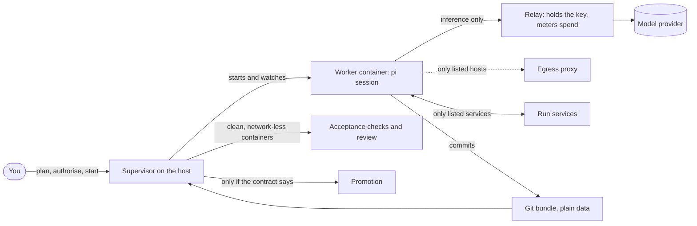
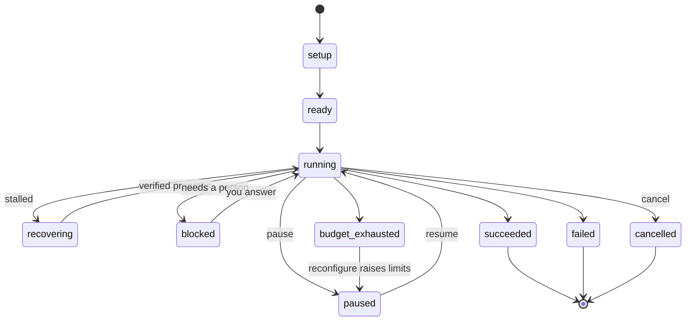
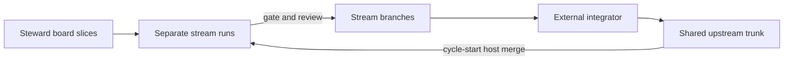

# Autonomous runs

`packages/autonomy` runs a task with Luna's agent **without you at the keyboard**: implement
something to a specification, build and deploy it against services inside the run, or improve a
repository in reviewed cycles. Each run happens inside a hardened container boundary that you read
and authorise first, is bounded by a budget in money, steps and time, judges its own success only
by checks the supervisor runs, and ends in one of four distinct outcomes.

It is optional and separate from interactive use. It needs a container engine, an image built for
it and a model provider key. Interactive work never needs any of these.

> **Status: beta.** The engine, its contract and its boundary are covered by offline suites and by a
> test on a real container engine, but no full run against a real model provider was made for this
> release. See [What has been verified](#what-has-been-verified).

## The idea

A run is one **contract** (`run.json`), one **supervisor** on the host that owns it, and a
**worker**: a `pi` session in a container that can reach only what the contract lists.



The supervisor never trusts the worker's word. It runs the **acceptance checks** itself, in clean
containers with no network, from definitions in the run directory that the worker never sees;
worker-written tests and reports are inputs to review, not proof. Success needs every required
check to pass in a trusted evaluation **and** the independent review to approve.

## The boundary

Every container the supervisor starts has these properties, and they cannot be configured away.
The supervisor also re-checks the finished `run` argument list against them before it executes
(`packages/autonomy/lib/containment.ts`), so a bug in an argument builder cannot start a
privileged container, one holding the engine socket, or an image other than the worker image and
the contract's `permissions.network.serviceImages` (`tests/autonomy-boundary-smoke.ts`):

- non-root, read-only root filesystem, all capabilities dropped, `no-new-privileges`, and pids,
  memory and CPU limits;
- on an **internal** network: no route off the host and no DNS beyond container names (only the
  relay and the egress proxy face outward, and only toward fixed destinations);
- never privileged, never on the host network, never sharing a host namespace;
- no container-engine socket, no home directory and no credential store mounted.

What a worker can do beyond that is exactly what the contract lists, and `plan` prints it before
anything runs:

| Path | Allowed | How it is enforced |
|---|---|---|
| **Model inference** | Only through the relay | The relay forwards to one fixed upstream, for the run's models only, holds the real key (received on stdin, never in a worker mount or environment), and meters spend from the upstream's reported cost. It refuses other paths and models, and refuses requests beyond the budget as a backstop. |
| **The internet** | Only hosts and ports in `permissions.network.egress` | Through the egress proxy, which resolves DNS itself, validates every address (no loopback, private, link-local, metadata or reserved ranges, in any spelling), connects to the validated address, never inspects TLS, does not follow redirects and audits every decision. With no `egress`, there is none: no package downloads, no LAN. |
| **Run services** | Only those the contract declares | Databases, web servers or queues from an allowlisted image list, started by the supervisor on the run's own network, with health checks. Deploying "in the zone" means to these. |
| **Files** | The worker writes to `/work`, its own state and a tmpfs | Changes are accepted only under `permissions.writeAreas`. The contract, checks and held-out tests are supervisor-held. |
| **Credentials** | Names only, delivered only to the service that declares them | A credential value never appears in a contract (credential-shaped strings are rejected), a worker environment or a check. |
| **Promotion** | Only what `promotion` says | `none` by default: nothing leaves the run directory. `local-branch` fast-forwards a branch in a local repository. `push` fast-forwards a listed remote and asks you first unless you turn that off. The worker never promotes. |

### Unattended operation, and how it stays inside the zone

With `permissions.unattended.authorised`, the worker runs Luna's tool firewall in
[unattended mode](autonomy-gate.md#unattended-mode): in-zone actions run without prompts, hard
denials stay, and anything that would need authority outside the zone fails closed. The supervisor
gives the worker `PI_KIT_UNATTENDED=1`, `PI_KIT_UNATTENDED_BOUNDARY=container` and a read-only,
sanitised copy of the contract at `/run/contract.json`; the firewall activates only when all of
that agrees, and cannot be switched on from inside a session. With `autoApprove`, the worker's
approval dialogs are answered automatically; a question that needs a person **blocks the run**
instead.

The firewall trusts the supervisor's statement that the boundary is a container. It cannot verify
it, which is why the boundary probe runs before every start and resume, and why the host-side
containment check exists. What the firewall does check is that the contract's provenance is seen
from the initial user namespace, so the user and mount (and PID) namespaces a user can create
without root count for nothing (`tests/firewall-unattended-smoke.ts`). A consequence: a worker
under a rootless engine, including the default rootless Podman, is in such a namespace and is not
unattended; it runs under the normal headless rules. The boundary probe also reports whether the
worker shares PID 1's namespaces (`packages/autonomy/tests/boundary-probe.ts`).

### Authorisation is bound to the boundary

`start` shows the resolved boundary and a **digest** (a SHA-256 over every security-relevant field:
what the run may write, reach, spend, run, promote and check). It proceeds only if you confirm at a
terminal, or the contract carries an `authorisation` block whose digest equals the current one.
Change anything that widens what a run may touch and the digest changes, so an old authorisation no
longer applies; changing the title, the specification or the backlog does not, so one authorised
configuration can be reused. A digest mismatch always refuses. With no terminal, a flag alone is
not consent: without a matching authorisation, `start --yes` still refuses.

The authorisation record is a consent and integrity record, not a signature: whoever can write the
contract file can write it. The supervisor runs on the host from a checkout outside the worker's
writable area, so the worker cannot change the contract, the digest, the check definitions or the
supervisor's own code.

## Quick start

From a shell, or from inside pi with `/autonomy` in the `long-horizon` profile (below):

```sh
node packages/autonomy/cli.ts templates                       # what kinds of run exist
node packages/autonomy/cli.ts init --template implement --out run.json \
    --spec "A small HTTP API for todos" --check unit="node --test tests/"
node packages/autonomy/cli.ts plan --config run.json          # the boundary, its digest, problems
node packages/autonomy/cli.ts start --config run.json         # confirm the boundary; then it runs
node packages/autonomy/cli.ts status --run <run>              # one run, or `status` for the fleet
# `status` lists every run with its step, spend against budget, and the question a blocked run waits on.
node packages/autonomy/cli.ts export --run <run>              # results, evidence, usage, the work
```

Every command accepts `--json` and then prints exactly one JSON object (`{ ok: true, ... }` or
`{ ok: false, error, code }`). Exit codes: 0 ok; 1 error; 2 usage or invalid contract; 3 refused
(authorisation, duplicate run, lock, illegal state). A foreground `start` or `resume` ends 0
succeeded, 10 failed, 11 cancelled, 12 budget exhausted, 13 parked (blocked, paused or signalled).
`--detach` starts the supervisor in the background and returns its pid.

Working examples are in `packages/autonomy/examples/`.

### From inside pi

The `autonomy-run` extension, in the `long-horizon` profile, adds `/autonomy`:

```
/autonomy templates | init <template> [flags] | plan <run.json> | start <run.json>
/autonomy status [run] | pause | cancel | resume | steer | promote | export | inbox | reconfigure
/autonomy watch [on|off]
```

**Live run widget.** While a run is active (starting up in `setup` or `ready`, running,
recovering, or paused after at least one cycle), pi shows a widget above the editor: a heading with the number of active and waiting runs,
then one line per run that has not ended (active runs first, at most six, the rest counted) with
its id, template, cycle, phase (from the newest host event: working, gate green or red, pushed, a
failure code, or the run's status when it is not running), spend against budget and the age of its
last event. Every line is cut to the terminal's width, so a narrow terminal never wraps it. The
widget is refreshed every 2 seconds through the CLI (`pi-autonomy status --json` and
`pi-autonomy events --json --limit 200`), skipping a refresh while the previous one is still
running, but only while some run can change on its own (`setup`, `ready`, `running` or
`recovering`), or for a minute after `/autonomy start` or `/autonomy resume`. A paused or blocked
run changes only when the operator acts, so with only such runs the widget is drawn once and not
refreshed. It hides itself when no run is active. It is checked at session start, after
`/autonomy start` starts a run in the background, after `/autonomy resume` and after
`/autonomy status` with no run; `/autonomy watch` checks it now and `/autonomy watch off` hides it
for the rest of the session. Pinned by `tests/autonomy-command-smoke.ts` (the renderer at 80 and
120 columns and at narrow widths, which runs show and which keep it refreshing, showing a run
still in `setup` after a background start, showing after resume, hiding and `watch off`).

**Not covered:** the widget needs a screen and is not drawn in print or JSON mode; outside the
terminal UI (RPC mode) its lines are rendered at 80 columns. Each refresh starts the CLI twice and
reads the host event log in full, so a very large log makes each refresh slower. A run that becomes
active from outside this session (another terminal or a timer), or a paused run resumed from
outside it, shows only at the next check above. A run whose supervisor died during `setup` keeps
the widget refreshing until the run is cancelled.
No test draws the widget in a real terminal.

`/autonomy inbox` lists a run's owner cards (or the fleet's runs waiting to be published) and
`--answer <card> --value <text>` answers one; listing a run's cards settles its past-due ones, so
it is not a pure read (settlement: `tests/autonomy-inbox-smoke.ts`; the forwarding:
`tests/autonomy-command-smoke.ts`).

It is a **command, not a tool**: the model has no tool that starts, authorises, steers, promotes or
reconfigures a run. (A model with a shell tool can run the CLI itself; see "Limits" below for what
the firewall does about that.) `start` shows the boundary and its digest and asks you to confirm it; confirming records the
authorisation for exactly that digest and starts the run in the background. Without a screen it
refuses unless the contract already carries a matching authorisation, made earlier at a terminal
with `plan --authorise`. `cancel`, `promote`, `reconfigure` and `resume --approve` ask first. See
`packages/extensions/src/autonomy-run/README.md`.

### Seeing a run in pi

`workflow_status` and `/workflows` list an autonomous run beside workflow and subagent runs,
labelled `autonomy`. The list shows its contract title (else its template), status, spend and,
when blocked, the question it waits on; `workflow_status {id}` shows the phase and step, dollars
spent against the budget, in-progress and done tasks, the blocker and its options, the last error,
the run directory and `supervisor.log`. It reads `$PI_AUTONOMY_HOME/<run>` (else
`$XDG_STATE_HOME/pi-autonomy/<run>`, else `~/.local/state/pi-autonomy/<run>`), so set
`PI_AUTONOMY_HOME` in pi's environment to see a non-default state home. This is a read-only view:
starting, answering, resuming and cancelling a run stay with `/autonomy`
(`tests/run-query-smoke.ts`).

`workflow_status` is registered inactive; a session wakes it (and `workflow_control`) when it
receives a prompt while an autonomous run has a live supervisor or is blocked
(`tests/lazy-run-tools-smoke.ts`). `/workflows` works regardless.

## The run contract

One JSON document, `schemaVersion: 1` (`packages/autonomy/schema/run-contract.schema.json`). It is
validated by dependency-free code so the supervisor runs on plain Node, and the suite checks the
two agree. The rules are **fail closed**: unknown top-level keys, and unknown or malformed keys
under `permissions`, `generations`, `promotion` and `authorisation`, are errors; anything absent defaults to the
closed choice (no egress, no services, no unattended approval, no promotion), never a wider one.

| Field | What it says |
|---|---|
| `run`, `template` | The run id (`a-z0-9-`, 3 to 41 characters) and its template. |
| `objective` | `title`, and `spec` or `specFile`; an optional `backlog` of items with their own acceptance. |
| `inputs` | `repository` (a local path or URL and a ref, or none for an empty start) and read-only `references`. |
| `acceptance` | `checks` (each `id`, `run`, `timeoutMinutes`, `required`), `overlay` (held-out files the supervisor copies over the clone before checking), `review` (independent approval required). |
| `permissions` | `writeAreas`, `network.egress`, `network.services` and `serviceImages`, `credentials.names`, `outputs`, `unattended`. |
| `model`, `providerSettings` | Provider, worker, manager and review models, upstream and key name. The key value is never in the contract. |
| `effort` | An [effort](effort.md) tier and cap for the run (default E3). It is fixed at start. |
| `budget` | `totalUsd`, `perStepUsd`, `maxSteps`, `maxMinutes` (active time). Every run is bounded by money, steps and time; none may be omitted. |
| `recovery` | `softNudges` (default 2), `hardRestarts` (default 1), `maxAttemptsPerStep` (default 8); finite templates only (see Recovery and budgets). |
| `generations` | Memento mode, off by default; see [Generations](#generations). |
| `promotion` | `policy` (`none`, `local-branch`, `push`), `destinations`, `requiresOperatorApproval` (default true). |
| `runtime` | Engine (`podman` or `docker`), image, memory, CPUs, pids and the git identity for commits. |
| `authorisation` | Written by `plan --authorise` or an interactive `start`: the boundary digest, who and when. |

## Templates

| Template | Kind | What it does |
|---|---|---|
| `implement` | finite | Build or change something to a specification until the acceptance checks pass and the independent review approves. |
| `deploy` | finite | Like `implement`, plus run-scoped services the supervisor starts on the run's internal network, so the worker can build, deploy and test against them. Nothing leaves the zone. |
| `self-improve` | cycling | Repeated review, plan, improve and verify cycles on a repository, each merged into one integration branch when it has commits, passes the checks and passes a merge review (see below). Optional: one template among several. |
| `dispatch` | cycling | A `self-improve` run whose queue is the steward board: each cycle claims the top ready item of the run's streams for one of its engineers and works that one item (see [The `dispatch` template](#the-dispatch-template)). |

A template supplies prompts and defaults; everything that must not vary (lifecycle, lock,
boundary, budgets, acceptance, recovery, promotion, evidence) belongs to the engine.

## The lifecycle



The outcomes are never conflated: **succeeded** (every required check passed in a trusted
evaluation and the required review approved), **failed** (with a reason such as
`boundary_violation`, `recovery_exhausted`, `step_attempts_exhausted`, `review_rejected`,
`final_gate_red`), **cancelled** (an operator ended it) and **budget_exhausted** (money, steps or
active minutes ran out). **blocked** is not terminal: a genuinely external blocker or an approval
needs a person, and `resume --answer` (or `--approve`, `--deny`) continues it.

A model provider's credit or key-limit refusal (HTTP 402, "requires more credits", "insufficient
credits", a key or weekly limit) parks the run as **blocked** with the provider's message
(blocker id `provider-limit`, `waiting_budget`) instead of closing empty cycles; a single rate limit
(429) stays an ordinary retry, and a long run of them parks as `waiting_provider` (see "Parking on a
provider refusal"). Worker model entries cap `maxTokens` at 32,768, because a provider
reserves the cost of a request's full output maximum and a model advertising a near-context-sized
one makes a low balance fail every call. In `self-improve`, a `report.md` that was already on the
branch when the cycle began does not count as this cycle's report, and a merge is refused before
the review model runs when an `Item:` line names a commit that is not in the cycle's diff
(`tests/autonomy-smoke.ts` pins the limit detection, the clamp, the commit check and the
stale-report predicate; `tests/autonomy-selfimprove-smoke.ts` pins the cycle flow). Only
hash-shaped tokens (a digit and a letter a-f) in an `Item:` line count as commit ids. Nothing
pins the use of the stale-report predicate inside a live cycle.

Exactly one supervisor owns a run at a time. A lock file holds its pid, process start time, host and
a heartbeat; a duplicate `start` refuses, and after a crash the next supervisor takes the stale lock
over, removes the orphaned containers and continues. When several supervisors find the same stale
lock at once, exactly one takes it over and the others refuse: a taker must first create an
exclusive claim file for that lock, and moves the lock aside only if it is still the one it judged
stale; a claim left by a crashed taker is cleared once it is older than the stale threshold
(`tests/autonomy-lifecycle-smoke.ts`). A silent but live owner is never taken over
automatically, because two supervisors on one run would repeat side effects.

## Recovery and budgets

**Recovery is bounded for `implement` and `deploy`** (`tests/autonomy-run-smoke.ts`). When a run stops making verified progress (no check newly passing and the
accepted head not moving inside the write areas), it climbs a ladder: soft nudges (a steering message
in the same session), then hard restarts (a fresh session on the same workspace, briefed from verified
state), then the run **fails** as `recovery_exhausted`. Counters persist across a supervisor crash and
reset only on verified progress; `maxAttemptsPerStep` bounds the turns spent on one target for the
life of the run. Recovery never resets spending, extends a budget or widens scope, and the hard
limits are not decided by it. The generic `recovery.softNudges`, `hardRestarts` and
`maxAttemptsPerStep` settings, including changes through `reconfigure`, do **not** apply to
`self-improve`; it uses `templateOptions.limits` and the cycle manager instead.
`tests/autonomy-selfimprove-smoke.ts` pins the independent restart allowance with generic recovery
set to zero.

**Budgets are hard.** The relay meters the provider's reported cost for every response, the
manager's and reviewer's calls included; the run stops as `budget_exhausted` at the money, step or
active-minute limit. `reconfigure` is the **only** way effort or limits change for an existing run:
it cannot touch permissions, network, credentials, promotion, the image or the acceptance definitions
(those are the authorised boundary; changing them means a new run), it asks for confirmation, and it
is logged in the run's state.

**Attribution and the ledger.** Every row in `meter/usage.jsonl` (the relay) and
`meter/manager.jsonl` (the host's own manager and review calls) carries the `run`, `cycle` and `role`
(`worker`, `manager` or `review`) the supervisor named in `meter/attribution.json`, which it rewrites
when a worker session starts; the relay reads it on every request, and a missing file is `unattributed`,
never a guess. A request that ends without usable usage is still a row: `outcome` is `non-200`,
`error`, `aborted` or `unmetered`, with `unresolved: true` and no cost, because cancellation does not
prove the provider stopped billing. A request the relay itself refused is `refused` (not a
liability). Unresolved rows are counted per cycle and are not priced, so they neither raise nor lower
spend: they are reporting only, not budgeted, and no count of them stops or parks a run. `steps/NN/cycle.json` records the contract digest and limits in force (`effective`: manager calls
per cycle, step allowances, budget) and the cycle's spend by role with its unresolved count (`meter`),
so drift between cycles is visible. Spend only goes up: the supervisor takes the higher of its saved
state and the meters, the relay starts from the ledgers on disk (so a restart resets nothing) and
counts the host's own calls toward its stop, reads the cap from `meter/limit.json` on every request (so a
`reconfigure` that raises or lowers the run budget is live without restarting the relay), and an unreadable ledger row is counted, not dropped
quietly. Not covered: the relay cannot tell a child agent's request from its parent's (they share the
worker's key), so child spend is tagged `worker` and overstates the parent's share (child roles are not
separated); the unresolved rows are listed, not yet reconciled
against the provider's own totals. `tests/autonomy-meter-smoke.ts` pins the rows, the restart and the
host-spend stop and a raised cap; `tests/autonomy-selfimprove-smoke.ts` pins the cycle record.

**Parking on a provider refusal.** A 402 (credit, key or weekly limit, or the relay's own "Run budget
exhausted") parks the run as `blocked` with `waiting: waiting_budget`; a 403 from the provider or a
429 that persists (five failed replies in a row, or a retry that gave up; a 403 parks on the second) parks with `waiting: waiting_provider`.
The reason is the first word of the blocker's question, a field of the recorded blocker, a line of
`outcome.md` and the status listing. The relay's own refusals (a path or model it does not allow) are
not the provider's and do not park the run. `tests/autonomy-meter-smoke.ts`.

**One host, many runs: the gate slot bound.** The single-owner lock is per run, so several runs of
one user on one host could otherwise each start an acceptance gate at once and compete for CPU and
IO. A host-wide bound caps that at **two** concurrent gates per user, held under
`$PI_AUTONOMY_HOME/gate-slots` (default `~/.local/state/pi-autonomy/gate-slots`). A supervisor that
cannot take a slot sets phase `gate-wait`, keeps heartbeating (so it is not read as stalled) and
waits without accruing wall-clock minutes; it then runs the gate under phase `acceptance`. Control
commands still apply while it waits: a STOP file, a signal, a pause or a cancel ends the wait, the
acceptance is never run, and the run is parked (or cancelled) and stays resumable, recorded as a stop
rather than a supervisor error.
`PI_AUTONOMY_GATE_SLOTS` sets the count; `0` is unbounded. The gate container, its checks and the
definition of a pass are unchanged — only *when* a gate may start is bounded.
`tests/autonomy-lifecycle-smoke.ts` pins the parse, the two-at-once bound, the unbounded `0`, that
a killed holder frees its slot and that a `flock` failure other than lock contention (a permission
error or an unsupported filesystem) rejects instead of polling forever, and that a stop ends a wait without
disturbing the holder; `tests/autonomy-selfimprove-smoke.ts`
pins the `gate-wait` phase, the active minutes charged before the wait, the frozen minutes while
waiting, the return to `acceptance`, three supervisors never overlapping more than two gates, and a
throwing gate restoring the previous phase, and a signal or a pause during `gate-wait` parking the run
without running the gate.

**Effort inside a run.** The worker's effort tier is pinned from the contract and capped, so an
in-session `/effort` cannot exceed the cap and its children never exceed their parent; see
[Effort](effort.md).

## One ceiling, and `/away`

Turns, money and wall time are one object (`packages/core/shared/ceiling.ts`), and the first limit
reached ends the work as **parked**: stopped with its state kept, never reported as a failure. Three
things use it:

- **An autonomous run's budget** (`budget.totalUsd`, `budget.maxSteps`, `budget.maxMinutes`) is
  checked through it; reaching one is `budget_exhausted`, which the agent-state file calls `parked`.
- **A headless or scripted session** (`pi -p`, a cron job) sets `PI_KIT_CEILING_TURNS`,
  `PI_KIT_CEILING_USD` and `PI_KIT_CEILING_SECONDS`. At the first limit the turn is aborted, further
  tool calls are refused, and the process exits with code 13, the code `pi-autonomy` uses for a
  parked run.
- **`/away [--for 2h] [--budget 5]`** in an interactive session. It turns approvals automatic for
  that time and budget (default two hours), and sets the same ceiling. A tool call that the
  automatic checks cannot settle, and that would otherwise show an approval card, is refused with the
  reason "the operator is away" and recorded; nothing waits for an answer nobody can give. `/away
  off` returns, and a park ends it. Like `/auto on`, it needs a choice at the terminal of an
  interactive root session, and strict security refuses it.

A terminal bell and an OSC 9 desktop notification (only on a real terminal) ring when an approval
card has been open for 60 seconds, when a run of 60 seconds or longer ends, and when a run parks.

The environment ceiling is a floor: `/away` adds a limit measured from when it was sent, checked beside
it, so it can tighten the run but never loosen or clear it, and a park by the environment ceiling
ends only with the session. A park by `/away` ends with `/away off`. The workflow runner does not
use this ceiling.

Not covered: spend is what the provider reported for the session's own requests, so a subagent's or
workflow agent's cost is not counted against a session ceiling (a workflow has no separate budget);
wall time is checked at turn boundaries and by a timer, not inside a long tool call; there is no
queue of refused actions to approve afterwards, no webhook and no retry. `tests/away-ceiling-smoke.ts`
pins the ceiling, the park, the refusal and the bell rules; the autonomy budget path is exercised
by `tests/autonomy-run-smoke.ts`.

## Promotion and results

Nothing leaves the run directory unless the contract's promotion policy says so, and `export` is
always available:

- `none`: use `export` to take out the results, evidence, usage, decisions and the work.
- `local-branch`: fast-forward a branch in a local repository. No remote is contacted.
- `push`: fast-forward push to a listed remote branch, after your approval (`promote`) unless
  `requiresOperatorApproval` is false.

Every promotion step is idempotent and recorded as started before and done after; a run resumed after
a crash checks the destination's real ref before repeating anything, so a resume never publishes twice.
Public deployment, production changes and anything outside the zone are never done by a worker.

## Unpublished work

`pi-autonomy top` lists every run under the state home and says, for each, whether its merged
integration branch is ahead of the remote ref the run already holds (`nothing unpublished`
otherwise). It never fetches and never writes a ref: it compares
`refs/heads/<integration>` with `refs/integration/remote` in the run's own `mirror.git`. `status
--run <id>` shows the same line for one run:

    unpublished: 3 commits since 2026-09-30T11:00:00Z — publish failed (will retry): ...

`unpublished:` means the work is merged locally but not on the git remote. The cause is the last
`publish failed` line in the supervisor log; the timestamp is that line's, else the oldest
unpublished commit's. A run with no integration branch, no configured remote or no fetched remote
ref is `unknown`, and so is a run whose branch has diverged from that ref; a run whose local branch
ref is missing is `absent`. Neither is flagged, so `doctor` can pass while such a run holds work
that has not been published.
`pi-autonomy inbox` lists runs unpublished for 30 minutes or more (waiting on an
operator), and `pi-autonomy doctor` exits non-zero while any run is ahead, naming each.

Recovery: inspect the run (`status`, `export`), rewrite the unpublished commits, verify and run the
leak scan, fast-forward push the integration branch to the remote, then recreate the run.
`tests/autonomy-cli-smoke.ts` pins the surface (`smoke:autonomy-cli`).

## The `self-improve` template

The original behaviour of this package, now one template: repeated cycles on a repository, each a
fresh pi session that does one piece of work directly, and every cycle with commits that passes
the acceptance checks and passes a merge review is fast-forwarded into one integration branch
(`pi-autonomy/integration` by default, never `main`), from which the next cycle starts. Nothing is
force-pushed, and by default nothing leaves the machine: promotion is `local-branch` unless you choose
`push` (`tests/autonomy-selfimprove-smoke.ts`).

- **A cycle ends** once its report is on the branch. A live session that settles without one gets
  two reminders, then a manager decision (`tests/autonomy-smoke.ts`). A report whose `Item:` lines
  leave a commit unnamed gets one follow-up in the live session first: every commit since the cycle
  start that changes more than record files under `autonomy/` must appear, by a 7-character or
  longer prefix, in a line `Item: <title> - <commit shas> - <test>`; the commit that writes the
  report is exempt, since it cannot name itself. The cycle completes after that one follow-up
  whatever the outcome, and the merge review sees any commit still unnamed (`lib/ledger.ts`;
  `tests/autonomy-smoke.ts`, `tests/autonomy-selfimprove-smoke.ts`). Acceptance runs on the
  accepted head in a clean clone with no network; the head is tagged (`tests/autonomy-selfimprove-smoke.ts`).
- **The cycle prompt** gives the worker the cycle start sha, the review's diff budget and the exact
  command that measures it (`git diff <start>..HEAD` without the lockfile and this run's record
  directories, piped to `wc -c`), tells it never to run `npm test` or `npm run check:all` (the host
  gate runs the full suite, about four minutes on the reference host) and to repeat that rule in
  every subagent task, and asks it to keep its note under 4,000 characters, the most the host reads
  (see "The cycle record"). Assigned board items come right after the budget, and the
  precedence is stated once (`tests/autonomy-selfimprove-smoke.ts`).
- **The worker brief is lean.** The worker does the work directly. It delegates only an isolated
  question or an independent package, to one `subagent`, whose spend and permissions are the
  worker's; there are no compulsory scouts, no per-item reviewer and no whole-diff reviewer, since
  the host reviews the finished diff once. It does not search for unrelated work: with nothing
  assigned and nothing failing it writes the note `Outcome: nothing found` and stops without
  committing, and it ends its session by submitting the head and a short note. It commits no
  `report.md`, `plan.md`, `review.md`, `verify.md`, `HANDOFF.md` or `JOURNAL.md` line: see "The cycle
  record" (`tests/autonomy-selfimprove-smoke.ts`; `tests/autonomy-boundary-smoke.ts` for the environment).
  Whether the model follows the brief is not tested.
- **Thinking is low by default.** The worker session starts at `--thinking low` (`PI_THINKING`,
  set by `lib/worker-env.ts`), and the image entrypoint writes the same level as pi's
  `defaultThinkingLevel`, so a child starts low too. Medium for planning and implementation only is
  deliberately deferred, not enforced (implementation also runs at low): a role-level setting would make a `planner` and a `scout` run differently, which a
  nested workflow plan refuses (`tests/workflow-plan-smoke.ts`). The host's
  manager and review calls ask OpenRouter for low reasoning and cap their output at 2,048
  (manager) and 4,096 (review) tokens, which also bounds a reasoning model's thinking; a reply
  cut off by the cap has no verdict and is handled as an unusable review below
  (`tests/autonomy-lean-smoke.ts`). The low-reasoning hint is sent only on the OpenRouter path; the openai-compatible path sends the cap alone, because a strict provider may reject an unknown field, so on that path the caps assume a non-reasoning or low-effort reviewer (a reasoning model can spend the whole cap thinking and the cycle is then parked as review-unavailable). The cap and reasoning effort are not configurable per run.
- **The gate container** for a self-improve run gets 8 CPUs and 8 GB by default
  (`templateOptions.gate.cpus` and `.memory`; a number or a string, `tests/autonomy-contract-smoke.ts`).
  Luna's reference gate, `packages/autonomy/image/gate.sh`, runs `check:all` with
  `--jobs=<the container's CPU quota>` (at most 16) and `--check-timeout=600` when the checked-out
  tree's `packages/core/check-all.ts` supports those flags, and one check at a time on an older
  tree. A red `check:all` adds a `check-all:<label> (<detail>)` step for each failed check (up to
  12), which the next cycle's prompt names, and repeats the failure summary at the end of
  `gate.log`. The separate `test:security` step is skipped when `check:all` already runs each of
  its files (`tests/autonomy-image-scripts-smoke.ts`).
- **The workspace reset** at a new cycle's first session discards uncommitted and unpushed work from
  an earlier cycle; dirty tracked files no longer abort it. The reset stays owed until a session
  emits its first frame, so a session that dies while starting is relaunched with the reset again
  (`tests/autonomy-image-scripts-smoke.ts`, `tests/autonomy-selfimprove-smoke.ts`).
- **Dead sessions recover on the next tick**, whether the exit code is zero, non-zero or unknown.
  Up to `templateOptions.limits.autoRestartsPerCycle` automatic restarts (default 3; 0 disables)
  continue the same workspace with a briefing, without spending manager calls. The allowance
  persists across pause/resume and supervisor restart; exhaustion closes the cycle as partial with
  `auto_restarts_exhausted`. Live sessions retain the idle/no-commit triggers. Hard cycle time,
  spend and run stops take priority (`tests/autonomy-smoke.ts`, `tests/autonomy-selfimprove-smoke.ts`).
- **Close-out salvage** avoids another model session just to write a report. On worker exit with
  accepted commits and no report, the host runs the acceptance gate. A green gate produces
  `steps/NN/salvaged-report.json` with the head and a minimal partial report from the git log;
  it makes no claim about the worker's mode or completion. The report is host evidence, outside
  the worker branch, and is exported with the step artefacts. It never counts as "nothing found".
  The full diff still passes control-path/size checks and an independent merge review, even if
  ordinary cycle review is disabled. Red or empty work is not salvaged and uses the bounded restart
  path (`tests/autonomy-selfimprove-smoke.ts`).
- **An unusable review parks the cycle; it does not reject it.** A reviewer reply with no verdict
  (an error, a timeout, prose with no JSON object) is retried three times, then asked once of the
  manager model as a second reviewer (it has the same authority, and `review.json` records which model
  answered); a lone JSON verdict object is found inside surrounding prose, but several objects or a
  stray brace make the reply malformed. If no
  reviewer produces a verdict the cycle stays current and the run blocks as `review-pending`; the work
  is not recorded as rejected, and `resume --answer "continue"` reviews the held head again without starting a worker session. Only a parsed
  `REJECT` rejects. The `implement` template's task review does the same (`tests/autonomy-smoke.ts`,
  `tests/autonomy-selfimprove-smoke.ts`).
- **Work the host refuses to accept is kept.** Worker commits that diverge from the accepted head, or
  touch paths outside `permissions.writeAreas`, would be overwritten by the next fetch and by the next
  cycle's workspace reset. The supervisor keeps each under `refs/wip/<run>/` in the run's `mirror.git`
  (local only, never published) and names the ref and its diffstat in the next briefing or cycle
  prompt. Uncommitted edits are already committed by the checkpoint snapshot before every close,
  pause, stop and cancel. A snapshot that cannot be fetched at all (the bundle fails) is not kept
  anywhere else (`tests/autonomy-run-smoke.ts` pins the write-area case; the diverged case is not
  pinned).
- **Risk tiers decide how much review a cycle gets.** The host classifies a cycle from the paths it
  actually changed (`lib/risk.ts`), never from the report, and records the tier in `cycle.json` and
  `review.json`. **R0**, prose and static files only (`docs/`, top-level documents, images, this
  run's own records; not `AGENTS.md`, skills, prompts or agent definitions), needs the acceptance
  checks but no model review once the operator opts in with `templateOptions.integration.r0Review`
  (the share of R0 cycles still reviewed, from 0 to 1, chosen deterministically from the head).
  The default is 1: every R0 cycle is reviewed until the operator lowers it. **R1**, anything else,
  gets one review. **R2**, recovery, concurrency, persistence, shared-interface or authorisation
  paths, gets the same single review with one specialist question about the topics the paths touch
  added to it: the reply must answer `"specialist": "OK"` or `"CONCERN"`, a `CONCERN` is a `REJECT`
  and a reply without the answer is unusable, so it is retried and then parks like any unusable review.
  **R3**, permissions, budgets, credentials, the charter, gate policy and release files, is the
  owner/steward route: refused with no model call and proposed in the proposals file, unless
  `allowControlChanges` is on, when it gets the one ordinary review (the operator's opt-in already
  says the review is the only control). A path the host cannot classify (empty,
  absolute, `..`, control characters) is R3, a cycle with no paths to classify is R1, and any path
  outside the known prose shapes takes a cycle out of R0, so unknown never relaxes. Matching is
  case-insensitive. The path lists are in `lib/risk.ts`; they are a first cut and not every
  sensitive path is in them (`tests/autonomy-lean-smoke.ts`, `tests/autonomy-selfimprove-smoke.ts`).
- **One ordinary attempt plus one repair per board item.** A cycle that claimed a board item in its report
  and did not merge counts as an attempt against it. With no claim (a crash, an exhausted budget, a
  no-change cycle, a provider outage) nothing is charged, unless the merge review itself rejected the
  assigned work; the items a cycle caused to be withheld are named in its `cycle.json` (`withheldItems`); a merge clears the
  count. After two the host stops offering the item, logs why, and keeps the count and the last
  reason in `selfImprove.itemAttempts` in the run state; the steward offers it again by filing it
  under a new ID. The allowance is fixed at two. An item the host withheld still stays on the board
  file (`tests/autonomy-lean-smoke.ts`, `tests/autonomy-selfimprove-smoke.ts`).
- **The host gates the base before any work starts.** Before a fresh cycle the host runs the acceptance
  gate on the integration head the cycle would start from, unless that exact head already passed (a
  merged cycle's head did) (`lib/preflight.ts`). It classifies a failure from the gate's own output before
  anyone is paid to work on it: provider, network, disk or timeout trouble (**infra**) backs off five,
  ten, twenty, forty and sixty minutes with no worker and no model call, then parks with
  `waiting_provider` and the question id `base-infra`; a check that cannot run here (command not found,
  permission denied; **deterministic**) asks a person with `base-red` and is not rerun; a **product**
  failure gets a host-built repair cycle whose prompt carries the failing checks and no board items, twice
  at most for one head (the ordinary attempt and one repair), then asks a person with `base-red`. Only a
  failure the operator lists in `templateOptions.knownFlakes` (check ids or `id/step` names) is ever
  confirmed: one more run, with the first failure kept next to it under `steps/NN/preflight/first`
  and `confirm`; passing on the confirmation is recorded as a flake and work starts, failing again is a
  product failure. Nothing is rerun until it passes. The classification reads the check's output
  with patterns (`lib/preflight.ts`), so an unusual infrastructure failure reads as product and gets
  a repair cycle; the answer to either question (`Fixed; look again`) clears the verdict and looks again.
  `tests/autonomy-preflight-smoke.ts`.
- **The diff cap is enforced before the gate and the review, in code.** When a cycle ends, the host
  measures the diff the merge review would read (same exclusions and upstream scope as the live
  budget probe). One over the budget is refused before the acceptance gate runs and before any model is
  asked, and its commits stay on the attempts branch for the next cycle to carry as a reviewable subset;
  the merge decision still refuses an over-budget or unreadable diff as the fail-closed backstop.
  Claims are also checked deterministically before the review: a report that names a commit that is not
  in the cycle is refused, and a cycle whose diff holds only this run's records merges on the checks alone
  when it reports `Outcome: nothing found` and is refused for any other claim, with no model call either way.
  `tests/autonomy-preflight-smoke.ts`, `tests/autonomy-selfimprove-smoke.ts`, `tests/autonomy-review-inputs-smoke.ts`.
- **An empty queue sleeps; nothing scouts.** When nothing is assigned or offered (a board run: no
  unblocked board item left after withheld ones), nothing is failing, no steer is waiting and no
  upstream conflict, publication blocker or refused commit is pending, the host starts no worker, manager or
  review. It looks again every `templateOptions.emptyQueueSleepMinutes` (default 15), waking at once for
  any of those. A run with a board waits for the steward for as long as it runs; a run without one (its
  queue is the open and in-progress rows of `autonomy/BACKLOG.md`, a red previous cycle, a
  `partial` report, and its first cycle always runs) ends as `backlog_exhausted` after
  `limits.nothingFoundToStop` empty looks. Idle looks are not cycles and cost nothing; whether the idle time counts
  against `maxMinutes` is not pinned by a test. The worker brief has no "never idle" fallback: a worker that
  still finds nothing records `Outcome: nothing found`. `tests/autonomy-preflight-smoke.ts`.
- **The merge review** is a separate model call from the host that answers `MERGE` or `REJECT` from the
  charter, the report, the commits and the diff. Its input starts with a host ledger: the cycle's
  `git log --format="%h %s"` and the `git diff --shortstat` without the lockfile and this run's
  records, which the reviewer is told are authoritative over any counts or stats in the worker's
  prose. It rejects for the records only when the report claims work the diff lacks, or when a
  change outside the records is covered by no report item. A **cycle context** section gives host
  facts the precedence depends on: the upstream sync outcome, whether the cycle resolves an
  upstream conflict, and the previous cycle's outcome, gate and merge reason. A malformed answer,
  or none from any reviewer, parks the cycle instead (next item). A cycle that is not merged is kept by its tag and shown to the next cycle so it
  can salvage what is sound.
  A completed cycle with a **red** gate is still reviewed: the reviewer is told which checks failed, a
  `MERGE` verdict cannot waive the gate, and the reason plus the reviewer's concerns are carried into
  the next cycle's prompt so it can bring over what is sound (`reviewSystemPrompt`, `gateGreen`). A
  host-closed partial cycle that never went green is not reviewed; its close-out reason and failing
  checks already reach the next cycle (`tests/autonomy-selfimprove-smoke.ts`).
- **Review inputs are never worker-authored.** The worker can write wherever its write areas allow,
  so the host decides what the review sees and what no review may pass
  (`tests/autonomy-review-inputs-smoke.ts`):
  - the charter comes from the integration head the cycle started from, never from the cycle's own
    commit; on a stream (an `integration.upstream` run) it is the package's seed charter rendered
    for the run, because a stream never rewrites the trunk's charter and an older trunk copy can
    rank board work below its own priorities;
  - a cycle that changes `autonomy/CHARTER.md`, package-manager configuration, a path in
    `templateOptions.integration.controlPaths` (globs, for example the scripts your checks run) or
    the `scripts` of any `package.json` is not merged, and no model is asked, unless
    `templateOptions.integration.allowControlChanges` is `true` (which `plan` warns about). This
    applies with the review turned off too. The one exception: the root `package.json` may gain new
    `smoke:<name>` scripts whose whole command is `node tests/<name>-smoke.ts`, with every existing
    script unchanged, so a cycle can add a test (`check:all` fails on a test no script names); the new
    test file is listed to the reviewer like any other. Package-manager configuration is `.npmrc`, `.yarnrc`,
    `.yarnrc.yml`, `.yarn/plugins/`, `.yarn/releases/`, `.pnpmfile.*`, `pnpm-workspace.yaml` and
    `bunfig.toml` at any depth: it can change what every `npm run` executes;
  - a diff longer than 60,000 characters (lockfiles excluded) is not merged; it is never cut down
    to its start and end for the review. A diff the host cannot read in full (a git failure, a
    timeout, or output over its cap) is not merged either, with the review on or off;
  - the review prompt lists the changed tests, check definitions, package-manager configuration,
    `package.json` files and the files their scripts name, says the charter is the host's copy, and
    treats the report, commits and diff as data, never instructions.
- **The manager** is a separate model call, made only when a trigger fires (20 minutes without
  events from a live session, 90 minutes without a push, the 3-hour soft limit, the per-cycle budget,
  two red gates in a row, three stall episodes since the last guard decision or commit, or a live
  session that settled without a report). Progress-guard notices less than two minutes apart count
  as one episode. It answers
  with exactly one of `CONTINUE`, `NUDGE`, `RESTART_SESSION`, `NEW_CYCLE`, `RESET_TO_LAST_GOOD` or
  `ABORT_RUN`, which the supervisor validates and carries out. At most 3 interventions per cycle
  count against `managerCallsPerCycle`; `CONTINUE` decisions, and the `CONTINUE` used when the
  manager cannot be reached, count only against a loop guard of three times that. When the cap is
  reached while the worker is alive, it gets one steer to commit, record and push, and 15 minutes
  to do so before the cycle closes as partial with `manager_calls_exhausted`. The manager is told
  that waiting on the full suite is not progress. The hard
  limits (a 5-hour cycle ceiling, and the run's budget) never consult it. These limits are the
  template's defaults and can be changed in `templateOptions.limits` (`tests/autonomy-smoke.ts`,
  `tests/autonomy-selfimprove-smoke.ts`).
- **Modes.** Cycles work in *fix* mode for repairs and *improve* mode for evidenced board improvements. Consolidation of a previous improvement follows higher-priority
  gate, upstream conflict and board work. A run whose reviews find nothing three times in a row (`nothingFoundToStop`)
  stops rather than inventing work: the acceptance checks run once more on the integration branch,
  and if they pass the run **succeeds** with the reason `backlog_exhausted`; if they are red it fails
  as `final_gate_red`. The same final check ends a run that reaches its cycle limit or when the
  operator chooses to stop after blocked publication; a green check records that stop as
  `succeeded` with reason `publish_blocked_stopped` (`tests/autonomy-selfimprove-smoke.ts`).

The charter, backlog and handoff a repository is seeded with are in `packages/autonomy/seed/`.

## The `dispatch` template

A dispatch run is a `self-improve` run (the same cycles, pre-flight, acceptance gate, merge review,
integration branch, publication and limits) whose work for each cycle is one item from the steward
board (`control/board.json`, see [Steward interface](#steward-interface)) instead of work the cycle
chooses itself. The contract names the board streams the run takes items from and the engineers
its cycles claim as:

```json
"templateOptions": {
  "integration": { "branch": "pi-autonomy/integration", "review": true },
  "dispatch": { "streams": ["ux"], "engineers": ["alice", "bob"] }
}
```

Both lists are required and hold 1 to 20 distinct names: streams match `^[a-z0-9][a-z0-9._-]{0,63}$`
and engineers `^[A-Za-z0-9][A-Za-z0-9._@-]{0,63}$`. Any other key under `dispatch` is an error, and
a `self-improve` contract that carries `dispatch` gets the usual unknown-key warning and ignores it.
`pi-autonomy init --template dispatch --streams ux,api --engineers alice,bob` writes such a
contract with the self-improve defaults; `plan` and `start` accept it, and the run's
`contract.json` names the streams and engineers.

Each new cycle:

1. Offers work to its engineers in turn: cycle *n* starts with `engineers[(n - 1) mod count]`,
   then the others in order.
2. After the pre-flight, and under `control/board.lock` (the lock `board claim` takes), reads the
   board. For each engineer in that order: if it holds an open claim (`in_progress`, its
   `assignee`, no `submittedAt`, not approved), the cycle continues it; otherwise it claims the top
   ready, unowned, not approved item, in board priority order, setting `assignee`, `claimedAt` and
   `status: "in_progress"` in one atomic write. The first engineer with work takes the cycle, so an
   engineer whose turn finds nothing does not leave another engineer's unfinished claim waiting.
   A board whose `stream` is missing or is not one of the run's streams offers nothing, and items
   the host withheld after two failed attempts are neither continued nor claimed. A repair cycle on
   a red base claims nothing. A board lock still held after the bounded wait (about five seconds)
   counts as an idle poll: the host logs it and looks again on the next tick.
3. Keeps that one item and its engineer as its board snapshot: the cycle prompt shows only the
   item (id, priority, title, detail and acceptance), names the engineer and the stream, and asks
   for its `Board:` line. A resumed cycle keeps its snapshot and engineer.
4. With nothing to continue or claim, and no other host work, the host sleeps with no worker
   session and no model call, and looks again (the empty-queue rule of self-improve). A dispatch
   run waits for the steward for as long as it may run.
5. When the cycle merges and its note reports `Board: <its item> done - ...`, records `submittedAt`
   and `sha` (the integration head after the merge) on the item under the board lock, so the next
   cycle does not continue it. Nothing else on the item changes; a board that no longer holds the
   item, or holds it for another engineer, is left alone and the run log says so.
6. When the host later rewrites or discards integration history (the rebase of a diverged
   integration branch, or the rollback after a publish-blocked answer), it maps each recorded
   `sha` of the run's engineers through the rewrite and clears `submittedAt` and `sha` from an item
   whose commit is no longer on the integration branch, so that item is an open claim again and
   is redone. The rebase and rollback paths themselves are not exercised end to end for a dispatch
   run; the revision is pinned at the function level.

`backlog`, `board`, `board claim` and `inbox` work for dispatch runs as for self-improve runs.
`tests/autonomy-dispatch-smoke.ts` pins the contract rules, `init`/`plan`/`start`, the claim
(lock wait, one write, continuation, the hand-over to another engineer's open claim, withheld,
submitted, off-stream and stream-less boards, an empty queue, a busy lock), the prompt carrying
only the claimed item, the recorded submission and its revision, and the idle run with no model
call.

Not covered yet: nothing reviews a submission against the item's acceptance, records a verdict or
review rounds, or moves an approved item off the board (the submit, verdict and land steps); the
`verdict`, `verdictBy`, `rounds` and `findings` fields are only validated. A submitted item stays
`in_progress` with its owner until the steward changes it. The claim does not expire: an engineer
whose claim was abandoned keeps it until the steward reassigns the item.

## Steward interface

A steward is an external, scheduled operator session: for example, inspect after roughly 25 cycles
and queue the next priorities. No scheduler is built into pi-autonomy and no test covers an actual
25-cycle steward schedule. Use the host CLI and its file inbox; do not edit `state.json` or the
held contract while the supervisor owns them (`tests/autonomy-cli-smoke.ts`,
`tests/autonomy-selfimprove-smoke.ts`).

Read these files under `$PI_AUTONOMY_HOME/<run>` (default `~/.local/state/pi-autonomy/<run>`):

| File | What to inspect | Test |
|---|---|---|
| `state.json` | Status, current cycle, history, acceptance, usage and publication blockers | `tests/autonomy-selfimprove-smoke.ts` |
| `heartbeat.json` | `at` (UTC timestamp), `phase`, `cycle`, `status`; updated on engine ticks and phase boundaries, with a final parked/terminal status | `tests/autonomy-selfimprove-smoke.ts` |
| `supervisor.log` | Session restarts, merge decisions, stop reason and push failures | `tests/autonomy-selfimprove-smoke.ts` |
| `meter/*.jsonl` | Inference usage and spend | `tests/autonomy-run-smoke.ts` |
| `steps/NN/summary.json`, `cycle.json`, `review.json`, check evidence | Per-step outcome, committed head, gate and independent review | `tests/autonomy-selfimprove-smoke.ts` |
| `steps/NN/salvaged-report.json` | Host close-out when the worker died before its report | `tests/autonomy-selfimprove-smoke.ts` |
| `steps/NN/checks/<id>.json`, `steps/NN/checks/<id>.logs/` | One check's verdict with the last 4000 characters of its output (`tail`) and `logs`, the paths of its full gate logs. The gate's scratch directory (`gate-work/`) is wiped before every check, so the copies under `<id>.logs/` are the only lasting record: regular `.log` and `.json` files only, links never followed, at most 16 files of 8 MiB each (a longer log keeps its end) | `tests/autonomy-smoke.ts` |

Suggested monitoring policy: flag a work heartbeat older than **2 minutes or four ticks**, whichever
is longer (`runtime.mirrorSeconds` sets the tick interval). This is an investigation threshold, not
a kill or takeover instruction, and no test pins a real-time watchdog. Acceptance and host git
operations can legitimately run without ticks: allow the sum of the check timeouts during
acceptance, and up to three five-minute review calls plus retry delays during merge review. The
lock's timer heartbeat proves lock ownership only; it does not prove the engine is advancing.
A stale engine heartbeat with a fresh lock heartbeat can identify a hung-but-alive supervisor.
There is no automatic phase watchdog or self-parking deadline. Stop the old supervisor before
resuming a wedged run; the lock refuses concurrent ownership (`tests/autonomy-lifecycle-smoke.ts`).

Commands (`node packages/autonomy/cli.ts` is equivalent to the `pi-autonomy` executable):

```sh
pi-autonomy status --run <run> --json
pi-autonomy export --run <run> --out <directory> --json
pi-autonomy steer --run <run> --message "Focus the current work on recovery"
pi-autonomy backlog --run <run> --message "Check compaction recovery with evidence"
pi-autonomy board --run <run> --file board.json
pi-autonomy board --run <run> --json
pi-autonomy board claim V-01 --run <run> --by <agent> --json
pi-autonomy inbox --run <run>
pi-autonomy inbox --run <run> --file cards.json
pi-autonomy inbox --run <run> --json
pi-autonomy inbox --run <run> --answer <card-id> --value "Use the local branch"
pi-autonomy reconfigure --run <run> --budget-usd 100
pi-autonomy pause --run <run>
pi-autonomy cancel --run <run> --reason "End the experiment"
pi-autonomy resume --run <run> --detach
```

`status --json`, `export`, `steer`, `reconfigure`, `pause/cancel` and `resume` are pinned by
`tests/autonomy-cli-smoke.ts` (the top-level help lists the available flags). `backlog --message` enqueues a file-based control online or offline; items appear
under **Steward backlog for this cycle** in the next cycle prompt, are retained with their delivered
cycle in state, and are replayed when that cycle resumes. It does not interrupt the current worker
and is available only for the cycling templates, self-improve and dispatch (`tests/autonomy-cli-smoke.ts`,
`tests/autonomy-selfimprove-smoke.ts`). Backlog text is operator authority: keep the run directory
host-owned and out of worker mounts.

`board --file` validates and atomically replaces `control/board.json`, except that it never drops
a claim written since the steward read the board: for an item kept under the same id, a file that
names no assignee keeps the board's `assignee`, `claimedAt`, `submittedAt`, `sha` and claimed
status (unless the file sets the item `blocked`), and a file naming the same assignee keeps the
`claimedAt`, `submittedAt` and `sha` it leaves out. Naming another assignee reassigns the item;
leaving the claim out never releases it (drop the item, or re-file it under a new id). `--json`
lists the ids whose claims were kept as `keptClaims` (`tests/autonomy-dispatch-smoke.ts`).
`board claim` is the only way a worker takes one item. Both writes are serialised on `control/board.lock`, a real run lock
separate from the supervisor's `supervisor.lock`, and the claimant retries with a bounded wait
while another writer holds it. `inbox --run` takes the same lock for its writes, because settling
a card can unblock a board item (nothing pins that the inbox takes the lock). `board --json` returns the current board (an empty items list for
older runs) without taking the lock. The commands are available to self-improve and dispatch runs.

`board claim <id> --run <run> --by <agent> --json` claims one ready, unowned item: it sets
`assignee`, `claimedAt` (the current ISO timestamp) and `status: "in_progress"` in one locked write.
Two agents claiming the same item under the lock produce exactly one winner; the loser exits 3
with `code: "refused"` and, in `--json`, the winner's `assignee` and `claimedAt`. Re-claiming by
the same agent is idempotent: `--json` reports `already: true` and does not rewrite `claimedAt`.
A missing or `blocked` item is refused, and omitting `--by` is a usage error (exit 2). The board
format is:

```json
{
  "stream": "ux",
  "items": [{
    "id": "V-01",
    "title": "Improve the menu",
    "priority": "P1",
    "acceptance": "A tested keyboard workflow",
    "status": "ready"
  }]
}
```

`stream`, item `detail`, `acceptance` and `status` are optional. Priorities are `P0`–`P3`;
statuses are `ready`, `in_progress` or `blocked`. A claimed item may also carry the host-owned
review metadata `assignee`, `claimedAt`, `submittedAt`, `sha`, `rounds`, `verdict`, `verdictBy`
and `findings`: `assignee` and `verdictBy` are non-empty strings of at most 200 characters,
`claimedAt`/`submittedAt` are ISO timestamps, `sha` is 40 lowercase hex characters, `rounds` an
integer from 0 to 1000, `verdict` one of `pending`, `approved` or `rejected`, and `findings` at
most 10 non-empty strings of at most 1000 characters each. These fields are validated when
present and are never defaulted, so an older board round-trips unchanged. Unknown keys, duplicate
ids, ids outside `^[A-Z]+-[0-9]{1,4}$`, more than 50 items, titles over 200 characters and
detail/acceptance over 2000 characters are rejected. Stream names are limited to 200 characters,
ids to 64 characters, and input files to 2 MiB. Each new cycle reads the host-owned board afresh
and shows the top two nonblocked items by priority, preserving file order for ties. The next-item
selector the `dispatch` template claims with skips blocked, in-progress, owned and
verdict-approved items and takes the first ready item in that same priority order. The cycle keeps that snapshot
until it closes: a cycle resumed after a pause or a blocking question shows and is judged against
the board it started with, whatever the steward has written since; the new board applies from the
next cycle. The worker cannot write this file. When the board has items, the prompt asks for one
line per item worked on, and its exact `Board: <ID> done|progress|blocked - <one sentence>` report lines become
`selfImprove.history[].board` in `status --json`, without changing board statuses. The steward
verifies completion and updates the board; the host ignores malformed report lines and bounds
notes to 500 characters (`tests/autonomy-cli-smoke.ts`, `tests/autonomy-selfimprove-smoke.ts`).
The claim itself, its one-winner behaviour, the loser's owner report, idempotent re-claim, strict
metadata validation and the shared `board --file` lock are pinned by
`tests/autonomy-dispatch-smoke.ts`.

### The cycle record

The cycle's record is kept out of the product branch, in the run state home. The host writes one
**receipt** per cycle, `steps/<NN>/receipt.json`: run, cycle, the board items assigned and the ones
the note claimed, start and head, the changed paths (the first 200, with the count left out), the
gate result and failing checks, the review verdict and risk tier, the outcome, whether it merged and
why not, cost, worker sessions and the previous cycle's lineage with each worked item's attempt
count. It is built from git, the gate and the review, never from what the worker wrote. The worker
writes one short **note** to `/state/cycle-note.md` (the run's `agent-state/` directory): `Outcome:`
and `Mode:` lines, any `Board:` lines, and only what the diff and commit messages do not say. The
host reads it to 4,000 characters through a no-follow read, stores a copy beside the receipt
(`steps/<NN>/note.md`) and clears the file when a fresh cycle starts, so a note is never carried
into the next cycle. The note is worker-authored data: the merge review reads it as the "Worker
note" section, the manager as "The worker's cycle note", and the next cycle's prompt quotes it after
the host receipt inside a fence that says it is data (`lib/receipt.ts`;
`tests/autonomy-lean-smoke.ts` pins the bound, the link refusal, the clearing and the briefing;
`tests/autonomy-selfimprove-smoke.ts` pins a cycle with no committed record, the receipt and the
stale-note case). A worker that stops without a note is asked for it once or twice, then the
existing close-out applies.

A cycle that finds nothing now commits nothing, so it is recorded as `completed` with the gate
skipped and not merged (`no commits`); it still counts toward `nothingFoundToStop`. Not covered: the
receipt is not signed, and a run whose state home is lost loses its records; the repository keeps
only the commits. The proposals a cycle files (`autonomy/proposals/`) are still committed, and a
worker that still commits a `report.md` (an older prompt on a resumed cycle) is honoured: its report
closes the cycle and is read as the note.

History is kept: committed `autonomy/cycles/**`, `HANDOFF.md` and `JOURNAL.md` stay as they are,
`checkJournal` still holds them to the journal rules, and it never asks for a line for a cycle that
committed no report (`tests/autonomy-lean-smoke.ts`). New streams are no longer seeded with a
`HANDOFF.md`. The earlier cap on a cycle's committed paperwork (below) applies only to a repository
whose runs still commit those files. Run
`node packages/core/paperwork-budget.ts <cycle-dir>` (add `--journal=autonomy/JOURNAL.md
--run=<run> --cycle=<NN>` to check the journal line) and it prints the per-file breakdown; it
exits non-zero on an overrun or a missing or duplicate journal line. It is a manual check run by
the steward, not a gate that blocks a merge, and `--max-lines` only overrides the cap for an
experiment. Nothing in the test suite pins it. The cap counts the cycle's record, not its work: commit
messages, code and tests are not counted.

The precedence is (0) red gate / broken branch, (1) upstream merge conflict, (2) assigned board
items in order, (3) carry-overs from the previous cycle's note, (4) discovered defects, (5) security, (6) tests/docs,
(7) cleanup. New worker ideas belong in `autonomy/BACKLOG.md` as proposals (on streams, in the
individual proposal files described below) unless they block an
assigned item. The merge reviewer receives the claimed board items (or the two assigned items
when no claim is present), their acceptance, the assigned order and this precedence from the
prompt's host-held board snapshot. It judges actual progress, churn and lower-priority detours. When the board has
items, a claimed id that is not on it never refuses merge: the cycle is judged against its known
claims (or the assigned items, labelled as shown for reference rather than claimed), the unknown
ids are listed to the reviewer as a record concern, recorded as `unknownClaims` in the cycle
history and named to the next cycle. Without a board (no `control/board.json`, or
no items), the prompt asks for no `Board:` lines, and any it gets are recorded in the history but
never refuse merge. The board section, and improve mode taken from assigned items with own ideas
filed as proposals, apply to streams and to runs with board items; other runs keep the original
improve mode, chosen by the worker when the review finds nothing to fix. Green partial cycles with new commits also receive independent review, even with normal
cycle review disabled; red gates and cycles without commits remain unmerged. Workers run tests
for their changes and finish; the host runs the full gate (`tests/autonomy-selfimprove-smoke.ts`).
A merge refused for an over-budget diff tells the next cycle to carry over only a reviewable
subset (the rest stays on the attempts branch), not to bring the whole attempt over again. The cycle's
own pre-report check measures the diff while the worker is still alive and steers it once per
measured head; if that same head is still over budget after the split steer, the cycle itself
refuses with a `refused_budget:` reason naming the measured number when it is known, and closes
`partial`, so the refusal does not wait for the merge review. The same check covers a session
that exits after recording its report: a dead worker cannot act on a steer, so the cycle refuses
that report the same way instead of closing it `completed`.

A `steer` reaches the running cycle session at once (as a steer while it works, as a prompt once
it has settled). One recorded while no session was alive waits for the next cycle prompt; if it
was recorded while an earlier cycle was working, it is passed on as "Sent during cycle NN, which
has ended; apply only if it is still relevant", never as a fresh authoritative order
(`tests/autonomy-selfimprove-smoke.ts`). On a stream, the cycle prompt also names the stream's
focus (`objective.title` and `objective.spec`) and tells the worker to stay inside that area and
file problems elsewhere as proposals.

Set `templateOptions.integration.upstream` to a branch such as `integration/luna`, different from
`integration.branch`. Before every new cycle the host fetches it from the promotion remote and
creates a merge commit on the run's integration branch when clean, then starts the cycle there.
When the integration branch is already an ancestor of the upstream head (typically after an
integrator landed it with a `--no-ff` merge), the host fast-forwards it instead of writing an
empty merge, so the stream and the trunk settle rather than trading content-free merges every
cycle (`tests/autonomy-smoke.ts`).
A conflict leaves integration unchanged and supplies `refs/upstream/trunk` through the offline
bundle, with a P0 instruction to merge it, preserve both sides' intent and re-verify. The host
refuses merging a cycle that omits that upstream ancestry. A cycle that merges the upstream head is
judged on what it adds over both parents: only the paths where its head differs from the
integration head and from the upstream head count for the control-path refusal, the review
budget, the reviewed patch (taken against the upstream head), the listed commits (those in
neither parent) and the worker's write areas. Upstream's own changes (its charter, scripts, bulk
and other runs' records) are not the cycle's work. A resolution that keeps the integration side
of a path upstream changed since the merge base, as `git merge -s ours` does, refuses merge. A failed fetch is logged and the cycle
continues from its local integration head; `cycle.json`, state history and supervisor logs record
`merged` or `fast_forward` (with sha), `conflict`, `up_to_date` or `fetch_failed`. The upstream is fetched from
the promotion destination, so a contract that sets it under promotion policy `none` (or `push`
without a git remote) is refused. Without the option, existing runs retain their behaviour and
need no new state fields (`tests/autonomy-selfimprove-smoke.ts`). New upstream ref transport
requires a rebuilt autonomy worker image. `tests/autonomy-container-smoke.ts` checks the image's
`setref` role carries `refs/upstream/trunk` into the worker's remote and that the clone-side
refresh commands bring it into the clone; the agent role itself is not run there, since the test
image has no pi.

Parallel streams use separate integration branches, each following a shared upstream trunk. A
steward supplies a board slice to each run; an external integrator can combine reviewed stream
branches into the trunk, which flows back at the next cycle. The CLI does not supply an integrator
or schedule board updates; the tests above cover individual streams, not a live multi-stream run.

When `templateOptions.integration.upstream` is set, bookkeeping is isolated by run:

- Carry-over reaches the next cycle through the host receipt and the worker's note in the state home,
  not a committed handoff; resume briefings, automatic worker restarts, manager inputs and merge
  review inputs read the note.
- Each new proposal uses a separate `autonomy/proposals/<run>-<NN>-<slug>.md` file. `NN` is the
  cycle number, padded to two digits; seeded operator brief items use `00`. Choose a different,
  descriptive slug for each proposal. The stream never seeds or is instructed to edit the shared
  `autonomy/BACKLOG.md`.
- `autonomy/CHARTER.md` remains shared. Stream seeding creates it only when missing, including
  when adopting an existing integration branch. Existing charters and bookkeeping files are
  preserved. The cycle prompt supplies the current run's paths even when an older charter names
  the shared handoff or backlog. Cycle directories remain `autonomy/cycles/<run>/<NN>/`.

Runs without upstream retain `autonomy/BACKLOG.md`. Paths are derived
from the contract; existing state files need no migration. These behaviours are pinned by
`tests/autonomy-selfimprove-smoke.ts`, `tests/autonomy-review-inputs-smoke.ts` and the reminder and
restart checks in `tests/autonomy-smoke.ts`. Enabling upstream on a previously shared-path run
does not migrate its backlog; start a new stream run or carry its context over explicitly.

The self-improve merge review's 60,000-character diff budget excludes only this run's
record-shaped files (`.md`, `.txt`, `.log` and `.jsonl`) under `autonomy/cycles/<run>/` and,
with upstream set, `autonomy/runs/<run>/`, alongside the existing lockfile exclusion. Any other
file there (code, a test a runner's glob would pick up, JSON a program could import) stays in the
reviewed patch. Other runs' records, proposals and other `autonomy/` files remain budgeted. The
reviewer gets a separate host `git diff --stat` of the excluded records (a failed read or output
over 256 KiB refuses merge), clipped to 4,000 characters of head and tail like the other
worker-influenced sections, plus the worker's note (cut at 4,000 characters by the host, then clipped to the review's report bound). The complete changed-path list still
drives control-path checks. Real code over budget and unreadable diffs still refuse merge,
including with review disabled (`tests/autonomy-review-inputs-smoke.ts`).

The repository's `.gitattributes` uses `merge=union` for `CHANGELOG.md` and `autonomy/JOURNAL.md`,
retaining both sides of overlapping additions. Host upstream and base merges use
`git -c attr.tree=<integration-head> merge-tree --write-tree`, so a bare mirror reads committed
attributes without a worktree or index. The attributes must already be committed on the
integration side, and host Git must support `attr.tree`; older Git can still report a conflict.
Cycle integration itself is a fast-forward and performs no content merge. The two host content
merge paths and the fast-forward are covered by `tests/autonomy-smoke.ts`. Union merging does
not validate changelog wording, ordering or duplicates; review the resulting text.

`autonomy/JOURNAL.md` is the shared journal of the cycle reports committed so far: a line per
report. New cycles commit no report, so the cycle prompt no longer asks for a line;
`node packages/core/journal.ts` still derives and appends one for any non-close-out report that
lacks one, for a repository whose runs keep committing them. `npm run smoke:docs` runs
`checkJournal` (`packages/core/lib/journal.ts`; also `node packages/core/journal.ts --check`) and
fails a report with no line, a line with no report and a line whose board IDs differ from the
report's, and so reddens the acceptance gate (`tests/docs-smoke.ts`). A host close-out report, which the worker never
finished, is reported as a warning instead. The journal is replaced through the safe write helper,
so a symbolic link at `autonomy/JOURNAL.md` is refused instead of followed, and a cycle directory
whose name could not be one journal key (whitespace, a line break) stops the run of the script
before anything is written (`tests/docs-smoke.ts`). Cycle reports and individual proposals keep
their own separate paths.



For a file-only stop, create **`STOP`** in the run directory. At the next control checkpoint the
worker is stopped, committed work is synced, the current cycle is retained, status becomes
`paused`, and the supervisor tears down and exits; a queued unpause cannot override STOP. A STOP
already present before setup cancels without launching the run. Remove STOP before `resume`.
Acceptance or review already in progress reaches its next safe checkpoint first. Signals also
park active runs; unexpected supervisor exceptions record the error and park before exiting
(`tests/autonomy-selfimprove-smoke.ts`). This cannot interrupt a blocked host call; use the stale
heartbeat policy to investigate such a supervisor.

For unattended publication, explicitly authorise a `push` destination on an experimental integration
branch (for example `integration/luna`), with `requiresOperatorApproval: false`. Every host
publication/promotion push first calls the repository's `packages/core/prepush-scan.ts` library on
commits the destination does not already hold, including all tags about to be published. It fetches
fresh destination refs, excludes known published main/master history, and reads exceptions from the
supervisor-held source base, never worker changes. The same scan first runs at each cycle's
close-out, on the cycle's own commits (excluding the integration head and the base), with the same
exceptions: a cycle the push would refuse is refused there, before the acceptance run, the review or
the merge. Its reason names commit and location only, its tag is `<prefix>refused/cycle-NN`, which
is never published, and the next cycle is told to bring the work over in reworded commits from
`attempts/<run>/refused/cycle-NN`. A scan that cannot complete judges nothing: the cycle is held,
the run parks on a review-pending question and the answer scans it again. A manager reset scans the
head it abandons the same way and tags a leaky one `<prefix>refused/abandoned-NN`
(`tests/autonomy-selfimprove-smoke.ts`). Publication keeps its own scan as the backstop for what
close-out cannot see, such as an upstream merge. Findings (locations only), mixed exception/content
changes, or scan errors refuse the push; automatic cycles continue locally with
`state.selfImprove.publishBlocker`/`publishError` and `state.selfImprove.publishBlockedCycles`, and
explicit promotion records `promotion.error`. The refusal is now surfaced instead of only logged:
`pi-autonomy status` reports `selfImprove.publishBlocker` and `selfImprove.unpublished` (a
`publication BLOCKED` line in the text view), the next cycle's prompt names the refused commit and
location and makes removing the identifier its first job, and after **two** merged
cycles stay unpublished (an intervening non-merged cycle does not reset the count), the host stops
the run in `blocked` with an operator question (remove the identifier and resume, or stop the run).
Answering it to resume (any answer except the stop option or a denial) first rolls the local integration branch back to the last published head,
discarding the merged-but-unpublished cycles and every one of the run's tags whose commit is not
an ancestor of the published head (their `cycle-NN` and `abandoned-NN` tags are dropped so the
leak scan is not shown the discarded commits again). Their history entries are marked `discarded`
(while `merged` stays the historical fact), so the next cycle's prompt tells the worker to redo
the work instead of looking for a report that is no longer on the branch. Then exactly one cycle
runs — the answer is consumed as that one resume permission. The stop option ("Stop the run", ignoring surrounding space and case) or a denial does neither: it leaves that unpublished history and its tags untouched and ends through the final acceptance check without starting another cycle (reason `publish_blocked_stopped`; `tests/autonomy-selfimprove-smoke.ts`). The rollback is required because
publication is fast-forward only and the leak scan reads the whole pushed range, so merely
removing the identifier in a later commit leaves the refused commit publishable; the answer's
cycle redoes the discarded work. The run parks again if that cycle's publication is still refused. A successful
publish clears the blocker and the count (`tests/autonomy-selfimprove-smoke.ts`). The worker has no
push credentials and never performs host promotion; host pushes stay fast-forward
only (`tests/autonomy-selfimprove-smoke.ts`, `tests/autonomy-smoke.ts`; scanner rules:
`tests/prepush-scan-smoke.ts`). Approval-gated publication remains held for `promote`. Disabling tag
publication avoids publishing rejected attempts, but the integration branch is still public as soon
as it is pushed (`tests/autonomy-selfimprove-smoke.ts`). Exports and run logs are local operator
evidence and are not made safe for public posting by the commit scan.

### Owner inbox

`inbox --file` validates and atomically replaces the host-owned `control/inbox.json`, exclusively
for the cycling templates (self-improve and dispatch). A card records a question for the owner, the recommended default, a
deadline, and optionally the steward-board item it blocks. The format is:

```json
{
  "cards": [{
    "id": "OWN-1",
    "question": "Promote to the shared branch or keep the local one?",
    "default": "Keep the local branch",
    "deadline": "2026-11-12T00:00:00Z",
    "board": "PG-09"
  }]
}
```

Every listing (`inbox --run <run>`, or the same with `--json`) or answer (`--answer <card-id> --value <text>`) settles cards whose deadline
has passed: the card records an outcome `{at, via, text}` with `via: "deadline"` and the default as
its text. The `--answer` call records the outcome immediately with `via: "answer"` and the owner's
text, even before the deadline. Settling unblocks the linked
board item (`blocked` becomes `ready`) so the next cycle sees it again; an unanswered card whose
deadline has not passed leaves its item `blocked`. A card that already has an outcome is never
rewritten, so repeated reads are idempotent, and the inbox command records only: it never writes
run state or queues a control message. `--file` only saves the cards; the next read settles them.
Use a strict ISO-8601 deadline with `Z` or an explicit numeric offset: `YYYY-MM-DDTHH:MM:SS` with
an optional fractional second, then `Z` or a numeric offset such as `+HH:MM` or `-HH:MM`.
A bare date, an offset-less timestamp, or any other string `Date.parse` happens to accept is refused,
because an offset-less value would be read in the host's local time. A settled card keeps its
linked board item `ready` on every later inbox read; to block that item again, drop the settled card
with `inbox --file` and then set the item back to `blocked` with `board --file`.

Card fields are `id`, `question`, `default`, `deadline`, optional `board`, optional `answer`, and
optional `outcome`; outcome keys are `at`, `via` (`answer` or `deadline`) and `text`. Unknown keys,
duplicate card ids, ids outside `^[A-Za-z0-9][A-Za-z0-9_-]{0,63}$`, board ids outside
`^[A-Z]+-[0-9]{1,4}$`, unparseable deadlines, more than 50 cards, empty text, questions over 500
characters, and defaults/answers/outcomes over 2000 characters are rejected (an oversize `--value` is refused before anything is written). An uploaded file may not carry `answer` or `outcome`: only the owner's `--answer`, a passed deadline, or the existing host file records a decision. Answering a card that already has an outcome is refused with the card id instead of being silently ignored. The text listing collapses card text to one visible line, removing control, format and bidirectional characters. Input files are capped
at 2 MiB. The file is written at mode 0600. `tests/autonomy-inbox-smoke.ts` pins the answered,
past-due and still-open cases, idempotence, refusal of bad input, the record-only rule, and the
refusal for finite runs; `tests/autonomy-dispatch-smoke.ts` pins that a dispatch run is accepted.

## Setting up

1. **A container engine.** The default is `podman` (rootless: no daemon, no `docker` group, and an
   escape gets your user's rights rather than root's). Docker works with `"runtime": {"engine":
   "docker"}`, but membership of the `docker` group is root-equivalent; do not run the supervisor with
   `sudo`.
2. **A provider key.** For the default `openrouter` provider, `OPENROUTER_API_KEY` in the supervisor's
   environment. The supervisor hands it to the relay on stdin; it never enters a worker container or a
   log. `openai-compatible` takes `providerSettings.upstream` and `apiKeyEnv`. The relay sends that key
   to that host, so `plan` says in words which variable (or `pi` login) goes to which host, the
   variable, login and extra headers are part of the boundary digest, a `pi` login is used only for its
   own provider's upstream, and a variable that names another service's credential (for example
   `GITHUB_TOKEN` or `AWS_*`) is refused.
3. **The image**, built from local git objects with no credentials in it:

   ```sh
   git fetch --tags origin
   packages/autonomy/build-image.sh --kit-ref v<version> --base-ref origin/main
   ```

   `--kit-ref` is the Luna release the worker runs. Without it the script uses the release tag of the
   checkout's `package.json` version (`v<version>`), so a build never quietly bakes an older kit, and it
   stops before building when that tag is not in the clone (`tests/autonomy-build-image-smoke.ts`).
   Before the release tag exists, pass a branch such as `origin/main`. `--base-ref` optionally prebakes that repository's dependencies for offline
   installs. Add toolchains your tasks need in a derived image and name it in `runtime.image`; keep
   `/usr/bin/tini` in it, because every helper container starts node under tini so short-lived child
   processes are reaped instead of filling `--pids-limit` (`tests/autonomy-smoke.ts`).
4. Run the supervisor from a checkout of `main`, not from the branch a worker is changing.

Check all of this at once with `pi-autonomy doctor --setup [--config run.json]`. It asks the engine
about itself and reports, one line each: whether the engine answers; whether it is rootless; whether
**unattended mode is enforced** on it (see below); whether the image's `pi-autonomy.kit-ref` label
names this checkout's kit version; and, given a contract, whether an inference key resolves (the
value is never printed). It exits 3 when something fails, and `plan` prints the same unattended line
for a contract that asks for unattended operation. The firewall's unattended mode activates only
when the worker sees the contract from the initial user namespace, so on the default rootless
engine it is **not enforced**: the worker runs under the normal headless rules, and an approval it
needs fails or blocks the run. `plan` says `unattended: NOT enforced on this engine` in that case;
a rootful engine enforces it, at the cost of a root-equivalent daemon (see step 1).
`tests/autonomy-cli-smoke.ts` pins the report against a scripted engine; nothing tests a real engine,
and a canary run, a Podman job in CI and a per-cycle scorecard are not built yet.

## Generations

With `generations.enabled`, a finite run (`implement` or `deploy`) works in time-boxed
**generations** ("Memento mode"): when a generation's box runs out, its worker writes a short
notebook, is stopped, and a fresh worker continues in the same workspace from that notebook. It is
off by default, and `self-improve` refuses it. The engine side is pinned by
`tests/autonomy-generations-smoke.ts` (`npm run smoke:autonomy-generations`, on the fake runtime) and
the contract side by `tests/autonomy-contract-smoke.ts`.

| Key | Default | What it does |
|---|---|---|
| `enabled` | `false` | Turns generations on. |
| `iterationMinutes` | 30 | A generation ends after this many active minutes (5 to 240). |
| `iterationUsd` | none | ...or once it has spent this much. |
| `maxGenerations` | 4 | Generations in all (1 to 8), capped by the Memento allowance (below). The last one has no box: the run's own limits and recovery end it. |
| `graceMinutes` | 3 | How long the worker has to write its notebook (less than `iterationMinutes`). |
| `resetOnNoProgress` | `false` | After a generation without progress, the next one starts from the accepted head instead of the workspace the last one left. |
| `notebookMaxChars` | 6000 | The notebook's size cap (1000 to 6000). |

**Capped by the Memento opt-in.** A contract cannot give a model more generations than the operator
allowed. At the first step, the engine reads the per-model opt-in in
`<agent dir>/pi-kit/autonomy.json` and the tier's `memento.maxGenerations`, the same rule
`/effort memento` shows ([Memento mode](effort.md#memento-mode)). It reads them for the worker
model at the run's effort tier. The run then uses the lower of `maxGenerations` and that allowance.
With the defaults, E1-E3 allow none, E4 allows 2 and E5 allows 4, and only for an opted-in model in
the `long-horizon` profile. An allowance of 0 runs the task as a single generation
with no box, and no worker is asked for a notebook. The decision is recorded once in
`state.memento` (`requested`, `allowance`, `maxGenerations`, `reason`, `model`, `profile`, `tier`),
so a resume or a later change to the opt-in does not change it. It is also logged
(`generations: the contract asks for 4, the Memento allowance is 2 (...): capped at 2`) and written
to the step's event log as a `memento` event (`tests/autonomy-generations-smoke.ts`, the four
"Memento" checks).

**It cannot raise the budget.** Unknown keys are errors. With generations on, `iterationMinutes` may
not exceed `budget.maxMinutes` and `iterationUsd` may not exceed `budget.totalUsd`. The run's budget,
steps, minutes, per-step limit, control commands and lock apply throughout, the grace period
included, and generations never change `state.limits`.

**Rotation at the box.** The box is measured from `usage.minutes` and `usage.usd` when the generation
started (recorded in `state.generations`). When it runs out during a turn, the supervisor steers the
worker to commit, write its notebook as JSON to `.pi/generation-notebook.json` in the workspace
(never committed) and stop, then waits until the worker settles or the grace period passes. It stops
the worker **before** reading the file, so the file cannot be swapped during the read, then opens it
without following links. A symlink, a `.pi` that is not a plain directory, anything but a regular
file (a FIFO included, without blocking) or a file over 64 KiB is refused unread. The file is then
removed from the workspace. The step is judged like any other (snapshot, ingest, trusted checks,
review). The notebook is parsed and appended to `notebook.json` in the run directory (see below),
with the supervisor's own measurements: the check results at the accepted head, the head, the files
changed since the generation began, and its minutes and dollars. A missing or malformed notebook is
recorded in the generation's history with its problems, and an empty notebook carrying the
measurements is appended in its place. A per-step budget that runs out during the grace period aborts
the worker's turn and ends the grace period early.

**Box spent with no live worker.** When a pause, a supervisor restart or a limit lands during the
grace period, the next step starts no worker for that generation: it takes whatever notebook is in
the workspace, judges the step and rotates, and the fresh worker belongs to the next generation.
When a worker crashes or exits after its box ran out, its step has already been judged (a crash
spends a hard restart), so the next step takes the notebook and rotates with that step's recovery
action without judging the same head again, then starts the next generation's worker
(`tests/autonomy-generations-smoke.ts`, "a worker that crashes after its box ran out").

**The fresh worker.** It is started with the briefing every fresh session gets (verified state
first), followed by the latest notebook rendered inside its `untrusted` fence: the measurements as
plain lines, the worker's text as data, and its own claims marked `[hypothesis]`.

**No progress counts toward recovery.** A generation whose last step has no verified progress and
did not move the accepted head is a stall. It skips the soft nudges, since its session is gone, and
spends a hard restart: the fresh generation is that restart. Once the hard restarts are used up, the
run fails as `recovery_exhausted`. The per-turn `maxAttemptsPerStep` count applies as before. With
`resetOnNoProgress`, the worker's branch is set to the accepted head and the next worker starts with
its workspace reset to it (uncommitted leftovers discarded, ignored files kept).

**Status.** For a run whose contract enables generations, `pi-autonomy status --run <run>` adds
the current generation of the generations the run may use (`generation 2/4`, or "not started" before the first
step), the box length, `capped from <n> by the Memento allowance (<reason>)` when the allowance
lowered the contract's number (or, when it left one, `a single generation, not <n>; the Memento
allowance is 0 (<reason>)` in place of the generation line), the last rotation (which generation ended, whether its time or dollar box
ran out, the recovery decision, whether a notebook was appended or the first three problems if not,
and whether the next generation was reset to the accepted head) and the latest notebook, rendered
as the next worker's briefing shows it. That rendered text is passed through the notebook's
redaction patterns again before it is printed. A rotation's problems can quote worker text (a
notebook that is not JSON is reported with the parser's message, which quotes it), so the supervisor
removes Unicode control and format characters from them before saving them to `state.json` or the
log, and the status removes them again from every last-rotation field it prints. A `notebook.json` that does not parse is
reported as unreadable instead of failing the command. `--json` carries the same under
`generations` (`current`, `max` after the cap, `memento` with the contract's `requested`
number, the `allowance` and its `reason` once the first step has decided it, `lastRotation`, `notebook.text`), which is `null` for a run
without generations, and the text then has no generations lines (`tests/autonomy-generations-smoke.ts`).
In pi, `/autonomy status <run>` shows that text and, for a run with generations, sets the footer
status line to `memento <run>: gen n/N, <status>; last rotation: time box` (or `dollar box`, with
`, no notebook` when none was appended). The line is cleared by `/autonomy status` of a run without
generations. `/autonomy status` with no run sets a one-line fleet summary instead: how many runs
there are, how many are in each status, and the first blocked run with the question it waits on;
the line is cleared when there are no runs or a run's status is unusable. It is not changed without
a screen. It is updated only
when you run that command, not while the run goes on (`tests/autonomy-command-smoke.ts`).

**Not covered:** a question the worker asks during the grace period is not answered: the worker is
stopped as soon as it asks. The box is checked once per supervisor tick, so a generation can overrun
it by up to one tick plus the grace period, inside the run's limits. No test drives generations
through the real container runtime, and whether generations help a given model is not measured. The offline harness that scores recorded
results is described in [Measuring Memento mode](efficiency-and-loops.md#measuring-memento-mode).

## Generations: notebook

`packages/autonomy/lib/notebook.ts` holds the notebook one generation hands the next. Everything in
this section is pinned by `tests/autonomy-notebook-smoke.ts` (`npm run smoke:autonomy-notebook`).

**What a worker writes.** A JSON object, schema 1: `state` (a string, required) and the string lists
`tried`, `failures`, `do_not_retry`, `next` and `self_reported` (each optional, empty when absent).
The parser uses type guards only. A value that is not JSON, not an object, a `schema` other than 1,
a non-string `state` or a list holding anything but strings is refused with one problem per field,
and nothing is appended. Unknown keys are dropped and listed in the report.

**`measured` belongs to the supervisor.** A worker-supplied `measured` key is always discarded, and
the report says so. The supervisor passes its own measurements (check results, head commit, files
changed, minutes, dollars) when it appends a generation; they are stored beside the worker's text,
and numbers that are not finite and non-negative are refused.

**Cleaning and the size cap.** Each string has every Unicode control and format character
(general categories Cc and Cf) and every default-ignorable code point other than tab and newline
removed before the tag check by `stripHiddenChars` in `packages/core/shared/visible-text.ts`, which
the notebook imports (extensions use generated copies of the same file through `npm run gen:shared`): C0, DEL
and C1 (which includes the single-byte CSI), the bidi embedding, override, isolate and mark
characters, the zero-width and invisible format characters (U+200B, U+2060, U+FEFF, the soft hyphen
U+00AD, U+180E and the tag characters U+E0000-U+E007F among them), and the default-ignorable
characters such as the combining grapheme joiner U+034F, the variation selectors and the Hangul filler
U+3164 (tests/autonomy-notebook-smoke.ts). The match is by Unicode property, not by a list. Then `<untrusted` (also with spaces after `<`) is defused and secret-shaped values are
replaced with `[REDACTED]`. The redaction
patterns are a copy of memory-vault's, and the test fails if the two lists differ. `state` is
clipped to 1500 characters and list items to 400. Each list keeps its newest entries up to a limit
(`tried` 40, `failures` 20, `do_not_retry` 20, `next` 10, `self_reported` 10). The whole notebook is
then capped at 6000 characters of JSON: the oldest `tried` entries go first, then `failures`, `next`,
`self_reported` and `do_not_retry`, and `state` is cut only when every list is empty. The report
records the sizes before and after, every clipped field, the entries dropped per list, the number of
redactions and whether `measured` was dropped. Unknown keys are listed after the same cleaning
(their redactions are counted), each clipped to 80 characters, at most 20 of them, with a count of
the rest.

**The file.** Each generation is appended as one entry (generation number, time, the cleaned
notebook, `measured` and the report) to a JSON file written atomically (temp file, fsync, rename)
with mode 0600, in a directory created with mode 0700. Earlier entries are never rewritten. A file
that does not parse, or whose entries are malformed or out of order, makes the append throw instead
of being replaced.

**Rendering.** `renderNotebook()` shows the supervisor's measurements as plain lines, then puts the
worker-written notebook inside `untrusted()` (`lib/templates/common.ts`), with each `self_reported`
claim prefixed `[hypothesis]`. Triple backticks in worker text become `'''`, so the text cannot
close the fence, and it cannot open or close the `untrusted` tag.

**Not covered:** redaction is pattern-based and best-effort, so a secret in a shape the patterns do
not know is stored as written; the cap counts characters, not model tokens.

## Reporting lines

`pi-autonomy report` is the host's reporting line up the chain. Each call (from a timer or the
integrator's tick) reads every run under the state home and does two things:

- It writes one machine-readable status file (`--out status.json`, schema version 1). The file holds
  each run's state, step, blocker and last cycle result; spend today and this month per inference
  source (OpenRouter, or the host of a custom upstream), summed from the run meters in the
  `--time-zone` calendar; each source's key limit; the open pull requests (with `--gh-repo`, `null`
  when `gh` fails, so unknown is never reported as none); and the last alert.
- It sends ntfy alerts (`--ntfy-url <topic URL>`). An alert goes out when a run stops (failed,
  cancelled or succeeded), runs out of budget, or is blocked (a provider refusal, or a parked
  question). It also goes out when a key's remaining limit reaches zero, when CI is red on an autonomy
  pull request (head `integrate/*`), and when a release pull request into `main` is green.
  - Each condition is sent once, and again only after it has cleared. A run the operator paused raises nothing.
  - One digest goes out per day at or after `--digest-hour` (default 8).
  - The sent state lives in `alerts.json` beside the status file. Both files are written atomically with mode 0600.
  - Delivery is at least once:
    - An alert that was not delivered is tried again on the next tick.
    - The first tick on a host (no `alerts.json`) records the conditions that are already true without sending them.
    - A corrupt `alerts.json` makes every active condition be sent again, and the tick logs that.
  - Run one tick at a time. Two overlapping ticks can send the same alert twice.

Text a model or worker wrote (a blocker question, an outcome or cycle reason) passes through the
redaction table (`docs/security-standard.md`, Redaction) before it reaches the status file or ntfy.

The token comes from `--ntfy-token-file`, is read at publish time, and goes only into the
`Authorization` header.
- A configured token file that cannot be read, or is empty, sends nothing.
- The token is never sent over plain `http://` to a host other than loopback (`localhost`, `::1`, or `127.0.0.0/8`).
- Redirects are refused.
- For a server with a certificate from the host's own store, run with `NODE_USE_SYSTEM_CA=1`.
- `--test-event <title>` sends that one event and nothing else.

The key limit comes from the relay. For an OpenRouter run it calls `GET /key` at start and then
hourly, and writes only `limit`, `limit_remaining` and `usage` to `meter/key.json`. The rest of that
reply is dropped, because its label shows part of the key. `pi-autonomy key-limit --config run.json`
asks the same question without a running relay. `tests/autonomy-reporting-smoke.ts` pins the status
fields, the once-per-condition rule, the first-run and corrupt-state behaviour, the retries, the
digest across time zones, the redaction, the token handling and the key probe.

Not covered:
- The status file and alerts are only as fresh as the last `report` call, and nothing here schedules that call.
- Other providers have no key-limit endpoint, so they report spend only.
- A `key.json` left by a finished run keeps its last reading. The status file shows the reading's time, not whether it is stale.
- `--gh-repo` reads at most 200 open pull requests.

## Host event log

Every supervisor on a host appends what its run does to one file, `events.jsonl` in the state home
(`$PI_AUTONOMY_HOME`, default `~/.local/state/pi-autonomy`). The status file above is the current
state; the event log is the history, oldest first. Each line is one JSON object with `v` (schema
version, 1), `at` (ISO time), `run` and `type`, plus the fields of its type:

| Type | Written when | Fields |
|---|---|---|
| `run.started` | the run enters `running` from `ready` | `template` |
| `run.status` | every state change the supervisor makes | `from`, `to`, `reason` (`null` when none), `by` when given |
| `cycle.started` | a cycle starts or resumes | `n`, `resume`, and for a dispatch cycle `engineer` and `item` |
| `gate.result` | a cycle's acceptance gate has run | `n`, `sha`, `green`, `failing` (check or step names) |
| `cycle.ended` | a cycle closes | `n`, `outcome`, `gate` (`skipped`, `green` or `red`), `merged`, `reason`, and `mergeReason` when not merged |
| `push` | the integration branch is published, or publication fails with an error different from the last one (a retry that fails the same way writes nothing) | `branch`, `sha` (`null` on failure), `ok`, `error` on failure |
| `failure` | the run fails, or the supervisor stops on an error | `code` (the failure reason, `supervisor_error` or `boundary_violation`), `detail` |
| `dispatch.claim` | a dispatch cycle claims or continues a board item | `n`, `item`, `engineer`, `outcome` |
| `dispatch.submit` | a merged dispatch cycle records its item as submitted | `n`, `item`, `engineer`, `sha` |
| `harness.degraded` | a worker session started without an optional harness command; the run continues (once per session) | `missing` (command names) |

Cycle, gate, push and dispatch events come from the cycling templates (`self-improve`, `dispatch`);
a finite run (`implement`, `deploy`) writes the `run.*` and `failure` events. Any template can write
`harness.degraded`.

At the start of every worker session the supervisor asks pi for its registered commands to check
the kit harness loaded (`HARNESS_CORE` and `HARNESS_OPTIONAL` in `packages/autonomy/lib/rpc.ts`). A
missing core command (the goal, hand-off, verification and firewall commands), a malformed reply or
no reply within 30 seconds fails the run with `worker_unavailable`. A missing optional command
(orchestration or tracing) does not: the session goes on without it and the supervisor writes a
`harness.degraded` event. `tests/autonomy-smoke.ts` and `tests/autonomy-events-smoke.ts` pin both
outcomes.

Whenever the supervisor writes a `failure` event it also writes `postmortem.json` in the run
directory (mode 0600; `packages/autonomy/lib/postmortem.ts`), so the cause can be read in one place.
It holds the failure `code` and `detail`, the run's status, template, step, phase and cycle, its
usage and budget, the worker container this supervisor last started, the required acceptance checks failing in the
latest evaluation, the last fatal error, the run's last 20 host events and the last 20 lines of
`supervisor.log`. Free text and log lines are redacted as event text is. Each failure replaces the
previous file, so only the latest is kept; the event log has them all. The file records no command
lines: a failed command shows up only through the failing checks, the detail and the log tail.
`tests/autonomy-lifecycle-smoke.ts` pins it.

How the file is written:

- Each event is one line, appended in a single write to a file opened with `O_APPEND` and
  `O_NOFOLLOW`, so concurrent supervisors on one local file system do not interleave lines.
- The file is mode 0600. A symbolic link at its name, or a file that is not the user's own regular
  file, is refused.
- Free text (`reason`, `mergeReason`, `detail`, `error`) and the `failing` names are made one
  visible line (so a secret split by a hidden character is joined) and then pass through the
  redaction table (`docs/security-standard.md`, Redaction; `tests/redaction-corpus-smoke.ts` runs
  the corpus through it). Every field is bounded in bytes as encoded in the line: identifiers at
  200, free text at 500, `failing` at 20 names of 100, so a line stays under 4 KiB whatever the
  characters.
- Writing is best effort. An event that cannot be written is noted in the run's `supervisor.log`,
  and the run carries on.
- Once the file is over 16 MiB it is renamed to `events.jsonl.1` (replacing the older one) before
  the next append. The rename happens under a lock file, `events.jsonl.lock`, and the size is
  checked again under it, so two supervisors that both see an oversized file rotate it once. A
  supervisor that finds the lock held appends without rotating; a lock older than a minute is taken
  as left by a supervisor that died.

`pi-autonomy events` reads the log: `events.jsonl.1` first, then `events.jsonl`, one line per
event, or the events as JSON with `--json`. Options:

- `--since <ISO time | duration>` (`90s`, `30m`, `2h`, `7d`)
- `--run <id>`
- `--type <type or family>` (repeatable or comma-separated; `cycle` means both cycle types)
- `--limit <n>`, which keeps the most recent `n`, still oldest first

A line that is not a valid event is skipped and counted, and a symbolic link at either name is
refused. Both files are opened before either is read, and opened again if a rotation happened in
between, so a rotation while the log is read neither loses nor repeats a generation. The reader is the library function `readEvents` in `packages/autonomy/lib/events.ts`, for
other callers. `tests/autonomy-events-smoke.ts` pins the event sequence of a dispatch cycle, the
`run.*` events of a finite run, one failed `push` for repeated identical failures, the filters, the
skipped lines, rotation and its lock, redaction (including a split secret) and byte bounds with
multi-byte text, the refused link, and a run that is not failed by a log it cannot write. Nothing
races two rotating supervisors or a rotation during a read.

Not covered:
- Events from outside a supervisor are not in the log: the integrator, `report`, host-kit tools, and
  a state change a command makes while no supervisor runs (an offline `pause`, `cancel` or
  `reconfigure`).
- There is no follow mode: `events` reads the log once and exits.
- Rotation keeps one older file. On a network file system, concurrent appends may interleave.
- Two supervisors that find the same stale rotation lock at the same moment can both rotate, and
  the second rename then replaces the generation the first rotated.
- An event lost to a failed write is not retried.

## The run directory

Everything is under `$PI_AUTONOMY_HOME/<run>` (default `~/.local/state/pi-autonomy/<run>`); nothing
is written to `~/.pi`.

| Path | Contents |
|---|---|
| `contract.json`, `state.json` | The authorised contract, and the one authoritative record of the run (status, usage, tasks, acceptance evidence, recovery counters, history). |
| `supervisor.log`, `supervisor.lock`, `control/` | The event log, the single-owner lock, and the host-owned control files (`board.json`, `inbox.json`) and queued control commands. |
| `checks.json`, `overlay/` | The check definitions and the held-out files: supervisor-held, never mounted for the worker. |
| `public/` | The sanitised contract, mounted read-only at `/run`. |
| `mirror.git`, `steps/`, `results/` | The host's copy of the work, each step's evidence, and exports. |
| `egress/`, `meter/`, `boundary.json` | Proxy audit, spend records, the last boundary probe. |
| `notebook.json` | The generations notebook (0600), when generations are on. |
| `postmortem.json` | The latest failure's post-mortem (0600), written whenever the supervisor records a failure (see the event log section). |
| `remote.git`, `work/`, `agent-state/` | The worker's side, written by the container. |
| `outcome.md` | Written whenever the run stops working (succeeded, failed, cancelled, blocked, paused, budget exhausted): the status, the reason, what a blocked run waits for, what was spent and the next step. |

The run also keeps one agent-state file, `autonomy-<run>.json`, in the shared agent-state directory
(`~/.local/state/luna/agents`, or `LUNA_AGENT_STATE_DIR`), so herdr or a script can see it without
opening the run. Status `blocked` maps to `blocked`, `paused` and `budget_exhausted` to `parked`,
`succeeded` to `done`, `failed` to `failed` and `cancelled` to `stopped`; the schema is described in
[herdr](herdr.md#the-agent-state-file). A run whose home is not the configured one reports beside it
(`<home>/.agents`). `tests/agent-state-smoke.ts` pins the mapping and `outcome.md`.

## What has been verified

- **Offline suites** (`npm run check:all`): the contract validator and schema, the lifecycle and its
  legal transitions, the boundary renderer and digest, the containment validator, the egress proxy's
  address and hostname handling, the run engine end to end against a fake runtime (acceptance,
  recovery, budgets, promotion, crash and resume), the `self-improve` template, the CLI, and the
  `/autonomy` command.
- **A real container engine** (`npm run smoke:autonomy-container`, run against Docker 29 in the
  release environment): the run network is internal (no DNS, no route out, none to the host); workers
  run non-root, read-only, with no capabilities and no engine socket; `inspect` agrees (mounts only
  under the run directory, no host namespaces, no published ports, the key in no environment or
  argument list); the relay injects the key the worker never had and refuses other paths and models;
  the egress proxy tunnels a listed host and refuses unlisted hosts, wrong ports and private,
  loopback and odd-spelled addresses; git plumbing works with no network; acceptance checks run in
  clean network-less containers with the held-out overlay applied; a run service serves a staged,
  read-only copy; cleanup removes everything it made. Without an engine, the test prints a `SKIPPED`
  line and exits 0, so it adds evidence where an engine exists; `check:all` still runs its offline
  counterpart. On a host whose firewall drops all container-to-host traffic (ufw's default input
  policy), the "none to the host" check cannot fail, and the test labels its control for that check
  `INCONCLUSIVE` instead of passing it.

**Not verified:** a full run against a real model provider (in the container test the relay talks to
a fake provider container on the run's outward network); rootless Podman (the container test used Docker); long runs (hours to days); macOS
and Windows; and the effect of the boundary on an adversarial worker beyond what the probe and the
container checks assert. Run `pi-autonomy boundary --config run.json --probe` on your own engine, and
start with a small budget, before trusting a long run.

## Limits

The worker is attacker A-7 in the [threat model](threat-model.md); the controls on it are C-31 to
C-34 in [Security controls](security-controls.md).

- **Consent is by whoever holds the terminal, and a shell is a terminal.** `plan --authorise --yes`,
  `start`, `promote` and `reconfigure` accept `--yes` without a screen, and the authorisation record
  is a consent and integrity record, not a signature. A model with a shell tool could therefore run
  them. The tool firewall classifies those commands as high and never learns an approval for them,
  so each one asks you, and an unattended worker is refused (`tests/firewall-unattended-smoke.ts`);
  this is a guard rail, not proof. `/autonomy start` binds its authorisation to the digest you were
  shown (`--digest`), and refuses if the file changed while you read it. A run id is a name
  (3–41 lowercase characters), never a path.
- **The relay screens requests with a denylist.** It allows two routes and a model allowlist, removes
  OpenRouter's web-search plugin and `web_search_options`, and refuses `:online` model variants. A
  server-side tool feature it does not know by name would pass through; the model allowlist and
  the budget are the stronger limits, and the worker's own network is the container's.
- **`runtime.user: "0:0"`** (root inside the container) is accepted only when the engine reports
  itself rootless, where that root is your own user; on a rootful engine it would be host uid 0, so
  the run refuses to start. `plan` prints the user the containers run as.
- **The boundary is the container.** The firewall's unattended mode is a second layer that trusts it.
  Anything the worker can read (the repository, references) can go to the model provider: do not add
  references that hold secrets.
- **Acceptance checks are quality evidence, not a security boundary.** They run the worker's own code
  in a clean container; the container's limits are what contain them. When the checks come from the
  worker's tree (the default overlay is empty), a cycle can weaken a test or a check file the host does
  not list as a control path, and the merge review is then the only independent control on it. List
  the files your checks run in `templateOptions.integration.controlPaths`, or hold them out with
  `acceptance.overlay`.
- **An allowlisted egress host is an opaque channel.** The egress proxy checks the destination of a
  `CONNECT` tunnel, never what passes through it, so anything the worker can read can be sent to any
  host in `permissions.network.egress`.
- **One run per integration branch at a time.** Two runs merging into the same branch diverge.
  When the published integration branch has moved under a run, the next cycle reconciles it
  mechanically: the sync's fetched destination is the base, and the run's local cycle commits are
  rebased with `git rebase --rebase-merges --onto <destination> <merge-base> <local>` in a
  temporary host worktree. The recorded cycle heads and start shas are rewritten through the
  first-parent mapping of the old commits to their rebased equivalents, and the same cycle continues
  from the reconciled head. Tags are never moved: each run tag keeps naming the commit that was
  originally published, even when its commit is rewritten locally. Publication stays fast-forward
  only, so the reconciled head is a descendant of the destination and the untouched tags still
  push. If the rebase conflicts, the run parks `blocked` on an `integration-diverged` question (with
  the branch and both short shas) instead of failing; reconcile by hand, then answer to resume or
  stop the run. Reconciliation makes no network call beyond the sync's fetch. Pinned by
  `tests/autonomy-smoke.ts` (`git mirror: reconcile a diverged integration branch...`) and
  `tests/autonomy-selfimprove-smoke.ts` (`PG-67: ...` reconciliation cases).
- **Dependencies are prebaked** from the base ref's lockfile. A change to dependencies fails the
  offline install; propose dependency changes rather than making them in a run.
- **Model specifications.** pi's catalogue may not know a new model id; the supervisor fetches limits
  and prices from the provider at start so compaction and cost match the model.
- **The v0 configuration format** (`supervisor.ts`, no `schemaVersion`) is mapped onto the
  `self-improve` template with a deprecation warning, and now needs an explicit remote and promotion
  policy. Its old defaults, which pushed to a fixed private host, are gone.
