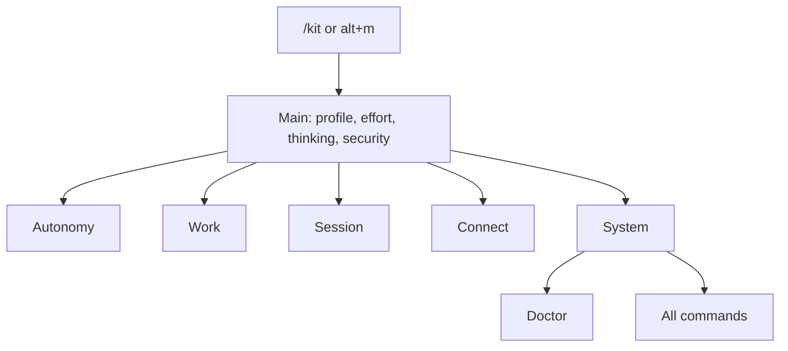

# Control centre

The kit registers many commands, and their settings live in subcommands that are easy to forget.
The control centre is one hub — `/kit` — that shows every level and page, with each row's current
value and the typed command that still does the same work. Nothing is renamed or unregistered:
every command keeps working, and the hub is an additional way in. In the TUI the `/` menu hides the
kit commands that moved into the hub, while typing them still runs them (see The curated `/` menu
below).

## Open it

| How | What happens |
| --- | --- |
| `/kit` | Opens the hub on the main page. |
| `/helpers` | Alias of `/kit`. |
| `alt+m` | Opens the hub from anywhere. |
| `/kit <page>` | Opens a named page directly (argument completion lists the page ids). |

`alt+m` is the default key. Put `"hubKey": "alt+k"` (or another free key) in
`<agent dir>/pi-kit/ui.json` to change it. The Help page and the `/kit` description name the
configured key. The hub reads only that key and never rewrites the
other settings in the file, so the status bar's own settings there are untouched.

The hub is not registered in an internal child session (`PI_KIT_INTERNAL_CHILD=1`), the same rule
`/workflow` follows, so a subagent never advertises a terminal hub.

## Pages

The main page is the levels strip plus five pages (`tests/docs-smoke.ts` checks the count against
`control-center/model.ts`). Every row shows its typed equivalent, and the old command can be typed
at any time.

| Page | Holds | Typed equivalents |
| --- | --- | --- |
| Main | Profile, Effort, Thinking, Security, then Autonomy, Work, Session, Connect and System | `/profile`, `/effort`, `/thinking`, `/security` |
| Autonomy | Approvals, remembered approvals, loop, auto-boost, container runs | `/auto`, `/firewall`, `/loop`, `/boost`, `/autonomy` |
| Work | Goal, todos, verify, delegation, recovery, memory, engagement, lab | `/goal`, `/todos`, `/verify`, `/orchestrate*`, `/subagents`, `/workflow`, `/reflect`, `/recover`, `/remember`, `/memory`, `/engagement`, `/improve`, `/review` |
| Session | Save, handoff, compact, compress, auto-compaction, new/fork/clone/tree/resume/name, clear | `/save`, `/handoff`, `/compact`, `/compress`, `/compaction`, `/clear` |
| Connect | Remote control, web console | `/remote`, `/console` |
| System | Display, updates and health, diagnostics, companions, all commands, help | `/footer`, `/tips`, `/caveman`, `/update`, `/trace`, `/capture`, `/skills`, `/firewall reload` |
| All commands | Every command from `pi.getCommands()` plus pi's built-ins, grouped by source; Enter pre-fills the command name and a space in the editor | built-in pickers pi cannot open from code |
| Doctor | Read-only health checks (see below) | the command on each line |

## Values

A row shows its current value when a process registry already publishes one, and the hub never
imports another extension to get it:

| Row | Source |
| --- | --- |
| Effort | `globalThis[Symbol.for("pi-kit.effort")].snapshot()` |
| Protections, delegation | `pi-kit.protections`, `pi-kit.delegation` |
| Auto-compaction | `pi-kit.compaction` |
| Approvals | `<agent dir>/pi-kit/firewall.json` (`mode`, `policy`) |
| Subagents | `pi-kit.subagents` |
| Unattended | `pi-kit.unattended` |

The header strip combines the profile, effort, thinking level, security level and approval mode.

## Renderers by mode

- **TUI** (`ctx.mode === "tui"`): the hub hosts pi-tui's `SettingsList` through `ctx.ui.custom()`,
  with search enabled. Enter or Space cycles a value or opens a row, Esc goes back, and typing
  filters the list. It opens as an overlay on pi 1.3.0 or newer, where the overlay `done()` bug is
  fixed; on older pi it opens without an overlay. `tests/control-center-smoke.ts` checks the
  version rule (1.3.0 and newer only) and that the hub asks for an overlay exactly when the
  installed pi passes it.
- **rpc** (a UI is present but not the TUI, as in a session the web console runs): a chain of
  `ctx.ui.select` dialogs. Every dialog carries a 60-second timeout, and a timeout counts as
  cancel, so a dialog nobody answers closes the hub instead of holding the session.
- **print and json** (no UI): a text page with every row, its value and its typed command, written
  to stderr.

A row that runs a typed command, or pre-fills the editor, closes the hub, so the command's own
dialogs or the editor get the keyboard. Reopen the hub with `alt+m` or `/kit`. Changing the
thinking level, or choosing a row that only shows information, keeps the hub open: it reopens on
the same row with every value read again. Back returns the cursor to the row that opened the page.

## The curated `/` menu

In the TUI, typing `/` offers only the pinned commands plus pi's own built-ins, the prompt templates
and the skill commands. Every other kit extension command, and every companion-package command, is
hidden from the list. Nothing is unregistered: a hidden command runs exactly as before when it is
typed in full, and it appears again once at least four characters of its name have been typed, so
muscle memory still completes (`tests/command-menu-smoke.ts`).

Hidden suggestions say where the command lives, for example
`moved → /kit ▸ Autonomy ▸ Approvals`, derived from the hub model's pages and rows; a command with
no row points at `moved → /kit ▸ All commands` (`tests/command-menu-smoke.ts`).

The pinned commands are `/kit`, `/goal`, `/verify`, `/save`, `/remember`, `/effort`, `/profile`,
`/update` and `/security`. A profile adds the commands that define it: `/autonomy` in autonomous,
`/engagement` in pentest and self-improving, and `/improve` and `/review` in self-improving
(`tests/command-menu-smoke.ts`).

Three keys in `<agent dir>/pi-kit/ui.json` change this (`tests/command-menu-smoke.ts`):

| Key | Default | Effect |
| --- | --- | --- |
| `commandMenu` | `"curated"` | `"all"` registers no filter, so the whole menu is shown. |
| `pinnedCommands` | `[]` | Extra names to keep visible; a leading `/` is optional. |
| `hiddenCommands` | `[]` | Extra names to hide, including built-ins, prompt templates and skill commands. |

An explicit `pinnedCommands` entry beats an explicit `hiddenCommands` entry, which beats a default
pin. An invalid value is warned about once on stderr and replaced by its default
(`tests/command-menu-smoke.ts`).

Only the command token is filtered: once a space is typed argument completion is untouched, a forced
file completion is passed through, and accepting a suggestion still delegates to pi's own provider
(`tests/command-menu-smoke.ts`). The filter is registered in the TUI alone - over RPC, in print or
json mode it never runs - and, like the hub, it is not registered in an internal child session
(`PI_KIT_INTERNAL_CHILD=1`) (`tests/command-menu-smoke.ts`).

## The Security rows

The **Security** row shows the effective [security level](security-level.md), which the tool
firewall publishes on `globalThis[Symbol.for("pi-kit.security")]`. When a floor raises the level
above the one requested, the row shows both, for example `guarded (requested balanced)`. Opening
the row shows the effective and requested levels. The hub reads the registry without importing the
firewall. When the firewall is not loaded there is no registry, and the row says
`not enforced (tool-firewall not loaded)`.

The **Security level** row runs `/security`, which opens the level picker. The picker applies a
stronger level at once and asks for a confirmation at the terminal before a weaker one. When
`/security` is not registered, because the firewall is not loaded, the row is disabled and never
runs an unregistered command.

## Weakening

A fallback row that lowers oversight is marked `weakening`:

- switching approvals to auto (`/auto on`);
- switching to a profile whose firewall default is auto (long-horizon, autonomous, self-improving);
- starting the web console (`/console start`);
- arming self-improvement (`/improve arm`).

The hub runs such a row only after a question the terminal alone can answer. It is a two-option
choice whose first, highlighted option is "No, keep things as they are", because pi's own confirm
dialog starts on "Yes". Outside the TUI, and in a child session, the row is refused with "change
this at the terminal". The question bypasses any remote mirror, the same mechanism `/remote` uses
so a pairing approval never reaches a phone. The Approvals → auto row hands over to `/auto on`
without asking, because the typed command asks the same question itself
([Autonomy gate](autonomy-gate.md)); it is still refused outside the TUI.
`tests/control-center-smoke.ts` pins these cases, and checks that the hub's profile rows and their
weakening set match `packages/kit/profiles/*.json` (`firewall.mode` is `auto`).

## Doctor

Doctor is a read-only page under System ▸ Updates & health. Each line names the command that gives
more detail:

- the kit version, profile and scope, from the install marker (`/update status`);
- the running pi version against the kit's tested pin and peer floor (`/update status`);
- the companions the marker records against the packages registered in the `settings.json` of the
  marker's scope (the project `.pi/settings.json` beside a project marker, else
  `<agent dir>/settings.json`), which catches a marker that lists a package settings no longer
  has (`/update status`);
- what the registries above report, including the security level the tool firewall publishes.

A line that reports drift starts with `! ` (for example `! Protections: 0 recorded`).

## Related

- [Effort](effort.md)
- [Profiles](profiles.md)
- [Security model](security.md)
- [Status bar and costs](status-bar-and-costs.md)
- [Remote control](remote-control.md)

## What is not covered

- No command is renamed, removed or unregistered. The curated `/` menu only removes autocomplete
  suggestions; every name still runs, and no alias is pruned yet (pruning is a later phase).
- The Security level row runs the typed `/security` picker. The level is not yet a registered
  control that the hub can cycle in place.
- In a terminal session the hub is drawn with `ctx.ui.custom()`. Remote control mirrors only
  select, confirm, input and editor dialogs ([Remote control](remote-control.md)), so a phone
  linked with `/remote` does not see the hub.
- The TUI's built-in search filters the rows on the current page. The global `searchRows` model is
  built and tested, but searching every page from one TUI query is not wired in this phase.

Every behaviour on this page is pinned by `tests/control-center-smoke.ts` (and the curated `/` menu
by `tests/command-menu-smoke.ts`), except the `custom()` renderer, which the harness can exercise
only as far as it builds the `SettingsList`. That the Security row reads the level the firewall
publishes is also pinned by `tests/security-level-smoke.ts`.
