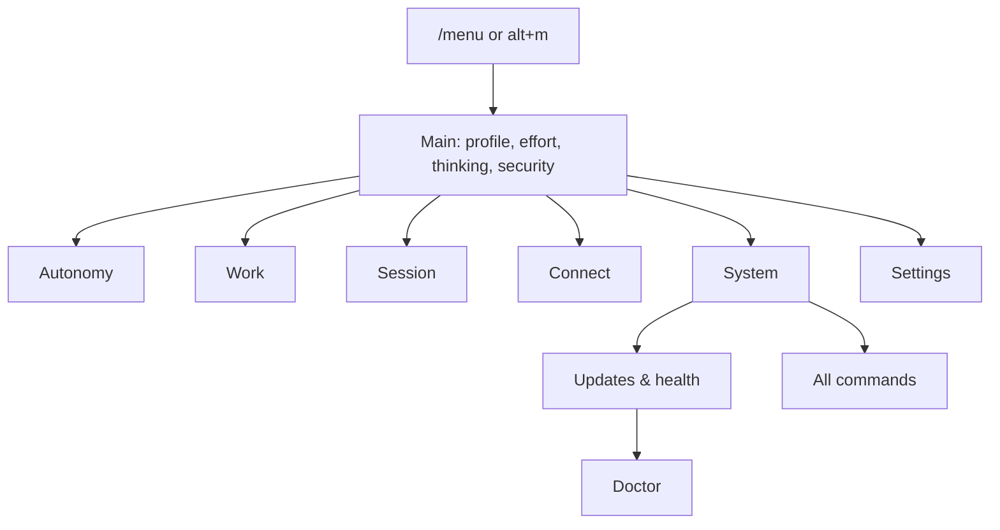

# Control centre

Luna registers many commands, and their settings live in subcommands that are easy to forget.
The control centre is one hub — `/menu` — that shows every level and page, with each row's current
value and the typed command that still does the same work. Nothing is renamed or unregistered:
every command keeps working, and the hub is an additional way in. In the TUI the `/` menu hides the
Luna commands that moved into the hub, while typing them still runs them (see The curated `/` menu
below).

## Open it

| How | What happens |
| --- | --- |
| `/menu` | Opens the hub on the main page. |
| `alt+m` | Opens the hub from anywhere. |
| `/menu <page>` | Opens a named page directly (argument completion lists the page ids). |

`alt+m` is the default key. Put `"hubKey": "alt+k"` (or another free key) in
`<agent dir>/pi-kit/ui.json` to change it. Surrounding whitespace is trimmed. A `hubKey` that is
not then a single key pi can parse (for example one containing spaces, control characters or
several keys) is ignored with one warning and `alt+m` is used. The Help page and the `/menu`
description name the configured key. The hub key takes effect on reload, and after a reload the
launch-screen header, `/menu`, the Settings/Help text and the shortcut all name the bound key.
The hub reads only that key and never rewrites the other settings in the file, so the status bar's
own settings there are untouched.

The hub is not registered in an internal child session (`PI_KIT_INTERNAL_CHILD=1`), the same rule
`/workflows` follows, so a subagent never advertises a terminal hub.

## Launch screen

At the top of a new terminal session Luna shows its wordmark, one summary line (profile, security
level, approval mode, how many extensions loaded and how many failed) and a short status list in
the style of a boot log:

```text
[ OK ] effort          [ OK ] tool-firewall     [ OK ] verify-gate
[FAIL] web-console: registered nothing
[ -- ] 18 off: branch-lab conductor dual-review ...
```

The list shows names only, never paths. `OK` is an extension the install marker enables; `--` is a
shipped extension that is not enabled; `FAIL` is an enabled extension whose `extension.json` says it
registers commands or tools but which has none in pi (pi reports the load error itself under
`[Extension issues]`). An enabled extension that registers nothing because you switched it off with
a variable its manifest declares (for example the off switch of `tool-capture`) is listed as `[ -- ] name (idle)`,
not as a failure. Detail is on demand: `/menu` opens the Doctor page. The installer also sets
pi's `quietStartup` to `"header"` on every install path (profile, `--only` and `--all`) when you
have not set it, and records that in the install marker so `uninstall` removes it again (only while
it is still `"header"`), which hides pi's own resource listing
(every skill, prompt and extension by path) while keeping its warnings; set `quietStartup`
yourself to choose otherwise. An install made before this setting existed gets it on the next
`/update` or installer run.

The reveal is cosmetic: the state of every extension is already known when the header is drawn, and
the `[ .. ]` cells are replayed, not waited on. It is not a loading indicator. The list is revealed over ten short frames (about 70 ms apart) and the timer stops itself. There is
no animation, and no timer, when `PI_KIT_REDUCED_MOTION=1`, `NO_COLOR` or `CI` is set (`NO_COLOR`
also draws the screen without colour),
`TERM=dumb`, or `reducedMotion` is `true` in `<agent dir>/pi-kit/ui.json`. A terminal narrower than
60 columns gets the summary and failures only, one shorter than 28 rows drops the wordmark, and
`PI_KIT_ASCII=1` (or an `iso`, `ansi`, `tty` or `ascii` theme, like the footer) uses printable ASCII
only. Put `"launchScreen": "off"` in `<agent dir>/pi-kit/ui.json` to turn it off.
`tests/launch-screen-smoke.ts` pins the on/off/failed classification, that every line fits the
width, the opt-outs and the wiring; it does not pin the art or the wording, so the screen can be
redesigned freely (`launch-screen.ts` draws, `boot-status.ts` decides what is on).

### Startup time

Measured with pi 1.5.1 in a scratch home and agent directory, installed the way a user installs
(the installer, with the `pi-lens` and `pi-readseek` companions), `PI_TIMING=1 PI_STARTUP_BENCHMARK=1 pi`
in a pty. Read your own the same way; the "Startup Timings: extensions" table lists every extension.

| State | Time to pi's first frame |
| --- | --- |
| Warm: pi alone | about 0.16 s |
| Warm: Luna, 36 extensions, no companions | about 0.4 s |
| Warm: Luna plus `pi-lens` and `pi-readseek` | 0.7 to 1.0 s on an idle machine |
| Cold: the first start after an install, an update or a reboot | 8 to 13 s |

Warm, Luna's own extensions are about 170 ms of the load; `pi-lens` is about 230 ms and
`pi-readseek` about 190 ms, so companions are most of it. Cold, almost all of the time is pi's
loader compiling every extension's TypeScript or JavaScript (`pi-lens` 3.8 s, Luna's extensions
2.2 s, `pi-readseek` 0.7 s) into a cache in the operating system's temporary directory. A reboot
empties that directory on systems where it is a memory filesystem (the Debian default), and every
update changes the files, so the slow start returns each time. Precompiling Luna's extensions would
not remove it: pi's loader transforms plain JavaScript too, as the `pi-lens` figure shows.

Nothing Luna runs does network work or directory scans before the first paint: a start with the
network namespace removed takes the same time. pi's own first-run download of `fd` and `ripgrep`
happens after the first frame. Luna's update check runs in the background, at most once a day.

What Luna does about the slow start:

- The installer loads every extension once at the end of an interactive install (`pi --mode rpc`,
  offline), so the compile happens there, with a message, and not on the first `pi`. A scripted
  install (no terminal) skips it, and a plain `pi install git:...` never runs the installer, so
  that route relies on the notice below. `tests/startup-notice-smoke.ts` pins the command it runs.
- When a start is cold anyway, `delegation-guard` (the first Luna extension pi loads) prints one
  line, `Luna: first start since an update or reboot, compiling, one time only`, and erases it at pi's
  first write to the terminal, so nothing is left in scrollback. It shows only on an interactive
  terminal, never in CI, `TERM=dumb`, print or rpc mode, a child pi or after `/reload`. "Cold" is
  a stamp file in the temporary directory next to pi's cache, named for this kit's version. The installer writes it after a successful pre-load, and the notice writes it only
  when pi's first write shows the start finished (an exit mid-compile leaves it unwritten);
  `tests/startup-notice-smoke.ts` pins both. A companion updated on its own, or a cache emptied
  while the stamp survives, does not reset it, so such a start is silent.

The line cannot appear before pi has loaded the extensions that sort before `delegation-guard`
(about 0.4 s cold; the rest of pi's own start comes first), and pi still draws nothing else until
every extension has loaded. The profile and the on/off list are read when the header is drawn, so
a `/profile` change shows from the next session ([Future work](future-work.md#startup)).

## Pages

The main page is the levels strip plus six pages (`tests/docs-smoke.ts` checks the count against
`control-center/model.ts`). Every row shows its typed equivalent, and the old command can be typed
at any time.

| Page | Holds | Typed equivalents |
| --- | --- | --- |
| Main | Profile, Effort, Thinking, Security, then Autonomy, Work, Session, Connect, System and Settings | `/profile`, `/effort`, `/thinking`, `/security` |
| Security | Security level, approval mode, approval mode to auto, details | `/security`, `/auto`, `/security status` |
| Autonomy | Remembered approvals, loop, auto-boost, container runs | `/firewall`, `/loop`, `/boost`, `/autonomy` |
| Work | Goal, todos, verify, delegation, recovery, memory, engagement, lab | `/goal`, `/todos`, `/verify`, `/orchestrate*`, `/workflows`, `/boost`, `/remember`, `/memory`, `/engagement`, `/improve`, `/review` |
| Session | Save, handoff, compact, compress, auto-compaction, new/fork/clone/tree/resume/name, clear | `/save`, `/handoff`, `/compact`, `/compress`, `/compaction`, `/clear` |
| Connect | Remote control, web console | `/remote`, `/console` |
| System | Display, updates and health, diagnostics, companions, all commands, help | `/footer`, `/tips`, `/caveman`, `/update`, `/trace`, `/capture`, `/skills`, `/firewall reload` |
| Settings | pi settings, command menu, hub key, pinned commands, hidden commands, display | `/settings` |
| All commands | Every command once, pi's built-ins first and then `pi.getCommands()` entries not already listed, grouped by source; Enter pre-fills the command name and a space in the editor | built-in pickers pi cannot open from code |
| Doctor | Read-only health checks (see below) | the command on each line |



## Values

A row shows its current value when a process registry already publishes one, and the hub never
imports another extension to get it:

| Row | Source |
| --- | --- |
| Effort | `globalThis[Symbol.for("pi-kit.effort")].snapshot()` |
| Protections, delegation | `pi-kit.protections`, `pi-kit.delegation` |
| Auto-compaction | `pi-kit.compaction` |
| Approvals | `<agent dir>/pi-kit/firewall.json` (`mode`, `policy`) |
| Subagents | `pi-kit.subagents` |
| Unattended | `pi-kit.unattended` |

The header strip combines the profile, effort, thinking level, security level and approval mode.
The header strip, page titles (including the text renderer's page titles) and the informational
rows (Doctor, Help) pass what they display through one display filter: pi-tui's terminal
sequence strip first, then removal of every control and format code point (Unicode `Cc`, `Cf` and
`Default_Ignorable_Code_Point`, which covers alternate-screen sequences, resets, C1 CSI and
bidirectional overrides), then a trim, then a bound of 500 characters. The Unicode class and the
one-line helpers live once in `packages/core/shared/visible-text.ts`; control-centre uses its
generated copy (`packages/extensions/src/control-center/shared/visible-text.ts`), so it does not
import another extension for the filter. Other rows are not sanitised
(`tests/control-center-smoke.ts`).

## Renderers by mode

- **TUI** (`ctx.mode === "tui"`): the hub hosts pi-tui's `SettingsList` through `ctx.ui.custom()`,
  with search enabled. Enter or Space cycles a value or opens a row, Esc goes back, and typing
  filters the list. It opens as an overlay on pi 1.3.0 or newer, where the overlay `done()` bug is
  fixed; on older pi it opens without an overlay. `tests/control-center-smoke.ts` checks the
  version rule (1.3.0 and newer only) and that the hub asks for an overlay exactly when the
  installed pi passes it. Both this hub and the `/workflows` panel draw a theme-coloured rounded
  border and dim the transcript behind the overlay (`overlay-frame.ts`), pinned by
  `tests/control-center-smoke.ts` and `tests/workflow-panel-smoke.ts`. The frame lays out its inner
  content four cells narrower than the framed width (two border and two padding cells) and forwards
  mouse clicks and wheel events inside the content area, so the hub's rows and search respond to the
  pointer; below ten cells no frame is drawn and the content keeps the full width. The overlay
  reduces its visible rows to fit a short terminal, dropping its title below fourteen rows and its
  trailing hint/description lines before it gives up the focused row; at three or four rows the
  search line gives way to the focused row instead of scrolling the cursor out of the box
  (`tests/control-center-smoke.ts`).
- **rpc** (a UI is present but not the TUI, as in a session the web console runs): a chain of
  `ctx.ui.select` dialogs. Every dialog carries a 60-second timeout, and a timeout counts as
  cancel, so a dialog nobody answers closes the hub instead of holding the session.
- **print and json** (no UI): a text page with every row, its value and its typed command, written
  to stderr.

Every renderer shows a row's typed command as `[command]` after its label: a legacy command, an
editor pre-fill, or the command an informational row names (the Doctor lines and the
page's Source row). The row name comes first, so a narrow terminal truncates the `[command]` suffix
before the name. The All commands page is already labelled with the command it runs and does not
repeat it. Choosing an informational row only shows information and keeps the hub open.

A row that runs a typed command, or pre-fills the editor, closes the hub, so the command's own
dialogs or the editor get the keyboard. Reopen the hub with `alt+m` or `/menu`. Changing the
thinking level, or choosing a row that only shows information, keeps the hub open: it reopens on
the same row with every value read again. Back follows the path the operator took: it returns to the
page the current one was opened from and puts the cursor back on the row that opened it. Only a page
opened directly, rather than reached from another page, falls back to the page's declared parent.

## The curated `/` menu

In the TUI, typing `/` offers only the pinned commands plus pi's own built-ins, the prompt templates
and the skill commands (the `/skill:*` commands fold behind one `/skills` entry while the skill-router
extension provides it; they stay runnable and appear again from four typed characters). Every other Luna extension command, and every companion-package command, is
hidden from the list. Nothing is unregistered: a hidden command runs exactly as before when it is
typed in full, and it appears again once at least four characters of its name have been typed, so
muscle memory still completes. A name shorter than four characters appears once its full name is
typed, so a hidden three-character command completes at its full name (`tests/command-menu-smoke.ts`).
The curated menu and the launch screen are installed for every session, so they still work after
`/new`, `/resume`, `/fork` or a `/tree` switch replaces the session (`tests/command-menu-smoke.ts`).

Hidden suggestions say where the command lives, for example
`moved → /menu ▸ Security ▸ Approval mode`, derived from the hub model's pages and rows; a command with
no row points at `moved → /menu ▸ All commands` (`tests/command-menu-smoke.ts`). With
`PI_KIT_ASCII=1` the hint's own glyphs are printable ASCII: `moved -> /menu > Security >
Approval mode` (or `moved -> /menu > All commands`), a page or row label's arrow is folded (`Plan ->
implement -> review`), and the description separator is ` - ` instead of ` — `. A command's own
description after the hint is shown unchanged.

The pinned commands are `/menu`, `/goal`, `/verify`, `/save`, `/remember`, `/effort`, `/profile`,
`/update` and `/security`. A profile adds the commands that define it: `/autonomy` in long-horizon,
`/engagement` in engagement and self-improving, and `/improve` and `/review` in self-improving
(`tests/command-menu-smoke.ts`).

Three keys in `<agent dir>/pi-kit/ui.json` change this (`tests/command-menu-smoke.ts`):

| Key | Default | Effect |
| --- | --- | --- |
| `commandMenu` | `"curated"` | `"all"` registers no filter, so the whole menu is shown. |
| `pinnedCommands` | `[]` | Extra names to keep visible; a leading `/` is optional. |
| `hiddenCommands` | `[]` | Extra names to hide, including built-ins, prompt templates and skill commands. |

An explicit `pinnedCommands` entry beats an explicit `hiddenCommands` entry, which beats a default
pin. An invalid value is warned about once on stderr and replaced by its default
(`tests/command-menu-smoke.ts`).

Only the command token is filtered: once a space is typed argument completion is untouched, a forced
file completion is passed through, and accepting a suggestion still delegates to pi's own provider
(`tests/command-menu-smoke.ts`). The filter is registered in the TUI alone - over RPC, in print or
json mode it never runs - and, like the hub, it is not registered in an internal child session
(`PI_KIT_INTERNAL_CHILD=1`) (`tests/command-menu-smoke.ts`).

## The Security page

Security is one control. The main page has a single **Security** row showing the effective
[security level](security-level.md) (`balanced`, `guarded` or `strict`), which the tool firewall
publishes on `globalThis[Symbol.for("pi-kit.security")]`; when a floor raises the level above the
one requested it shows both, for example `guarded (requested balanced)`. The footer carries the
same single `sec` chip. The hub reads the registry without importing the firewall; when the
firewall is not loaded the row says `not enforced (tool-firewall not loaded)`.

Opening the row shows the Security page: **Security level** runs `/security` (the picker, which
applies a stronger level at once and asks for a confirmation at the terminal before a weaker one),
**Approval mode** runs `/auto` (how tool prompts are answered: manual, or auto with a model judge),
**Approval mode → auto** is the weakening shortcut, and **Details** runs `/security status`, which
prints the level, approval mode, policy, floors with their reasons and the environment pin. The
header strip shows the level and the approval mode together. When a typed command is not
registered, because the firewall is not loaded, its row is disabled and never runs it.

## Weakening

A fallback row that lowers oversight is marked `weakening`:

- switching approvals to auto (`/auto on`);
- switching to a profile whose firewall default is auto (long-horizon, self-improving);
- starting the web console (`/console start`);
- arming self-improvement (`/improve arm`).

The hub runs such a row only after a question the terminal alone can answer. It is a two-option
choice whose first, highlighted option is "No, keep things as they are", because pi's own confirm
dialog starts on "Yes". Outside the TUI, and in a child session, the row is refused with "change
this at the terminal". The question bypasses any remote mirror, the same mechanism `/remote` uses
so a pairing approval never reaches a phone. The Approval mode → auto row hands over to `/auto on`
without asking, because the typed command asks the same question itself
([Autonomy gate](autonomy-gate.md)); it is still refused outside the TUI.
`tests/control-center-smoke.ts` pins these cases, and checks that the hub's profile rows and their
weakening set match `packages/kit/profiles/*.json` (`firewall.mode` is `auto`).

## Session commands

`/clear` starts a new session after a confirm; `/clear --handoff` first appends the last asks (redacted for
secrets, so the file still holds prompt text) and tools to `HANDOFF.md`. Without a UI it refuses, as there is nobody to confirm. `/status` prints the Doctor checks below as one line each, ending in the command
that gives more detail (`tests/session-commands-smoke.ts`). Neither compacts: `/compact` shrinks the
current context and keeps the thread.

## Doctor

Doctor is a read-only page under System ▸ Updates & health. Each line names the command that gives
more detail:

- the Luna version, profile and scope, from the install marker (`/update status`);
- the running pi version against Luna's tested pin and peer floor (`/update status`);
- the companions the marker records against the packages registered in the `settings.json` of the
  marker's scope (the project `.pi/settings.json` beside a project marker, else
  `<agent dir>/settings.json`), which catches a marker that lists a package settings no longer
  has (`/update status`);
- what the registries above report, including the security level the tool firewall publishes.

A line that reports drift starts with `! ` (for example `! Protections: 0 recorded`).

## Related

- [Effort](effort.md)
- [Profiles](profiles.md)
- [Security model](security.md)
- [Status bar and costs](status-bar-and-costs.md)
- [Remote control](remote-control.md)

## What is not covered

- No command is removed or unregistered. The curated
  `/` menu only removes autocomplete suggestions; every name still runs.
- The Security level row runs the typed `/security` picker. The level is not yet a registered
  control that the hub can cycle in place.
- In a terminal session the hub is drawn with `ctx.ui.custom()`. Remote control mirrors only
  select, confirm, input and editor dialogs ([Remote control](remote-control.md)), so a phone
  linked with `/remote` does not see the hub.
- The TUI's built-in search filters the rows on the current page. The global `searchRows` model is
  built and tested, but searching every page from one TUI query is not wired in this phase.

Every behaviour on this page is pinned by `tests/control-center-smoke.ts` (and the curated `/` menu
by `tests/command-menu-smoke.ts`), except the `custom()` renderer, which the harness can exercise
only as far as it builds the `SettingsList`. That the Security row reads the level the firewall
publishes is also pinned by `tests/security-level-smoke.ts`.
