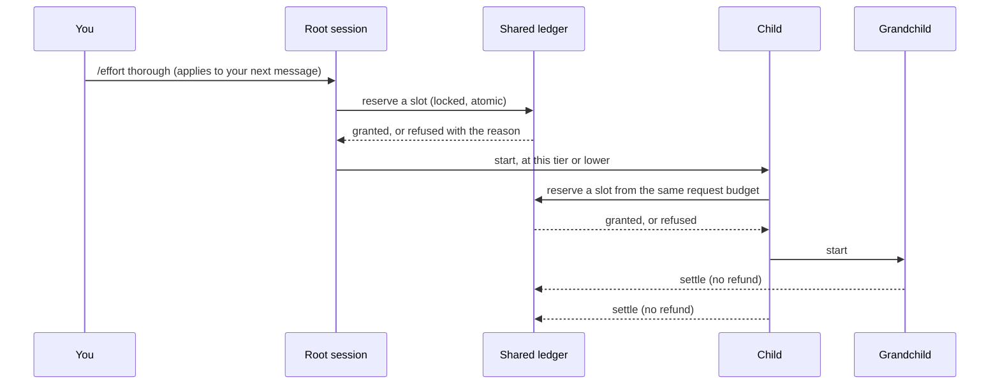

# Effort

The sibling [Security level](security-level.md) control adjusts firewall protections independently of effort.

Effort sets **how deep and how broad** the agent works on a task, and how much it may delegate to
sub-agents. It is one dial with five positions.

Effort is independent of three other things, and never changes them:

- the **model** and its **thinking level**;
- the **profile** (what is installed and loaded);
- **permissions**: what the firewall and guards allow. A higher effort never grants a permission,
  and a lower effort never removes one.

## The five tiers

| Tier | Id | Concurrent | Total | Scouts | What the agent is told |
|---|---|---:|---:|---:|---|
| **E1 Minimal** | `minimal` | 0 | 0 | 0 | Work directly. No discretionary delegation and no scouts. Inspect and verify only what correctness requires. |
| **E2 Focused** | `focused` | 1 | 1 | 1 | Investigate only what the task touches, state a brief approach, make the small change and run the targeted checks. Delegate rarely. |
| **E3 Standard** (default) | `standard` | 2 | 3 | 1 | Plan non-trivial work, inspect the relevant dependencies, delegate selectively, implement and validate, then review the affected behaviour. |
| **E4 Thorough** | `thorough` | 4 | 8 | 2 | Investigate risks and compare alternatives. Structure the plan, parallelise separable work, run broad relevant tests and have substantial changes reviewed independently. |
| **E5 Exhaustive** | `exhaustive` | 6 | 16 | 3 | Investigate systematically and work in phases with independent perspectives. Validate comprehensively, resolve material findings, document the evidence. A trivial edit is still done directly. |

The limits are **per user request**, not per session, and are defaults rather than quotas: the
agent is told never to invent work to use them up. The policy, the limits and the exact wording
live in one file, `packages/extensions/src/effort/policy/effort.json`, plus one markdown file per
tier next to it.

Every tier also receives the same shared paragraph, which states that effort controls execution
depth and breadth and not model reasoning or permissions; that the agent should apply it in
proportion to complexity, uncertainty and risk; that it should delegate only bounded work with a
clear deliverable; and that it must not claim checks it did not perform, and should recover in a
bounded way when blocked rather than repeat what failed.

## Choosing a tier

```
/effort                 a picker
/effort thorough        by name (also E4, or 4)
/effort status          the tier, limits and this request's use
/effort reset           forget the saved default
/effort help            the table above
/effort ultracode       E5 plus standing workflow mode (see "Ultracode" below)
```

A choice is saved as your default in `<agent dir>/pi-kit/effort.json` and applies **from your next
message**: the tier already governing the turn in progress is never changed under it. The status
bar shows the tier as a chip (`E3 Standard`, and `→ E4` while a change is waiting for the next
message); `/footer status` shows the limits and the current request's use.

The agent's prompt carries exactly one effort block. Changing tier replaces that block; it never
stacks a second one, so the cost of the setting does not grow over a long session.

### Adjusting the limits

`<agent dir>/pi-kit/effort.json` may lower or raise a tier's limits within the platform ceilings
(8 concurrent, 64 in total, 8 scouts):

```json
{
  "schemaVersion": 1,
  "default": "focused",
  "limits": { "thorough": { "maxTotal": 6 } }
}
```

Invalid entries are ignored with a warning and never stop pi from starting.

## How delegation is budgeted

Every way of starting a child (the `subagent` tool, workflows, the verification reviewer,
recovery) asks the same **shared ledger** for a slot before it launches anything. The ledger is a
small file under `<agent dir>/pi-kit/effort/ledgers/`, updated under a lock, so:

- the limits are **atomic**: two children asking at once cannot both take the last slot;
- they hold **at every depth**: a child's own children, and theirs, draw from the same request
  budget as the parent's, so delegation cannot multiply by nesting;
- a **failed or retried child still counts**: nothing is refunded, so a retry loop cannot spend
  unbounded children;
- a child can **never run at a higher tier than its parent**. A child's tier is the parent's
  tier, or lower if its agent definition or the `subagent` call asks for less.



At **E1** the model-launchable delegation tools are not even offered (their descriptions cost
around 850 tokens a turn and could only be refused); they return at the next message after a
higher tier is chosen.

Three kinds of launch are accounted separately from the discretionary budget above:

| Kind | Budget | Why it is separate |
|---|---|---|
| **Mandatory** verification (completion reviewer, validator) | up to 6 a request | Verification is a safety control, so a minimal effort setting must not switch it off. |
| **Recovery** | 2 invocations, 1 at a time, read-only scout roles only (see below), and only while the trusted recovery extension has recovery active | So a session at E1 can still get help when stuck. The model cannot open this budget itself, and it never adds to the discretionary one. |
| **User-directed** (`/workflow` and similar commands you run) | the platform ceilings only | You asked for it. |

If the policy or ledger cannot be read, delegation is **refused** rather than allowed without a
budget; mandatory verification is the one exception, and runs unbudgeted rather than not at all.
An unbudgeted verification child does not inherit a tier or a ledger, so it starts its own root
scope; that is harmless only because the reviewer and validator roles have no `subagent` tool.

**What "read-only scout" means.** A role is read-only (`isReadOnlyRole`) when its tool list is
explicit and names only `read`, `grep`, `find` and `ls`. Any other tool counts as able to change
state: `bash` and `powershell` run any command, and an extension or MCP tool is not known to be
harmless. Recovery accepts a read-only role that is named `scout` or says `scout: true`. The
built-in `scout` has `bash`, so it is not read-only: a recovery launch of it is charged as read-only
only on its read tools, and the child runs with `--tools read,grep,find,ls` and no shell. Once the
recovery budget is spent, a scout charged to the discretionary budget keeps its full tool list
(`tests/delegation-guard-smoke.ts`). Every child also runs under its parent's firewall and
protections whatever its role says. The conductor applies the same read-tools rule to its
specialists (`tests/conductor-specialist-bounds-smoke.ts`).

## Script workflows

The ledger also has a **workflow** launch kind for the agents of a
[script-workflow](script-workflows.md) run: every agent the `workflow` tool starts is charged here,
through delegation-guard with the run id and token. Its limits live in the
`workflow` block of `effort.json`:

| Limit | Default | Bounds |
|---|---:|---|
| `workflowConcurrent` | 16 | agents of one run that are live at once |
| `workflowTotalPerRun` | 1000 | agents one run may ever start (retries and failed agents count; nothing is refunded) |
| `workflowSessionTotal` | 2000 | agents all workflow runs of one session may start together |

A run first opens its own scope with `openRunScope(runId)` on the effort registry. That returns a
run token, and every reservation for the run must carry the run id and that token; only a hash of
the token is written to disk. The scope lives in the session's workflow ledger
(`<agent dir>/pi-kit/effort/ledgers/<session>-workflows.json`), a separate file that the per-turn
ledger rotation never replaces, so a run that keeps going across your messages keeps its count. A
run id is opened once; child processes cannot open runs. The workflow ledger is created only when
no file exists there. An existing file that cannot be read, or that has no workflow section, is
never replaced: opening a run and reserving both refuse with code `no-ledger`, so a corrupt or
edited file cannot reset the session's count. Workflow agents never draw on the tier
budget or count toward the 64-child session ceiling, and each agent is given E1 Minimal as its tier
and cap.

`reserveWorkflow` is how an engine asks for a slot. A `concurrency` denial is waited out: it asks
again until a slot frees or the caller aborts (code `aborted`). Every other denial (an unknown run
or wrong token, a used-up run, a used-up session, an unreadable ledger) throws a
`WorkflowLedgerError` carrying the code. The two policy loaders
(`packages/extensions/src/effort/policy.ts` and `packages/core/lib/effort.ts`) read and validate
the block the same way. Tests: `tests/workflow-ledger-smoke.ts` (`npm run smoke:workflow-ledger`)
and `tests/effort-smoke.ts` (`npm run smoke:effort`, the parity check).

## Memento mode

Memento mode (internally "generations") works a long task in time-boxed generations, each a fresh
agent continuing from the previous one's notebook. pi-autonomy runs it, for a run whose contract
sets `generations.enabled` ([Generations](autonomy.md#generations)). This section covers who may
use it and how many generations a task may have. The autonomy engine reads the same opt-in and
allowance, and a run uses at most that many generations (see "Enforced by pi-autonomy" below).

Each tier carries a Memento allowance, `memento.maxGenerations` in `effort.json`:

| Tier | E1 | E2 | E3 | E4 | E5 |
|---|---:|---:|---:|---:|---:|
| `memento.maxGenerations` | 0 | 0 | 0 | 2 | 4 |

No tier may exceed `memento.maxGenerationsCeiling` (8), and no tier may fall below the tier before
it. Both policy loaders (`packages/extensions/src/effort/policy.ts` and
`packages/core/lib/effort.ts`) check this the same way and refuse a policy that breaks it.

Memento mode is **off by default for every model**. You opt a model in per model, in
`<agent dir>/pi-kit/autonomy.json`:

```
/effort memento                         status: the allowance for the current model and tier, the opted-in models
/effort memento on [provider/model]     opt a model in (the current model if none is named)
/effort memento on a/b --max 1          opt in with a lower limit of its own
/effort memento off [provider/model]    opt it out (no question asked)
```

`on` asks a select whose first, default answer is "No, keep Memento mode off for this model". The
model is opted in only if you pick "Yes, allow Memento mode for <model>". `on` is refused with no
screen to ask on, in a child process, and outside the `long-horizon` and `autonomous` profiles.
The profile is read from the install marker: a project `.pi/.pi-kit.json` if there is one,
otherwise `<agent dir>/.pi-kit.json`. The file is written atomically with mode 0600 and keeps its
other keys. A file that cannot be parsed is never overwritten. protected-paths blocks the agent's
own write tools from writing it, so a model cannot opt itself in.

```json
{
  "schemaVersion": 1,
  "memento": { "models": { "openrouter/qwen/qwen3-coder": { "enabled": true, "maxGenerations": 1 } } }
}
```

A model is opted in only by `"enabled": true`. A model's allowance is its tier's
`memento.maxGenerations`, lowered by the model's own `maxGenerations` if it sets one. The model's
value never raises the tier's allowance, in the same way the limit overrides above never pass the
ceilings. The allowance is 0 when the model is not opted in, when no model is selected, and outside
the two profiles. Invalid entries are ignored with a warning, which `/effort memento` shows.
Tests: `tests/memento-optin-smoke.ts` (`npm run smoke:memento-optin`), `tests/effort-smoke.ts`
(`npm run smoke:effort`, the allowances and the parity of the two loaders) and
`tests/protected-paths-smoke.ts`.

**Enforced by pi-autonomy.** Before a run whose contract enables generations starts its first
generation, the autonomy engine works out the allowance for the contract's worker model
(`<model.provider>/<model.worker>`) at the run's effort tier. It uses the same reader as
`/effort memento`: `packages/extensions/src/effort/memento.ts`, imported in place through
`packages/core/memento.ts`, with the tier's allowance from `packages/core/lib/effort.ts`. The
profile is looked up from the directory the supervisor runs in. The run uses the lower of
`generations.maxGenerations` and the allowance. An allowance of 0 (the model is not opted in, the
tier allows none, or the profile is neither `long-horizon` nor `autonomous`) runs the task as a
single generation with no box. The decision and its reason go to `state.json` (`memento`), the run
log, the step's event log and `pi-autonomy status`. The engine decides once per run, so opting a
model out does not change a run that has already started. Tests: `tests/autonomy-generations-smoke.ts`
(`npm run smoke:autonomy-generations`: opt-in off gives 1 generation, an E4 allowance of 2 caps a
contract asking for 4, a model's own `--max 1` gives 1, and an opt-out after the start changes
nothing).

## Ultracode

Ultracode is E5 Exhaustive plus **standing mode** for [script workflows](script-workflows.md):
while it is on, the agent is told it may write and run a workflow script for substantial work
without waiting to be asked, instead of only when you ask for a workflow.

```
/effort ultracode                       E5 and standing mode (also /effort uc, /effort e5 --standing)
/effort ultracode --size 80             a different size guideline (default 50 agents a workflow)
/effort ultracode --budget 200k         an output-token budget for each run (k and m suffixes; none clears it)
/effort ultracode status                the current state (also a line in /effort status)
/effort ultracode off                   back to opt-in
```

Only you can switch it on: it is refused in a child process and in a session with no screen to ask
on. Switching it on asks one select whose first, default answer is "No, keep asking per workflow".
Either answer turns standing mode on and chooses E5 (saved as your default, from your next
message, like `/effort e5`); only "Yes, allow workflow runs this session" also
**pre-authorises** the `workflow` tool, so the firewall runs its calls without asking. Escape
changes nothing. Standing mode lasts for the session: it is recorded in the session with
`appendEntry`, and a reload or resume of that session restores it on a screen (never headless, in
a child, or when the tier in force is not E5). A restore never brings back the pre-authorisation:
each `workflow` call is asked until you answer Yes to `/effort ultracode` again.

- **Prompt.** While the `workflow` tool is in the active tool set, `policy/standing.md`, with the
  size guideline and the budget filled in, is added inside the one effort block, and each turn
  carries a one-line hidden reminder message. The effort extension injects these itself, as it
  does its tier text: this is the one exception to context-sieve being the only injector of
  turn guidance.
- **Size** is a soft guideline in the prompt; nothing enforces it. The engine's own limits (1000
  agents a run, the [workflow ledger](#script-workflows)) still apply.
- **Budget** becomes `budget.total` of every run the `workflow` tool starts while standing mode is
  on. Without `--budget` there is none, as when standing mode is off.
- **Firewall.** A pre-authorised `workflow` call is allowed only when the policy's own `ask` for
  the tool is its only finding above low, in a root session with a screen. Strict security, the
  pentest policy, headless sessions and children are decided as before, and any other finding
  (a trajectory chain, a secret path) still asks.
- **Wake chain.** A workflow's completion message starts a turn when the session is idle. More
  than 5 such turns in a row, with no message from you between them, ask a select whose first
  answer is "No, stop and wait for my next message"; No or Escape stops that turn (the result
  stays in the conversation), Yes lets it go on and asks again after 5 more. Your next message
  starts the count again.
- **Off** returns to opt-in and revokes the pre-authorisation at once; runs already going
  continue. Choosing a tier below E5, or `/effort reset` when the default is below E5, also turns
  standing mode off.

Tests: `tests/effort-standing-smoke.ts` (`npm run smoke:effort-standing`).

Not covered: the hidden reminder is one more message in the session for every turn while standing
mode is on, and the wake-chain cap applies only while standing mode is on.

## Autonomous runs

An autonomous run pins its tier from the run contract (`effort` in the run definition, default
E3). A pinned session ignores `/effort` for its own tier (the choice is only saved for later) and
passes the pin, and a cap, to its children through `PI_KIT_EFFORT` and `PI_KIT_EFFORT_CAP`. See
[Autonomous runs](autonomy.md).

## Sub-agent definitions

An agent file under `packages/kit/agents/` (or a project's `.pi/agents/`) may carry
`effort: <tier>` to ask for a lower tier for that role, and `scout: true` to count against the
scout limit (the built-in `scout` role always does). The `subagent` tool takes an optional
`effort` argument for the same purpose. Both are clamped to the parent's tier.

## What effort is not

Effort is a **cost and behaviour policy, not a security boundary.** The ledger is a file owned by
your user; a process running as you (or a compromised tool) could edit it or unset the
environment. The controls that stop an agent doing something it should not are the
[firewall and guards](security.md), which apply to every child whatever its tier. Effort keeps an
honest agent from over- or under-working; it does not contain a hostile one.
