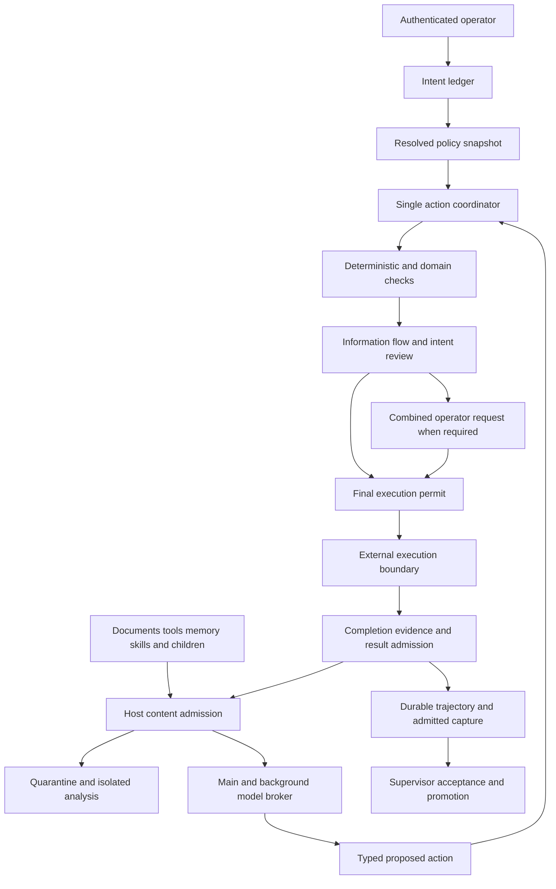
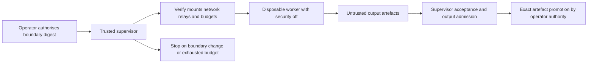
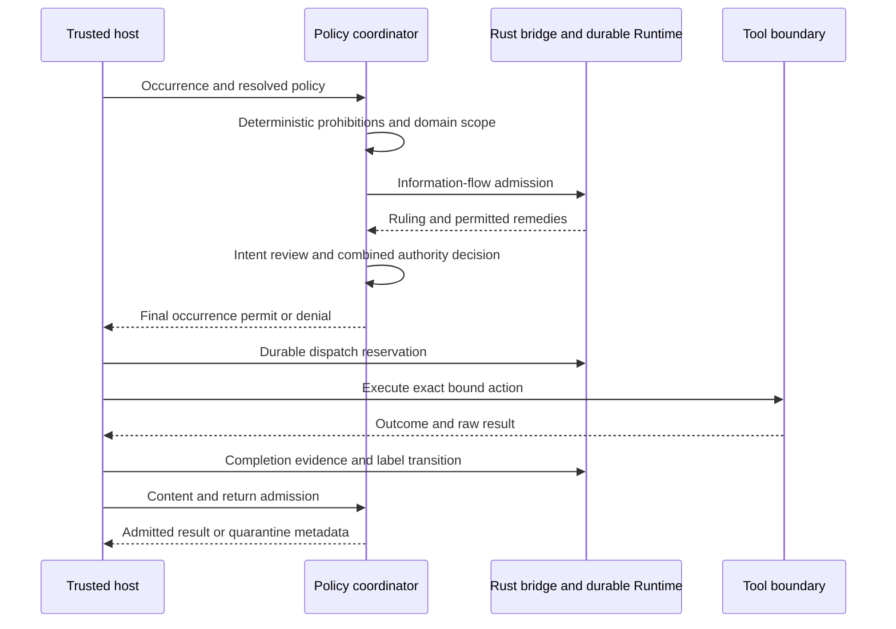

# Agentic security, alignment and autonomy

## Decision and scope

This engineering proposal recommends **useful autonomy within explicit authority**. Routine authorised work should proceed with few interruptions. Suspicious information, unclear authority and consequential effects should receive progressively stronger scrutiny. Alignment here means adherence to operator intent, authorised scope and verifiable task correctness; it does not mean that a model's confidence or helpful explanation creates permission.

The deliverable is a design and evidence inventory, replacing an OpenAPPA-only approach with a coordinated security architecture. OpenAPPA supplies one substantial part: information-flow admission. It does not replace intent review, content admission, correctness checks or external containment. No runtime behaviour, dependency, profile or approval setting is changed by this document.

Terminology throughout:

- **Current behaviour** describes inspected implementation and names existing tests where available.
- **Static finding** identifies a source-level concern, not a reproduced exploit or measured failure rate. Related tests are evidence of their own assertions, not proof that the concern is closed.
- **Proposal** specifies intended implementation and acceptance gates.
- **Unproven capability** requires host integration, regression evidence or empirical calibration before being advertised.

Current operational documentation remains in [Security model](../security.md), [Tool firewall and auto mode](../architecture/tool-firewall-and-auto-mode.md), [Autonomous runs](../autonomy.md) and [Supply chain](../supply-chain.md). The implementation baseline is pi-system commit `555a577316b51af17f7941733201a72832255e8a`. Findings below are pinned to that snapshot, rather than assumed true of later fixes.

## Baselines and pi 0.99.2 compatibility

### What was inspected

| Baseline | Evidence | Meaning |
|---|---|---|
| Declared pi 0.87.1 | Root dev dependencies and lockfile; [S1] | Repository test baseline, not the version found in the local dependency tree |
| Installed pi 0.85.1 | Installed package metadata and extension runner; [S15] | Historical inspection baseline; not a claim about the operator's current installation |
| Requested pi 0.99.2 | Published package metadata, changelog, extension runner and agent-session source; [S17] | Operator's stated stable version and proposed maximum tested compatible version |
| Peer floor 0.85.1 | Root, core and extensions manifests; [S1] | Present peer ranges use `>=0.85.1` and have no numerical upper bound |
| Advisory pi 0.99.1 | `pi-compat` CI job; [S16] | Existing newer-version lane is advisory, not evidence of supported 0.99.2 |

The 0.87.1 and 0.99.2 published tarballs were inspected separately without replacing repository dependencies or touching the operator's installation. Their npm `gitHead` revisions are respectively `f07218c4d4bbc12bef056a7058c3dd49dfe41abe` and `005af57d88ee23b33778f343a9595b32e67ff788`. Both runners catch `tool_result` and `before_provider_request` handler exceptions, report an extension error and continue with the current event or payload. If no successful transformation occurred, original content can remain. This verifies the concern against the declared version as well as the requested upgrade; it does not prove that every caller exports every original payload. Call-hook failure is a separate path: 0.99.2 propagates it to prevent execution. [S15][S17]

### Proposed compatibility workstream

Raise the **maximum tested compatible version to 0.99.2** as an early dependency of this work. Do not describe this as merely raising a package maximum: there is no current maximum in the peer range. Distinguish installable versions, tested versions and versions with demonstrated security coverage.

1. Pin both root development packages, `@earendil-works/pi-coding-agent` and `@earendil-works/pi-ai`, to `0.99.2`; regenerate `package-lock.json` together. Review transitive packages, exports, Node requirements, notices and distribution changes. Never hand-edit just a lockfile version field.
2. Replace the advisory 0.99.1 CI entry with a required 0.99.2 entry after the full suite passes. Retain a required 0.85.1 lane while the published floor remains 0.85.1. Keep a 0.87.1 transition lane until security and migration comparisons are recorded. Root CI should use the new lockfile baseline.
3. Review root/core/extensions peer declarations and the scaffolding in `packages/core/extract-extension.mjs`. The default recommendation is to retain the existing floor and open-ended peer declarations while publishing 0.99.2 as the tested ceiling. If an install-time upper bound is desired, separately review a consistent range such as `>=0.85.1 <0.100.0`; that excludes the next minor family, not untested 0.99 patch releases. Do not claim it enforces an exact 0.99.2 ceiling. Required security capabilities must be checked at runtime regardless of semver.
4. Validate built-in tools, custom tools, `ctx.executeTool()` nested calls, codemode scripts, native MCP tools, deferred activation, reload, compaction, fork/resume, RPC and provider routing. Bind contracts to original server/tool identity and registered implementation revision, not only a normalised display name.
5. Run `npm run check:all`, clean-install and package checks in isolated checkouts for each required version. Add meaningful host integration tests for the new routes and repeat the autonomous boundary probe in an authorised disposable container. Live-provider work remains an operator evidence gate, separate from deterministic tests.
6. Update `docs/beta.md`, `docs/supply-chain.md`, `docs/future-work.md` and release evidence only after those gates pass. A failed compatibility lane remains a blocker to claiming support, even if installation succeeds.

Pi 0.99.2 is especially relevant because nested calls pass through call/result hooks and carry `parentToolCallId`; their IDs do not become ordinary transcript tool entries. Results may contain `structuredContent`, which programmatic callers consume. Replacing only `content` drops that structured field in the inspected runner; a valid replacement must preserve an intentional typed contract. Native MCP discovery and server instructions add ingress routes, background connection changes timing, tool-name collision handling changes identity, and `/reload` can activate newly configured default tools. Include these in admission and policy invalidation, rather than assuming the old visible tool list is complete. These are source observations, not a completed pi-system compatibility run. [S17]

## Threat model and trust boundary

### Assets, actors and assumptions

Protect operator authority, engagement scope, source and artefact integrity, credentials, confidential data, model-request destinations, durable memory, audit history, budgets and host promotion decisions. Protect availability and legitimate task completion as well: a system that blocks ordinary work indiscriminately is not a useful security improvement.

The trusted computing base is the host admission implementation, policy resolver, authenticated operator channel, reviewed adapters/contracts, durable state store and external execution supervisor. Models and classifiers supply fallible judgements. Retrieved material, repository instructions, skills, memories, tool descriptions and child responses are data with provenance; their imperative wording does not authenticate them. Operator-approved project guidance can carry delegated instructional authority only within its recorded scope. A reviewed extension is trusted code; its outputs are not automatically trusted instructions.

Threats include hostile documents and dependencies, injected tool descriptions, private-data disclosure, an overeager agent expanding scope, mistaken destinations, stale approvals, edited scripts after approval, changed preconditions, overlapping calls, policy changes while a prompt is open, partial execution, crashes and ambiguous external completion. A compromised extension or tool can also act directly through Node APIs without asking the firewall.

**Current limitation:** the in-process protections registry checks which factories registered hooks. It cannot isolate hostile code executing in the same process, prevent direct filesystem/network calls or authenticate an extension against itself. Existing `tests/protections-registry-smoke.mjs` pins loading checks, not code isolation. The proposed coordinator likewise remains a guard rail unless trusted host mediation and external containment cover its exits. [S2]

### Entry, decision and exit inventory

| Route | Current integration point / evidence | Proposed boundary and remaining uncertainty |
|---|---|---|
| Operator input and generated user-role messages | Firewall input/latest-request handling, goal and RPC paths; `packages/autonomy/lib/rpc.mjs` | Host-authenticated intent ledger; generated continuations cannot create consent |
| Retrieved documents and tool results | `tool_result`, execution events, context-sieve; `packages/extensions/src/tool-capture/index.ts`[S15] | Admit content before model, capture or memory; separately mediate raw attachments |
| Tool descriptions, schemas and MCP server instructions | Extension registration; 0.99.2 MCP discovery/loadout; [S17] | Digest and screen descriptions as ingress; authenticate capability contracts independently |
| Project instructions and skills | Resource loading and kit profiles; [S1] | Record origin, operator delegation and scope; filenames/priority confer no authority |
| Memory recall, recap and promotion | `memory-vault`, local/mem0 memory; [S11] | Retain provenance, audience and trust; inspect both recalled content and proposed durable entries |
| Context contributions | Files read by context-sieve; [S10] | Authenticate producers before allowing system-channel contributions |
| Summaries and compaction | Host session lifecycle and context extensions; [S15][S17] | Persist labels and intent outside natural-language summaries; re-admit summaries |
| Child tasks, nested tools and child returns | Vendored subagent; native `ctx.executeTool()`; [S13][S17] | Inherit grants/restrictions, admit spawn and return, preserve occurrence lineage |
| Main, reviewer and background model requests | Provider hooks; direct `completeSimple` calls; `packages/extensions/src/memory-vault/index.ts`[S15] | One destination/privacy broker for all calls; direct SDK calls require mediation |
| Captures, trajectory, exports and final output | Tool-capture, audit, session exports; `packages/extensions/src/tool-capture/index.ts`[S17] | Admit ordinary payloads first; mediate streaming, export and attachment destinations separately |
| Autonomous execution and host promotion | Contract, RPC, supervisor lifecycle; [S14] | Verified containment and typed authority; acceptance and promotion outside worker |



The diagram is proposed architecture. An allow must reach the final permit only after all mandatory checks succeed. An operator remedy cannot override a prohibition that the policy declares non-overridable. Quarantine is a separate protected store, not ordinary context or capture.

## Prioritised static findings

Priorities are implementation ordering: **P0** closes authority or mandatory-boundary weaknesses before new permissive automation; **P1** closes provenance, consistency and evidence gaps. No exploit reproduction was run for this document. The proposed missing scenarios are future regressions, not tests added by this change. Test names below refer to existing files under `tests/`; the test tree is pinned in [S18].

| ID / priority | Source observation and impact | Existing coverage and qualification | Proposed correction and missing regression |
|---|---|---|---|
| F01 / P0 | `classifyToolCall` selects recognised non-command branches before `rule.decision`; explicit rules can be skipped for read/write/web branches. [S3] | `tool-firewall-smoke.mjs`, `firewall-shell-smoke.mjs`, `firewall-policy-warnings-smoke.mjs` cover classification and policy parsing; command-bearing tools already receive explicit deny/ask handling | Enforce explicit restrictions before every branch. Test deny/ask on each recognised tool, uppercase variants and calls with/without command fields |
| F02 / P0 | `WEB_TOOLS` admits `browser_*` as low-tier network reads; `READ_TOOL_NAMES` treats read-like names as capabilities. A browser mutation or misleading MCP name can be misclassified. [S3] | Classification suites pin routine reads; current Future Work acknowledges the convention. There is no demonstrated semantic browser-mutation coverage | Use reviewed capability/effect contracts. Test form submit, upload, cookie access, destructive `get_*` and unknown nested tools |
| F03 / P0 | An `allow` verdict executes regardless of confidence. Action cache keys use arguments, request and grant IDs but omit policy/model revision, mutable destinations and changing trajectory context. `packages/extensions/src/tool-firewall/judge.ts` | `firewall-outcomes-smoke.mjs` explicitly pins low-confidence allows and same-turn caching. This is a proposed behaviour change, not an untested accidental branch | Escalate uncertain allows under calibrated policy; revision-bind caches. Test same args after scope, remote, script, reviewer or security changes |
| F04 / P0 | Explicit reviewer lookup that fails can retain `ctx.model`; displayed configured name can differ from actual reviewer. [S2] | `auto-mode-smoke.mjs` covers an unavailable completer; it does not establish failure on an unresolved explicitly configured model | Reject unavailable explicit reviewer; disclose selected identity and privacy policy. Test typo, removed provider, missing auth and forbidden egress |
| F05 / P1 | `precedentsFor` ranks all feedback without workspace filtering. Exact authorising paths have separate workspace scoping, but reviewer examples can cross workspaces. [S5] | `firewall-approvals-smoke.mjs` and `firewall-gate-smoke.mjs` cover scoped grants; that does not make the reviewer-example query scoped | Scope precedents by workspace/operator/domain or require explicit sharing. Test identical signatures in unrelated workspaces and poisoned feedback |
| F06 / P0 | `readGoal` and user-role transcript fallback enter reviewer evidence without a sufficient authenticated authority distinction; agent-generated goals or child tasks can look like operator instructions. `packages/extensions/src/tool-firewall/judge.ts` | `auto-mode-smoke.mjs` checks that evidence is described as data; `todo-session-smoke.mjs` and `ctx-contributions-smoke.mjs` pin session isolation, not consent provenance | Introduce intent ledger and producer identities. Test forged goal, generated user message, summary and parent task text requesting extra authority |
| F07 / P0 | Approval hashing/sealing binds tool name and arguments, but mutable scripts/remotes and replaced tool implementations can change effects after consent. `packages/extensions/src/tool-firewall/approvals.ts` | `firewall-preauth-smoke.mjs`, `firewall-approvals-smoke.mjs` cover freezing, expiry and exact grants. Do not claim arguments are wholly unbound | Bind script digests, resolved destinations, implementation identity and preconditions; recheck at dispatch. Test script edit, remote rewrite, symlink and tool reload while pending |
| F08 / P1 | `recordAction` runs in the decision `finish` callback before execution; trajectory records allow/deny, not confirmed external effects. `packages/extensions/src/tool-firewall/trajectory.ts` | `firewall-noeffect-smoke.mjs` and `firewall-outcomes-smoke.mjs` cover decision accounting; they do not prove remote completion | Separate admission, dispatch and completion. Test allowed-but-failed action, timeout after write and restart with unresolved dispatch |
| F09 / P0 | Engagement scope uses `targets.find(targetInScope)`; one acceptable candidate can admit a mixed-target action. [S8] | `governance-smoke.mjs` covers scope/ROE and ordinary coding; no demonstrated all-target obligation for compound calls | Require every effect-bearing target in scope, with denied-target precedence. Test allowed plus denied host, redirect and batched actions |
| F10 / P0 | Metadata `risk_class` takes precedence, and `read_only`/`unknown` can skip target scope. Untrusted or stale metadata can launder active effects. [S8] | Governance suites cover policy metadata; local source/doc edits intentionally bypass network target checks and should continue to do so | Authenticate metadata and compare with actual effects. Test network mutation labelled read-only/unknown while retaining benign documentation edits |
| F11 / P1 | Governance uses mtime caches, differing extension/MCP data-root precedence and read-tail/append audit chains without a shared writer lock. `packages/container/mcp-servers/governance/ledger.js` | `governance-ledger-smoke.mjs` covers malformed reader records; `governance-smoke.mjs` covers corrupt-chain failure. Corrupt tails already fail rather than silently resetting | Digest-bound atomic snapshots, canonical data root and transactional single-writer ledger. Test cwd/root switches, equal-mtime replacements, parallel processes and partial writes |
| F12 / P0 | Context-sieve accepts explicit `channel: system`, and defaults many IDs to system, without authenticated producer authority. [S10] | `ctx-contributions-smoke.mjs` pins session scoping, path safety and load order; it does not authenticate producers | Host registry of allowed system producers; otherwise data channel. Test forged producer/ID/priority and session-directory writes |
| F13 / P0 | Memory recap and firewall reviewer/distillation use direct model completers; the main provider hook is not a universal SDK boundary. `packages/extensions/src/memory-vault/index.ts` | `memory-vault-smoke.mjs`, `model-routing-smoke.mjs` cover local functionality, not universal destination/privacy mediation | Shared model broker for reviewer, recap, distillation, compaction and children. Test denied destinations, stale auth and private memory sent by a background task |
| F14 / P0 | Capture consumes execution events and can retain original results and `fullOutputPath` attachments independently of model-visible redaction. [S12] | `tool-capture-smoke.mjs` covers storage/redaction; capture's own redact mode already skips full-output copies. No evidence that model redaction governs every raw route | Admit before ordinary capture; protect forensic store separately. Test execution events, structured output, temp files, attachments and export after quarantine |
| F15 / P0 | Result/provider hook exceptions continue with current content in inspected 0.85.1, 0.87.1 and 0.99.2 runners. [S15][S17] | Host source observation; kit tests do not establish complete fail-closed admission. Tool-call failure is distinct and blocks execution | Require host-owned withholding/abort semantics or an enforcing broker/wrapper; test exceptions, cancellation, malformed transforms and partial streams through real runtime |
| F16 / P0 | Autonomous RPC treats generic `confirm` requests as approvals when the contract auto-approves; UI wording is not typed security authority. [S14] | `autonomy-contract-smoke.mjs`, `autonomy-run-smoke.mjs` cover contract policy and dialogs; no separate security-transition authority path is established | Typed action approval vs operator-only policy control. Test `/security` downgrade, `/auto`, boundary replacement and benign confirms under auto-approve |

The governance implementation already allows ordinary local coding with no engagement, fails closed on partial engagement overlays and excludes file-write content URLs from target actions. These protections must survive refactoring. The current unattended firewall still denies hard classes and boundary violations before its automatic approvals; it is **not** the proposed worker `off`. A profile named autonomous is likewise not proof of a verified run. `packages/autonomy/lib/rpc.mjs`

## External precedents and validation limits

**Claude Code.** Adopt separation of content screening from action review, a reviewer view excluding agent rationalisations, staged classification and bounded recovery. Anthropic describes filtering assistant prose/tool results from its action reviewer and separate input screening. Its reported misses include misinterpreting whether consent covers an action's blast radius. This motivates authenticated scope and effect binding in pi-system; vendor evaluation results do not establish pi-system accuracy. Warning injection in the vendor design is not equivalent to this proposal's quarantine boundary. [Anthropic engineering explanation](https://www.anthropic.com/engineering/claude-code-auto-mode)

**Codex Approve for me.** Adopt independent sandbox and review controls: automatic review handles eligible escalation requests while the execution boundary remains configured separately. Improve the routine-work boundary before broadening reviewer permissions. Codex's documented reviewer view differs from Claude Code's; do not assume both strip all assistant/tool content. Pi-system's intended reviewer input is an independently specified, authenticated intent/action view. [Official auto-review documentation](https://learn.chatgpt.com/docs/sandboxing/auto-review)

**OpenAPPA.** Adopt deterministic information-flow admission, explicit contracts, policy-controlled remedies and durable trajectories. Determinism means reproducible decisions for the supplied facts; it does not guarantee correct labels, truthful effects or complete interception. Evaluate the bridge against pinned upstream source and independent pi workflows. Published upstream benchmark claims are not guarantees for this integration. [Pinned design][A1]

**Injection research.** Evaluate attack resistance alongside legitimate utility, including adaptive attacks rather than only familiar strings. This proposal derives its measurement requirement from the research, not a claim that one defence universally wins. [Primary evaluation research](https://arxiv.org/abs/2505.18333v1)

| Technique | Proposed use | Independent validation required |
|---|---|---|
| Local classifier | Fast ingress screening without additional data egress | False allows/blocks, multilingual and domain shift, window coverage, target-machine latency |
| Provenance marking | Preserve source identity, trust and audience across summaries/children | Host authenticity and lifecycle completeness; a textual tag alone is not enforcement |
| Constrained extraction | Admit typed values needed for a task, reducing instruction-bearing context | Schema, offsets, allowed fields, semantic manipulation and disclosure through values |
| Isolated analysis | Analyse suspicious material without execution tools or parent authority | Output validation, analyst destination policy, contaminated findings and parent utility |

## Shared policy coordinator and controls

Evolve `tool-firewall` into the single action-decision coordinator. Retain specialised evaluators behind interfaces for deterministic classification, protected paths, secret disclosure, domain scope, information flow and intent review. Do not introduce another independent approval hook whose ordering determines security. The host supplies content admission and final dispatch integrity; the coordinator combines checks into one decision.

| Control | Responsibility | Must not confer |
|---|---|---|
| Security level | Scrutiny, mandatory checks, failure behaviour | More capabilities or operator authority |
| Approval strategy | Eligible automatic reviewer or operator review | A weaker security floor or sandbox exemption |
| Capability profile | Available tools, skills and workflows | Trust in every tool result |
| Domain policy | Engagement targets, windows and specialised restrictions | Permission outside its engagement |
| Execution boundary | Enforced filesystem, network and credential access | Correctness of actions inside it |
| Effort | Work depth, breadth and delegation budget | Security exemption |
| Thinking | Model reasoning configuration | Consent or guaranteed alignment |

Resolve one immutable policy snapshot with `revision`, `origin`, selected level, effective checks, protected floors, approval strategy, domain revision, boundary digest and health/coverage. Define interfaces returning `allow`, `deny`, `needs_operator` or `unavailable`, each with typed reasons and dependency digests. Mandatory unavailable checks prevent admission; they are not an implicit allow.

Validate configuration against a schema and cross-field constraints before activation. Reject malformed or contradictory settings without silently reverting to weaker defaults. Publish the last valid snapshot with a visible failed-transition reason; where its required dependencies are no longer valid, suspend affected actions. Profiles supply initial defaults; ordinary profile switches preserve an operator's selected security. Supervisor/domain requirements establish protected floors. Advanced overrides cannot weaken those floors. A strict selection pins maximum supported protection while active; changing approval strategy cannot downgrade it.

### Security ladder

The presets below are proposed, not present commands. Each includes protections of lower enabled levels; higher levels must not broaden executable permission, weaken an active domain/boundary requirement or switch a required detector to optional. `off` is a separately authorised container operating condition. Empirical resistance need not be monotonic: more detectors can worsen utility or introduce new errors, so measure it.

| Feature | Off | Relaxed | Balanced | Guarded | Strict |
|---|---|---|---|---|---|
| Where selectable | Verified authorised container only | Host or container | Host or container | Verified required coverage | Verified all required coverage |
| Worker security vetoes and injection filtering | Disabled | Dangerous effects, sensitive paths and credential disclosure mandatory | Relaxed plus untrusted-ingress screening | Broader provenance/content checks | All supported checks mandatory |
| Routine scoped actions | Run within external boundary | Fast deterministic admission | Capability-based admission | Admission with required flow checks on supported routes | Admission only with demonstrated mandatory coverage |
| Consequential action review | No per-action approvals | Targeted review | Staged intent/effect review and scoped consent | Tighter grants and opaque-execution review | Explicit operator approval; exceptions only where policy permits |
| OpenAPPA | Worker gate disabled | Optional, reported | Enabled when supported; gaps visible | Required on supported routes; uncovered required routes blocked | Required; uncovered consequential routes blocked |
| Learned preferences | No worker authorisation needed | Advisory; explicit opt-in grants | Advisory; explicit scoped grants | Narrower expiry/dependencies | No learned authorising shortcuts |
| Detector incomplete/unavailable | No filtering promised | Gap visible; deterministic checks still required | Gap visible; restrict affected consequential use and resolve uncertainty | Withhold where required coverage missing | Withhold; refuse affected operation |
| Automatic reviewer unavailable | No reviewer | Operator fallback where allowed | Operator fallback; never substitute explicit model silently | Operator fallback only if all other mandatory checks pass | Operator cannot replace missing mandatory technical checks |
| Raw forensic retention | Separate supervisor policy | Explicit opt-in only | Explicit opt-in only | Explicit opt-in only | Explicit opt-in only |
| Supervisor containment, budgets and promotion | Active | Active if containerised | Active if containerised | Active if containerised | Active if containerised |

Balanced screening is part of the preset when available, and its absence is a degraded state rather than normal balanced coverage. A degraded balanced session may continue demonstrably unaffected local work; suspicious unscanned content does not silently enter high-authority context. Guarded/strict refuse operation on routes whose required coverage cannot be established, including startup if those routes are necessary to the selected profile. Strict means maximum implemented protection, not proof against all attacks or a requirement to prompt on every harmless read.

### Operator controls and transitions

Propose `/security` as a picker, `/security status`, `/security <level>`, `/security explain` and advanced settings. Show effective security beside effort and thinking, with pin source, boundary identity and unavailable checks. Display requested versus effective values when a floor strengthens the choice. These interfaces require future implementation and tests; none is registered by this document.

Keep `/auto` as approval strategy inside the resolved policy. It cannot establish container authority or relax strict/domain floors. Configuration writes and environment variables are requests to the resolver, not authenticated evidence that an operator approved weakening.

A strengthening transition may proceed within existing authority. Weakening requires an authenticated operator event containing previous/new revision, floor checks and any boundary attestation. Strict's pin can be ended only through that explicit operator control when no higher floor requires it. Reject child, generated-message and generic RPC-confirm attempts. Policy changes cancel pending prompts, revoke unconsumed permits and invalidate dependent caches. Every prompt response rechecks the revision before dispatch.

Profile changes remain transactional: stage the loadout and policy, verify required coverage, activate together, or restore previous settings and snapshot. A process crash during the switch requires durable recovery rather than assuming rollback completed. Children inherit restrictions, intent revision and scoped authority; parent-written task text is never new operator permission.

## Verified container autonomy

Default an operator-authorised container worker to **off**, with worker security vetoes, injection filtering and per-action approvals disabled. All worker gates must consume the same resolved setting, including firewall, secret/path controls, governance and verification gates that can veto worker work. Inventory each gate: disabling only the firewall while another extension still blocks is not off. Correctness evidence may still be produced, but worker-side security/completion vetoes do not substitute for supervisor acceptance. Status must distinguish loaded-but-disabled components from absent components.

The supervisor retains enforced filesystem and network containment, protected contracts, credential/service relays, CPU/memory/time/token budgets, acceptance checks, output admission and host promotion authority. Secrets should remain outside worker reach where possible. Off permits damage within the disposable workspace and compromise of worker output; containment and promotion review remain essential.

Bind off to a supervisor-authorised boundary digest covering run identity, image, mounts, network/relay destinations, credential exposure, budgets, output paths and contract revision. Verify the boundary externally, not through worker assertions alone. A changed digest requires a newly authorised run in the initial implementation. A read-only contract is useful evidence but not sufficient authentication against privileged or in-process attackers. The authentication/attestation mechanism and its threat model must be proved before off is enabled.

Host environment variables, autonomous profile selection and `/auto on` cannot activate off. A pentest engagement requiring worker domain enforcement establishes a floor incompatible with off: reject the combination explicitly. An operator can instead launch guarded/strict container work under that engagement. Existing engagement constraints cannot silently disappear because the worker is containerised.



A worker's assertion of success cannot promote its own artefacts. Bind acceptance to the exact output digest and target base revision. Promotion after a target change requires renewed verification; worker grants do not authorise host effects.

## Action admission and alignment

### Proposed envelopes and intent ledger

The host should create a typed proposed-action envelope before admission, rather than trusting an agent-authored description:

```typescript
interface ProposedAction {
  occurrenceId: string; // unique per attempt, never an args hash
  parentOccurrenceId?: string;
  sessionId: string;
  tool: { registryId: string; implementationDigest: string; serverId?: string };
  argumentsDigest: string;
  targets: Array<{ kind: string; resolvedIdentity: string; resolutionDigest: string }>;
  effects: Array<{ kind: string; target: string; evidence: string }>;
  preconditions: Array<{ kind: string; digest: string }>;
  intentRevision: string;
  policyRevision: string;
  boundaryDigest?: string;
}
```

Arguments and any approved script bytes are retained in protected host state; a digest alone is not executable evidence. Tool descriptions and model summaries cannot define effects unaided. Opaque execution needs a reviewed contract, bounded wrapper or stronger review, and strict blocks uncovered consequential execution.

The intent ledger stores authenticated operator instructions, scoped approvals, revocations and their revisions. It records origin, operator identity, workspace, scope, duration and delegation limits. Retrieved text, memories, assistant explanations and generated goals are evidence, never permission. A natural-language transcript's user role is insufficient because the host and extensions can generate such entries. Child instructions reference the parent's grant lineage.

The reviewer's minimal input is authenticated intent, the exact executable payload, host-derived effects/targets/preconditions and applicable restrictions. Exclude assistant rationalisations. Any needed factual evidence is separately admitted and labelled; it cannot be rendered as consent. Require an explicit reviewer identity and permitted provider destination. Use staged review only after held-out calibration; confidence is a signal to resolve uncertainty, not permission.

### Admission ordering and interruption reduction

1. Resolve and validate policy, tool identity and boundary health.
2. Apply deterministic prohibitions and domain scope to **every** relevant target.
3. Evaluate required information flow, sensitive paths/disclosure and intent/effect alignment.
4. Aggregate permitted remedies into one operator request, showing exact effects, scope, expiry and remaining uncertainty.
5. Recheck revisions and preconditions; issue a single-use occurrence-bound permit. Only then dispatch.
6. Record completion evidence independently of admission and admit returned content before consumption.

Reduce interruptions through accurate effect summaries, explicit environment trust, narrow task grants, expiry and dependency invalidation. Grants may authorise repeated routine local edits in a task workspace; they should not become a rule that similar network writes are approved. Learned preferences remain advisory unless the operator deliberately converts them to explicit grants, and strict never uses learned authorising shortcuts.

Denial recovery is bounded and preserves the boundary. A safer read-only alternative can continue; shell fragmentation, renamed tools and repeated equivalent requests cannot manufacture consent. Record semantic equivalence where practical, cap recovery attempts and route unresolved work to the operator. A timeout is uncertainty, not evidence of refusal or approval.

Correctness checks are necessary for consequential work: check base revision before overwrite, resolve recipients/remotes before transmission, confirm engagement windows at dispatch, validate exact promotion artefacts and obtain independent post-execution evidence. An error result does not prove no effect occurred. Unknown completion is indeterminate; do not automatically retry uncertain writes without reconciliation or a validated idempotency mechanism.

## Content admission and injection handling

### Host-owned content envelope

Introduce an envelope with occurrence/source identity, producer identity, trust, permitted audience, exact source digest, parent lineage, content type, typed payload schema and scan coverage. The host, not the source text, attaches these fields. Separate provenance authenticity from detector verdicts: benign classification does not establish trust, and a digest is identity evidence rather than permission.

Admit before model consumption, memory promotion, summaries and ordinary capture. Audit raw execution events, streaming chunks, temp/full-output files, structured results, images, exports and UI notices separately. Changing hook order alone cannot establish a universal boundary. For strict admission, buffer or withhold content until required checks finish; a later redaction cannot retract a streamed secret.

Authenticate producers requesting the system channel. Unrecognised contributions enter a lower-trust data channel or quarantine. Priority, filename and session-directory location do not establish producer authority. Review project instruction delegation explicitly rather than blindly moving all project guidance into system authority.

Route **all** model calls through destination/privacy checks, including reviewer, recap, distillation, compaction and child calls. The external-classifier destination is another egress route. Final responses and streaming output require output admission when they cross a confidential audience boundary; no complete mediation claim is made until those paths are tested.

### Detector contract and local candidate

Define a detector result containing `status: evaluated | unavailable | timeout`, source digest, detector/model revision, verdict, score and `coverage: complete | partial | unsupported`, with assessed ranges/content types. Bind a result to exact bytes and decoding/tokenisation assumptions. A score from one window cannot certify a whole document. Never use an invented universal safe score cutoff.

Evaluate Meta Prompt Guard 2 locally before selecting it. Its official model card describes a 512-token classification window and multilingual 86M model; it returns classifications, not validated attack-span offsets. Use overlapping windows, explicit coverage accounting and whole-source decision aggregation. Assess gated access/licence obligations, packaging, CPU/accelerator memory and actual target-machine latency. Published accelerator measurements are not workstation timings. Candidate performance and attack resistance remain unproven for pi workflows. [Official model card](https://huggingface.co/meta-llama/Llama-Prompt-Guard-2-86M)

External classifiers require explicit opt-in and permitted data egress. Detector failure cannot automatically fall back to sending private source text elsewhere. Long, split, multilingual, encoded and unsupported inputs must retain incomplete/unsupported status where coverage is not demonstrated. More aggressive scanning is not necessarily more effective; measure redaction damage and legitimate research utility.

### Redaction and quarantine rules

Use `[RISK_OF_INJECTION_REDACTED]` as an omission marker with host-authored source/reason metadata. It is not a detector verdict or trusted text by itself.

- Quarantine the affected chunk or whole result when safe span separation is unavailable. A whole-result classifier must not fabricate span positions.
- Allow span redaction only with validated offsets against the exact source digest, encoding and normalisation. Reject stale offsets.
- Preserve typed output integrity. If removing a span makes JSON/code invalid or changes semantics unpredictably, withhold the result or supply a schema-defined omission object. In 0.99.2 handle `structuredContent` and nested programmatic consumers explicitly.
- Distinguish source text literally containing the marker from a host redaction event through authenticated envelope metadata.
- Treat partial scans as partial. Strict withholds affected content when coverage is incomplete; required guarded checks likewise cannot fail open.
- Preserve restrictive provenance after deletion. Redaction does not make content trusted or public; a policy-authorised sanitizer transformation is separate.

Default logs contain metadata and admitted/redacted payloads. Raw forensic retention is separately opt-in, protected from worker reads, retention-limited and subject to destination/export policy. Include raw temp files, crash diagnostics, event logs and capture attachments in that policy. A forensic store must not become an alternate ordinary recall source.

### Isolated analysis

Provide a tool-less analyst for legitimate injection research and pentest evidence. It receives suspect material as labelled data through its own permitted model destination and has no execution, credential, policy-control or memory-promotion tools. Admit only a constrained analytical response, such as categories, quoted evidence identifiers and suggested safe extraction fields. Validate fields, sizes, source references and output audience before returning to the parent.

Operator permission to analyse an attack is not permission to execute it. Structured output narrows the channel but cannot prove semantic correctness: a plausible finding can still manipulate the parent's next action. Preserve low trust and restrictive audience on analyst returns unless a specific validated transformation permits otherwise.

## OpenAPPA integration foundation

### Algebra, contracts and remedies

Use the upstream algebra rather than a TypeScript reimplementation. Audience restricts who may receive session data; combining reads narrows the permitted audience by intersection. Trust reduces as less-trusted sources are consumed. Effects record consequential activity, with conservative reservations for unfinished calls. Attention is action-specific review, not permanent trust elevation. These concepts must remain distinct from pi-system's confidence scores and effort settings. [A1][A2]

A reviewed tool contract describes how returned data changes labels, what requirements a call must satisfy and what effects it may commit. Contracts must identify all real destinations and side effects, including MCP identity, redirects and nested execution. Unknown contracts are coverage gaps, not evidence of no effect. Tool names and descriptions are insufficient contracts.

Authorities may approve only the remedies their policy permits for a specific action. Sanitizers may transform data/labels only within explicitly declared permissions; removing a string does not itself declassify data. Isolated child reads and child-return checks can keep private material out of a parent, but a return is still an information-flow boundary. Already-consumed restrictions must not disappear merely because a summary omits the source. [A1]

Recommend a local Rust bridge embedding upstream `appa_runtime::api::Runtime`, with a TypeScript client in pi-system. Pin upstream revision and Rust dependencies, preserve upstream semantics and conformance fixtures, and version the bridge wire protocol. This is a recommendation, not an existing adapter. The pinned embedding surface is in `appa-runtime/src/api/mod.rs`; bridge operations below are conceptual adapter operations, not claims of stable upstream method names. [A2]

Keep the bridge local and access-controlled. Prefer framed stdio or a protected local transport with bounded messages, explicit timeouts, cancellation and health checks. Use a durable backend supported by the pinned runtime, with one writer/transaction model, protected event log and schema/version checks. Runtime logs can contain sensitive values and external-service data; they require the same retention and export controls as content captures. A separate process improves state ownership but does not contain a worker with unrestricted access to its socket, store or executable.

### Lifecycle mapping

| Host event / proposed adapter operation | Required state transition | Failure / acceptance condition |
|---|---|---|
| Root open | Bind family, policy snapshot, operator intent and boundary | Refuse missing/contradictory policy; no blank state on resume |
| Tool proposal / admission | Allocate unique occurrence ID, bind identity/args, obtain ruling/remedies | Check before **all** worker allow shortcuts when enabled; unavailable mandatory check blocks |
| Dispatch | Durably record admitted attempt and reserve applicable effects before execution | Never execute on an unrecorded permit; occurrence permit single-use |
| Completion | Associate actual result/outcome with occurrence; settle effects with evidence | Failure/timeout may be indeterminate, not automatically no-effect |
| Result admission | Apply contracts, content checks and permitted sanitizers before consumption | Withhold on mandatory failure; do not erase effects merely because result withheld |
| Spawn | Admit delegation and bind child to approved scope, label and grant lineage | Parent task prose cannot mint authority; fan-out children have distinct identities |
| Child return | Validate return labels, audience, trust and output schema | Block/quarantine invalid return before parent consumption |
| Nested tool call | Link `parentToolCallId` and unique child occurrence; check each call/result | Outer codemode approval does not approve arbitrary inner effects |
| Resume / compact | Restore durable family state and unresolved dispatches; retain labels outside summary | Crash recovery cannot reset restrictions or assume writes did not happen |
| Root fork | Explicitly identify copied-context source and inherited restrictions/reservations | A new session ID is not sufficient provenance; independent forks do not settle each other's writes |
| Shutdown | Persist pending state and cease new admission; reconcile incomplete calls later | No fabricated successful completion on cancellation or hard kill |

Stable occurrence IDs are essential for overlapping identical calls. Arguments hashes can identify equivalence but cannot identify which completion settles which call. Preserve dispatch reservations and labels across restart and compaction. Upstream recovery tests show durable state/open dispatch scenarios in its own integration; pi-system must prove its adapter's correspondence independently. [A3]



The execution branch runs only after a final allow; diagram arrows do not imply unconditional execution after denial. OpenAPPA admission cannot override another mandatory denial. Existing approvals cannot bypass a required OpenAPPA check. In off, the worker gate is explicitly disabled under the verified boundary; supervisor policies remain enforced separately.

### Complete mediation and coverage claims

Tool-call-only interception is useful but is not complete mediation. Before declaring results or provider requests controlled, require fail-closed host support covering hook exceptions, structured/nested consumers, raw execution events, direct SDK calls, final outputs and streams. The inspected runners do not provide that universal guarantee. Possible implementation choices are an upstream host admission API, a reviewed host wrapper/fork, or enforcing tool/provider brokers; choose after a real-runtime proof, not just extension-hook unit tests.

Pin and assess upstream API/preview instability, wire/schema migration and dependencies. Authorities and sanitizers can be unavailable or malicious; authenticate them and keep mandatory denials intact. Deterministic replay does not establish that an external write actually completed. Do not automatically retry an unresolved dispatch. Exclude experimental file mediation from the initial foundation; ordinary reads/writes remain under reviewed contracts and the external execution boundary. [A2][A3][A4]

## Example workflows

| Workflow | Proposed path | Useful result and authority boundary |
|---|---|---|
| Balanced repository bug fix | Operator grants scoped workspace edits/tests; host admits issue text; coordinator checks each effect | Routine changes proceed without repeated prompts; a deployment request needs separate authority |
| Document embeds an upload instruction | Ingress screening quarantines suspect chunk; parent receives host omission metadata | Extract remaining facts where safe; document text cannot authorise credential transmission |
| Injection research | Operator authorises analysis; analyst receives quarantined sample through permitted destination | Analytical evidence returns with low trust; executing the sample remains separately gated |
| Internal issue to public report | Contract labels issue internal; public destination fails audience requirement | Policy-permitted sanitizer or exact operator remedy; summarising alone does not make it public |
| Pentest multi-target batch | Domain evaluator resolves every target/method/window, then coordinator applies security checks | Mixed in/out-of-scope batch denied; keep existing engagement commands and evidence format |
| Authorised disposable container build | Supervisor verifies contract/digest; worker runs off; outputs leave through supervisor admission | Broad worker autonomy inside boundary; acceptance and exact host promotion remain outside worker |
| Approved push after remote changes | Revalidation detects changed destination digest before dispatch | Invalidate permit and resolve authority for the actual destination, even if command text matches |
| Remote write times out | Persist unresolved occurrence/effect reservation, reconcile by safe read/idempotency evidence | Report indeterminate completion; never repeat a consequential write solely to obtain a success message |
| Pi 0.99.2 codemode fan-out | Each nested tool has occurrence lineage, action admission and typed result admission | A single script can perform useful parallel work without laundering mutations through the outer tool |

## Migration stages and acceptance gates

Preserve pentest commands, engagement data and audit compatibility. Introduce generic security governance gradually behind adapters; retain `pentest` as a specialised engagement profile alongside a new generic `strict` profile. Avoid a naming-only overhaul that obscures changes in authority semantics.

| Stage | Work and dependencies | Acceptance gate before progression |
|---|---|---|
| 1: Baseline repair and compatibility | Reproduce F01–F16; prioritise P0 fixes. Complete pi 0.99.2 upgrade workstream and compare host semantics | Targeted regressions plus required version CI; current protections/ordinary coding preserved; no supported-version claim without passing evidence |
| 2: Shared policy | Resolver, selector, typed operator control, migration mappings; depends on repaired authority paths | Every preset resolved; strict/domain floors protected; transactional changes and cache invalidation demonstrated |
| 3: Trusted admission | Authenticated content envelopes/producers, universal provider broker and capture boundary; depends on host support | Real-runtime failures withhold/abort required routes; raw and structured paths accounted for |
| 4: Shadow evaluation | Local detector and intent reviewer record decisions without granting new authority | Held-out safety/utility/latency evidence, privacy controls and operator-reviewed calibration |
| 5: OpenAPPA foundation | Pinned bridge, contracts, durable lifecycle and child checks; depends on stages 2–3 | Conformance, parallel occurrence, restart, labels and pending-effect tests; mandatory check precedes shortcuts |
| 6: Enforced presets and off | Guarded/strict enforcement and externally verified container off; depends on evidence from stages 4–5 | Required coverage proven or refused; actual worker gates disabled in off while supervisor containment remains active |
| 7: Domain and enterprise extension | Gradual engagement separation, managed floors and specialised policies | Backward-compatible engagement/evidence migration and independent scope/authority review |

Shadow mode may observe proposed denials but never suppress an existing mandatory denial. Stage 1 repairs may ship before the larger architecture. Stage 6 must not wait to close known P0 defects. Each stage needs a rollback strategy preserving prior protections and durable label/grant compatibility; an incompatible state schema requires an explicit migration or a refused resume.

### Proposed legacy mapping

These are migration defaults, not exact equivalence claims. Material behaviour changes require a visible preview. The operator's selected security survives later ordinary profile changes.

| Existing setting/profile | Proposed initial mapping | Compatibility condition |
|---|---|---|
| Manual / coding | Balanced + operator approval strategy | Retain deterministic prohibitions; explain changed content/capability checks |
| Auto / coding | Balanced + automatic strategy | Existing learned records start advisory; migrate only explicit validated grants |
| Existing pentest policy or pentest profile | Guarded domain floor + pentest scope; operator strategy unless explicitly chosen otherwise | Existing “strict” pentest flag is not generic strict; preserve ROE, commands and data |
| Quick / lite | Relaxed capability defaults | Smaller model/effort does not weaken an existing operator security choice |
| Balanced / long-horizon / self-improving | Balanced defaults | Capability selection remains separate from security |
| Autonomous profile on host | Balanced defaults | Cannot enable off or manufacture run authorisation |
| Verified authorised container run | Off when no incompatible domain floor | Requires boundary proof, supervisor containment and newly authorised contract |
| New generic strict profile | Strict initial pin | Keep pentest separately available; refuse missing required coverage |

## Evaluation and acceptance test plan

The following tests are proposed work. Documentation validation does not establish their runtime outcomes. Use deterministic fakes for policy logic, real-host integration for hook semantics and authorised disposable environments for boundary/effect tests. Never exercise real operator credentials or production destinations.

| Group | Required scenarios | Acceptance assertion |
|---|---|---|
| Policy presets | Every level, advanced override, legacy mode/profile mapping, effort/thinking changes | Resolver output and floors match matrix; effort/thinking cannot grant permission |
| Strict and children | Strict downgrade attempts through env, profile, RPC, generated task and child | Unauthenticated weakening rejected; inherited restrictions survive spawn/fork/return |
| Container off | Genuine run, fake/read-write contract, changed image/mount/network/relay digest, host env spoof | Off requires verified authorised boundary; every worker gate honours off; supervisor blocks escape and unauthorised promotion |
| Pending decisions | Policy, scope, tool identity or base revision changes while prompt/reviewer awaits; profile activation fails | Pending permits/caches invalidated; transactional rollback restores previous valid policy |
| Classification and scope | Explicit recognised-tool deny/ask, browser mutation, read-named write, mixed-target batch, metadata laundering | No shortcut bypasses deterministic/domain denial; all effect-bearing targets checked |
| Reviewer and feedback | Low-confidence allow, unavailable explicit reviewer, stale positive cache, cross-workspace precedent | Uncertainty follows resolved policy; no silent model fallback; scoped evidence cannot become unrelated consent |
| Consent provenance | Assistant-written goal, synthetic user-role entry, memory preference and parent task text | Only authenticated ledger entries or valid delegated grants authorise actions |
| Injection utility | Malicious instructions in ordinary docs, legitimate security research, memories and tool descriptions | Host handling preserves boundary while measured benign task completion remains acceptable |
| Detector coverage | Long/split/window-boundary attacks, multilingual text, encodings, binary/image/unsupported inputs, timeouts | Exact digest/coverage retained; partial scans cannot certify complete admission |
| Redaction integrity | Literal marker, invalid offsets, JSON/code/structured payloads, changing source bytes | Host redaction distinguishable, typed outputs valid or withheld; trust/audience not silently raised |
| Raw routes and egress | Redaction before capture/recap/provider, original events, full-output file, stream, export and direct background completer | Required content withheld before exposure; external classifier opt-in and destination policy enforced |
| Information flow | Private parent read, isolated child, contaminated return, compaction, copied root fork, parallel identical calls | Labels and authorities preserved; independent occurrence settlement; no child declassification shortcut |
| Interrupted execution | Crash before/after dispatch, after remote commit but before result, restart and cancellation | Durable reservations remain; indeterminate outcome not retried blindly or reported complete |
| Correctness | Changed overwrite base, destination rewrite, expired engagement window, altered promotion artefact, false success text | Preconditions checked at dispatch; evidence supports completion or marks it indeterminate |
| Pi 0.99.2 | Native MCP discovery/instructions, codemode, nested `ctx.executeTool`, structured outputs, name collisions, reload and RPC | New routes independently mediated; nested transcript omission does not erase audit/flow lineage |

Measure harmful false allows, benign false blocks, unnecessary operator queries, task completion, redaction damage, latency (including tail latency), model/compute cost and route coverage. Report sample sizes, uncertainty, severity and level/domain/version breakdowns. Keep detector accuracy, reviewer consent accuracy and end-to-end harmful effects separate. A stopped attack that also prevents the legitimate task counts against utility.

Build held-out pi workflows with ordinary development, memory-heavy sessions, multi-agent work, legitimate security research and authorised engagements. Separate training/calibration data from evaluation, include adaptive attacks and blind review of consent scope. Calibrate thresholds per detector/version and approved workflow distribution; choose budgets before enforcement pilots. Do not invent universal safe cutoffs or transfer vendor rates. Record regressions when tools, contracts, models or pi versions change.

## Residual risks and coverage register

| Surface | Current evidence | Intended enforcement claim / residual risk |
|---|---|---|
| Tool calls | Firewall suites and host call hooks | Supported routes admitted; hostile same-process code still outside extension isolation |
| Content/results | Context/capture tests; result hook source | Fail-closed host boundary required; classifier misses and semantic extraction errors remain |
| Structured/nested calls | Pi 0.99.2 source, not pi-system integration proof | Typed result and per-call contracts required; outer script approval insufficient |
| Provider requests | Main hook plus direct background calls | Universal broker required; permitted providers still receive authorised confidential inputs |
| Intent and grants | Existing scoped approvals; unauthenticated evidence paths | Authenticated ledger and preconditions required; human ambiguity cannot be eliminated |
| Memory and summaries | Functional/session isolation tests | Labels retained outside prose; poisoned memories and lossy summaries need continued evaluation |
| Audit/effects | Decision records, chain tests | Durable admission/dispatch/completion with single writer; remote effects may remain unknowable |
| Container and promotion | Existing boundary/lifecycle suites | Off depends on independent boundary proof; privileged supervisor compromise is outside worker checks |
| OpenAPPA | Pinned upstream source and upstream recovery fixtures | No pi adapter yet; accurate contracts, host completeness and protected state are prerequisites |
| Pi 0.99.2 compatibility | Published-source inspection only | Required CI/full suite and live workflow evidence before support declaration |

Additional residual risks include compromised dependencies, authorised but harmful operator choices, covert disclosure through permitted outputs, detector evasion, poisoned authority/sanitizer services, host/kernel compromise, resource exhaustion and concurrency bugs. Strict reduces uncovered consequential routes; it does not prove task correctness or eliminate these risks. Externally contained off deliberately sacrifices worker content/action security and can produce compromised artefacts.

## Prioritised implementation work

First repair/reproduce P0 authority and bypass findings, and establish required pi 0.99.2 compatibility. Next implement shared policy and typed operator control, followed by host-owned content/provider admission and raw-capture handling. Then calibrate local detection and intent review in shadow mode, integrate the pinned Rust bridge, and prove lifecycle enforcement. Enable guarded/strict and verified off only after coverage gates pass. Domain/enterprise expansion comes last, preserving pentest compatibility throughout.

The next implementation review should receive: reproduced cases and dispositions for F01–F16, a version/capability matrix, policy schema and transition design, host admission proof, bridge conformance results and held-out utility/security measurements. Open findings stay visible when reproduction disproves or narrows an assumption; update the proposal rather than preserving a stale audit claim.

Document acceptance is navigation/link validation, parsed Mermaid diagrams, documentation smoke checks and a strict MkDocs build. These checks validate the deliverable, not the proposed security guarantees.

## Commit-pinned source references

Repository references S1–S14, S16 and S18 mean `555a577316b51af17f7941733201a72832255e8a:<path>` in this checkout. Resolve them with `git show <commit>:<path>` (or `git ls-tree` for directories). This internal integration commit is not present in the public mirror, so no public URLs are invented for it. External source links use immutable upstream commits. Test references throughout name coverage without claiming tests were rerun for the proposed runtime changes.

| Reference | Pinned source and inspected points |
|---|---|
| S1 | `package.json`, `package-lock.json`, `packages/core/package.json`, `packages/extensions/package.json`: baseline dependencies and profiles |
| S2 | `packages/extensions/src/tool-firewall/index.ts`: `latestRequest`, `readGoal`, `modelCompleter`, `decide`, `finish`, reviewer cache and protections registry |
| S3 | `packages/extensions/src/tool-firewall/classify.ts`: `WEB_TOOLS`, `READ_TOOL_NAMES`, `classifyToolCall` branch ordering |
| S4 | `packages/extensions/src/tool-firewall/judge.ts`: evidence prompt and verdict parsing |
| S5 | `packages/extensions/src/tool-firewall/feedback.ts`: `precedentsFor` versus workspace-scoped authorising queries |
| S6 | `packages/extensions/src/tool-firewall/trajectory.ts`: `recordAction` and persisted decision state |
| S7 | `packages/extensions/src/tool-firewall/approvals.ts`: action hashes, scopes and expiry; compare sealing in S2 |
| S8 | `packages/extensions/src/pentest-governance-domain/index.ts`: `riskClassFor`, `targetScopeRequired`, `checkScopeRoe`, cache/data-root and chained writers |
| S9 | `packages/container/mcp-servers/governance/ledger.js`: `PI_AGENT_DATA_ROOT` precedence and persisted ledger |
| S10 | `packages/extensions/src/context-sieve/index.ts`: contribution admission and `channelOf` |
| S11 | `packages/extensions/src/memory-vault/index.ts`: direct recap completer; compare firewall `profile.ts` distillation via S2 completer |
| S12 | `packages/extensions/src/tool-capture/index.ts`: execution-event capture, original result and full-output attachment handling |
| S13 | `packages/extensions/third_party/subagent/`: delegated session lifecycle and parent/child boundaries |
| S14 | `packages/autonomy/lib/rpc.mjs` and `packages/extensions/src/tool-firewall/unattended.ts`: generic confirm handling and current contract gates |
| S15 | [Pi 0.85.1 runner][S15], [pi 0.87.1 runner][S15b]: `emitToolResult`, `emitBeforeProviderRequest`; published version metadata also inspected |
| S16 | `.github/workflows/ci.yml`: required floor and advisory 0.99.1 |
| S17 | [Pi 0.99.2 runner][S17], [agent session][S17b], [changelog][S17c], [extension contract][S17d]: nested hooks, structured content, MCP/codemode changes |
| S18 | `tests/`: named current regression suites, not proposed acceptance evidence |
| A1 | [OpenAPPA pinned design][A1]: labels, effects, attention, authorities, sanitizers and forks |
| A2 | [OpenAPPA embedding API][A2]: runtime surface; verify method mapping at implementation time |
| A3 | [OpenAPPA crash-recovery tests][A3]: upstream committed state and open-dispatch recovery |
| A4 | [OpenAPPA file-mediation notes][A4]: excluded experimental foundation |

[S1]: #commit-pinned-source-references
[S2]: #commit-pinned-source-references
[S3]: #commit-pinned-source-references
[S4]: #commit-pinned-source-references
[S5]: #commit-pinned-source-references
[S6]: #commit-pinned-source-references
[S7]: #commit-pinned-source-references
[S8]: #commit-pinned-source-references
[S9]: #commit-pinned-source-references
[S10]: #commit-pinned-source-references
[S11]: #commit-pinned-source-references
[S12]: #commit-pinned-source-references
[S13]: #commit-pinned-source-references
[S14]: #commit-pinned-source-references
[S14b]: #commit-pinned-source-references
[S15]: https://github.com/earendil-works/pi/blob/d981de1229ef899957bbe968bc8dcda02a21f477/packages/coding-agent/src/core/extensions/runner.ts
[S15b]: https://github.com/earendil-works/pi/blob/f07218c4d4bbc12bef056a7058c3dd49dfe41abe/packages/coding-agent/src/core/extensions/runner.ts
[S16]: #commit-pinned-source-references
[S17]: https://github.com/earendil-works/pi/blob/005af57d88ee23b33778f343a9595b32e67ff788/packages/coding-agent/src/core/extensions/runner.ts
[S17b]: https://github.com/earendil-works/pi/blob/005af57d88ee23b33778f343a9595b32e67ff788/packages/coding-agent/src/core/agent-session.ts
[S17c]: https://github.com/earendil-works/pi/blob/005af57d88ee23b33778f343a9595b32e67ff788/packages/coding-agent/CHANGELOG.md
[S17d]: https://github.com/earendil-works/pi/blob/005af57d88ee23b33778f343a9595b32e67ff788/packages/coding-agent/docs/extensions.md
[S18]: #commit-pinned-source-references
[A1]: https://github.com/archestra-ai/OpenAPPA/blob/6710c7f22ba2c94ae1b269cd4c5330bc5c24d322/website/content/docs/how-it-works.md
[A2]: https://github.com/archestra-ai/OpenAPPA/blob/6710c7f22ba2c94ae1b269cd4c5330bc5c24d322/appa-runtime/src/api/mod.rs
[A3]: https://github.com/archestra-ai/OpenAPPA/blob/6710c7f22ba2c94ae1b269cd4c5330bc5c24d322/appa-runtime/tests/crash_recovery.rs
[A4]: https://github.com/archestra-ai/OpenAPPA/blob/6710c7f22ba2c94ae1b269cd4c5330bc5c24d322/appa-runtime/FILE-MEDIATION.md
