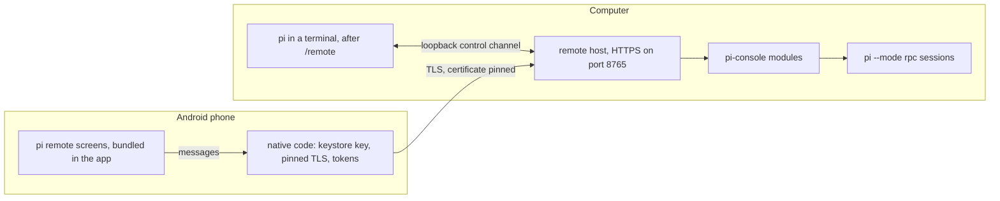
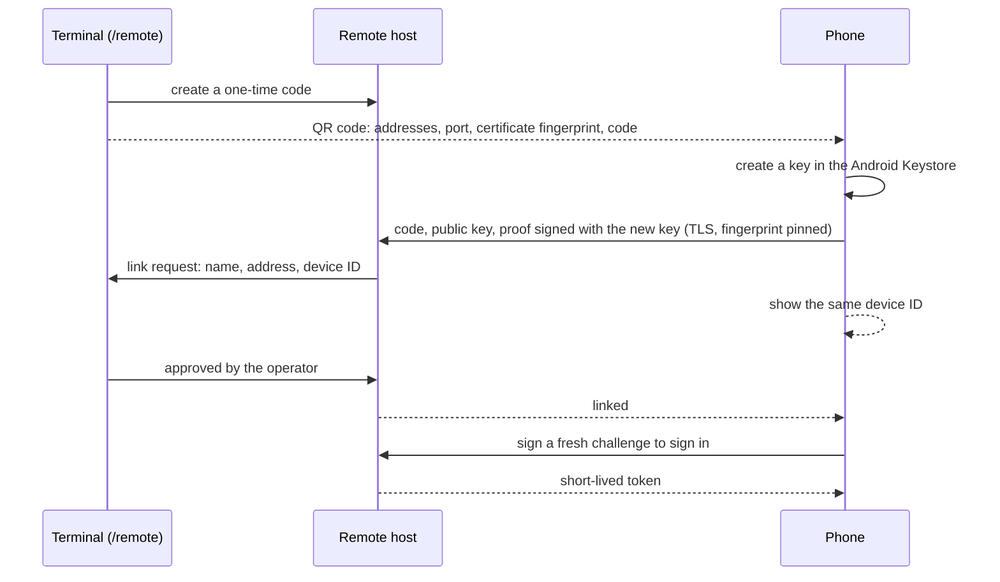

# Remote control

`/remote` lets you drive pi from an Android phone with **pi remote**, the app in `apps/android`.
The phone connects straight to your computer, over your home network or, when you are out, a VPN
such as Tailscale. There is no cloud service in between. From the phone you can:

- watch a pi session that is running in a terminal on the computer, prompt it, steer it, abort it,
  change its model or thinking level, and answer the dialogs it opens (a tool-firewall approval,
  for example);
- start new sessions in a folder of your choice, with a model, thinking level and agent, and end
  them;
- open the sessions pi has saved, read their stats and todos, and continue them.

A linked phone can make your agent run commands on your computer, so linking is protected the way
a credential is. This page states exactly how.

## How it fits together

- The **remote host** (`packages/web-ui/server/remote-host.ts`) is a Node process that `/remote`
  starts in the background and that every pi terminal on the computer shares. It serves
  pi-console's API (see [Web console](web-console.md)) over HTTPS to linked phones only, and adds
  linking, sign-in and terminal sharing. It keeps running after pi exits, until `/remote stop`.
- The **`remote-control` extension** adds `/remote`. It starts the host, shows the QR code that
  links a phone, asks you to approve the phone, and shares the terminal's session with the host
  over a loopback control channel.
- The **app** is a phone-sized pi-console. Its screens (`packages/web-ui/mobile`) are bundled in
  the APK and render chats with pi-console's own Markdown and chat code. Networking, keys and
  tokens live in the app's native code, never in the page.

## Linking a phone

1. Build and install the app: see `apps/android/README.md`.
2. In pi, in a terminal on the computer, run `/remote`. It starts the host and shares this session.
   While no phone is linked, it also shows a QR code, a one-time code, the addresses the host can
   be reached at and the fingerprint of its certificate. The QR code is about 25 rows tall and 50
   columns wide, so the panel is laid out for the terminal it is in: the QR code beside the details
   when the terminal is wide, above them when it is only tall, and otherwise the details alone,
   with the size the QR code needs. The details are enough to link a phone by hand. The panel
   follows the terminal as it is resized. `tests/remote-control-extension-smoke.ts` pins the
   three layouts and that no line is wider than the terminal.
3. In the app, tap **Link a computer** and scan the QR code. The camera app works too: the code is
   a `pirc://pair` link that opens pi remote. Without a camera, choose **Enter the details
   instead** and type an address, the port and the code; the app then shows the fingerprint of the
   certificate it was given, which must match the one in the terminal.
4. The phone shows a **device ID** such as `ABCD-EFGH-JKMN-PQRS`, and the terminal asks whether to
   link that phone, with its name, address and the device ID with its last group hidden
   (`ABCD-EFGH-JKMN-····`). **Approve** is still the first choice. Approving then asks you to type
   the last four characters of the device ID from the phone's screen; the host links the phone only
   if they match, and a wrong value rejects the request. A link request from an address outside
   loopback, the LAN ranges and Tailscale's range carries a warning to reject it unless you know
   why.

The computer is then listed in the app. Open it to see the shared terminal session (marked
*Terminal*), the sessions the host is running and the recent sessions on disk. `/remote pair` links
another phone, and `/remote` in another terminal shares that session too.

### Away from home

By default the host listens on every interface and advertises each LAN and VPN address it finds:
LAN addresses first, then Tailscale's (`100.64.0.0/10`). Container bridges are skipped. The app
keeps them all, tries the one that worked last first and the others a quarter of a second apart,
and uses whichever answers. With Tailscale on both the computer and the phone, the same link works
at home and away. `PI_REMOTE_BIND=tailscale` makes the host listen on its Tailscale address only,
and `PI_REMOTE_ADVERTISE` adds names, such as a MagicDNS name, to the list.

Recommended binds: `PI_REMOTE_BIND=tailscale` when the phone uses Tailscale, home and away;
`PI_REMOTE_BIND=loopback` with an SSH or VPN forward of your own; the default `all` only when the
phones are on a LAN you trust. While the host listens on every interface it writes a `WARNING:`
line saying so to `host.log`, and the host's status carries it, which `/remote status` and
`remote-cli.ts status` show (`tests/remote-host-smoke.ts` pins the log line and the status; no
test runs `remote-cli.ts`).

### A computer without a terminal session

On a headless computer, `node packages/web-ui/server/remote-cli.ts` manages the host, over SSH for
example: `start`, `status`, `pair` (shows the QR code and asks for the approval in that terminal),
`devices`, `revoke`, `rename` and `stop`. It must run as the same user as the host.

## Commands

| Command | Effect |
|---|---|
| `/remote` | Start the host if needed and share this session; show a QR code while no phone is linked |
| `/remote pair` | Link a phone |
| `/remote status` | Addresses, certificate fingerprint, linked phones, shared sessions and recent failures |
| `/remote devices` | List linked phones |
| `/remote revoke <id or name>` | Unlink a phone after confirmation; its access ends at once |
| `/remote rename <id or name> <new name>` | Rename a linked phone |
| `/remote detach` | Stop sharing this session; the host keeps running |
| `/remote stop` | Stop the host and the sessions it started; every phone is disconnected |
| `/remote reset` | Stop the host and replace its certificate and identity; every phone must be linked again |

A shared session stays shared across `/new`, `/resume`, `/fork` and `/reload` in that pi process.
With `PI_REMOTE_AUTO_ATTACH=1`, every terminal session that starts while a host is running is
shared.

`/remote` works only in an interactive terminal (`status` and `devices` work anywhere). In rpc,
json and print mode, which includes every session a phone starts, it refuses to link phones or
share sessions, so a phone cannot link another phone.

## Driving a terminal session from the phone

- A prompt sent while pi is idle starts a turn. While pi is working, the phone offers **After this
  run** (queued as a follow-up) and **Steer now**.
- A prompt that starts with `/` must name a command that an extension, prompt template or skill
  registered. Built-in terminal commands such as `/quit` are refused with a message, and so is
  `/remote`.
- Dialogs that extensions open in the terminal (select, confirm, input and editor) appear on the
  phone as well. Whichever side answers first wins, and the other copy closes.
- Notifications shown in the terminal reach the phone too.
- `/remote detach`, or quitting pi, ends the phone's view of the session.

## What protects it

| Threat | Control |
|---|---|
| Someone on the same network uses the host | Every `/api` route needs a bearer token. Tokens are issued only to a linked phone that signs a fresh, single-use challenge with its own key. |
| Linking a phone you do not hold | Linking needs the one-time code from the terminal (10 characters, about 50 bits, valid for 5 minutes; 5 wrong tries burn it; one offer at a time) **and** your approval at the terminal, where you type the last four characters of the device ID from the phone. The device ID is derived from the phone's public key, and the phone proves it holds the private key. |
| A leaked code claimed by two phones | A second correct claim of a code that is already claimed cancels the waiting request, is refused with `offer_contested`, is audited as `pair_second_claim` and is reported at the terminal; `/remote pair` makes a new code. |
| An agent or script approving a phone | The control secret admits any process of your account, so the host also checks who is deciding: it finds the process behind the control connection and accepts an approval only from one that has a controlling terminal, is in its foreground process group and reads its input from a terminal (an interactive `pi`, or `remote-cli.ts pair`). pi runs an agent's shell commands without a controlling terminal, and the sessions pi-console and the host start read a pipe, so their approvals are refused, audited as `pair_decide_refused` and reported at the terminal. Each `pair_approved` record names the deciding process and terminal. Rejecting works from any connection. |
| A device record written into `devices.json` | At start the host compares `devices.json` with `audit.jsonl`. A device with no `pair_approved` record is **suspended**: it is listed (marked SUSPENDED), cannot sign in, and is reported in `host.log`, `/remote status` and `/remote devices` as `device_unaudited` until you revoke it or pair it again. |
| Not knowing which phone answered | Each dialog a phone answers (a firewall card, a confirm, a choice) is audited as `phone_dialog_answer` with the device, the session, the card's risk tier and the choice (typed text by length only), and the terminal shows which phone answered. |
| A machine in the middle (café Wi-Fi, a hostile router) | The host speaks TLS with its own P-256 certificate. The QR code carries the certificate's SHA-256 fingerprint, and the app pins it on every connection, whichever address it uses. The pairing proof and every sign-in signature cover the fingerprint the phone saw and the host's identity, so a relayed connection is refused. A different certificate at a known address is reported, never used. |
| A stolen token | Tokens last an hour (`PI_REMOTE_TOKEN_TTL_MIN`) and are held in memory on both sides; the host keeps only their hashes. A host restart ends all of them, and the app signs in again by itself. |
| A lost or stolen phone | `/remote revoke` deletes the phone, its tokens and its open streams at once. The phone's private key is created in the Android Keystore (StrongBox when the phone has one) and cannot be exported. The app can ask for a fingerprint, face or screen lock when it opens and again after 30 seconds in the background, and can hide itself from screenshots and the recent-apps view. Its data is excluded from backups. |
| Guessing codes or keys | Unauthenticated routes take 60 requests a minute per address. 10 failed links or sign-ins within 10 minutes block the address for 15 minutes. Failures are written to `audit.jsonl` and shown by `/remote status`. |
| Other programs on the computer | The control channel listens on loopback only and needs a 256-bit secret from `control.json` (mode 0600). The secret never reaches a pi session the host starts. |
| Web content inside the app | The app loads only its bundled screens, from a private origin, under a Content-Security-Policy; any other request is refused. The page has no JavaScript interface: it exchanges messages with the native code, which accepts them only from that origin, and keys and tokens never reach it. Cleartext traffic is disabled. |
| Requests that pi-console would refuse | The host applies pi-console's own rules to the API it serves: the RPC allow-list, input validation, size limits and JSON-only state changes. |

## Files on the computer

The host keeps its state in `~/.pi/agent/remote-control/` (or `PI_REMOTE_STATE_DIR`), mode 0700.

| File | Holds |
|---|---|
| `identity.json` | Server id and name |
| `tls-key.pem`, `tls-cert.pem` | The certificate phones pin and its private key (0600) |
| `devices.json` | Linked phones: name, device ID, public key, when linked and last seen. No secrets |
| `control.json` | The control channel's port and secret, while the host runs (0600) |
| `audit.jsonl` | Links (with the address and the deciding process), sign-ins, failures, refused approvals, second claims, unaudited devices, phone answers and revocations |
| `host.log` | The host's log |

## Settings

| Variable | Default | Purpose |
|---|---|---|
| `PI_REMOTE_BIND` | `all` | Where the host listens: `all`, `loopback`, `tailscale` (the Tailscale address only) or an IP address |
| `PI_REMOTE_PORT` | `8765` | HTTPS port |
| `PI_REMOTE_NAME` | the host name | Name the app shows |
| `PI_REMOTE_ADVERTISE` | unset | Extra addresses or host names for the QR code, comma-separated; listed first |
| `PI_REMOTE_TOKEN_TTL_MIN` | `60` | Token lifetime in minutes, 5 to 1440 |
| `PI_REMOTE_STATE_DIR` | `~/.pi/agent/remote-control` | State directory |
| `PI_REMOTE_AUTO_ATTACH` | unset | `1` shares each terminal session that starts while a host is running |
| `PI_KIT_WEBUI_ROOT` | found as for `/console` | Path to `packages/web-ui`, where the host ships |

## Limits and residual risks

- **No notifications in the background.** The app receives events only while it is open. It
  closes a session's stream 30 seconds after going to the background and reconnects on return.
- **The host listens on every interface by default.** Anyone who can reach the port can try to
  link or sign in, within the limits above. Narrow it with `PI_REMOTE_BIND` or a firewall; the
  host warns while it is bound to every interface.
- **The terminal check is about how a request arrives, not a wall between your processes.** A
  process of your account that reads `control.json` and runs itself in the foreground of a
  pseudo-terminal it creates can pass it. The host cannot tell whether a person is at that
  terminal; the typed confirmation needs the phone's screen, which such a process does not see
  unless it also controls the phone. The firewall treats reading `control.json` or `tls-key.pem`, or the state
  directory recursively, as a credential read and writing any file there as high
  (`tests/firewall-autoload-smoke.ts`), but a process that does not go through a tool call is not
  seen by it. The check reads `/proc` on Linux and uses `lsof` and `ps` on macOS, where it is
  untested; elsewhere every approval is refused.
- **Suspension catches a device added without a pairing record, not a forged record.** Whoever can
  write the state directory can write both files; the check stops a planted device that skipped
  pairing, which is what an agent writing `devices.json` would do.
- **Typed-in details are trust on first use.** Only the QR code (or link) carries the fingerprint.
  When you type the details, compare the fingerprint the app shows with the terminal's.
- **The phone drives your agent with your permissions.** Sessions it starts run as you, with your
  installed profile, so the tool firewall and its approvals apply as they do at the terminal.
  Anyone holding your unlocked, linked phone can do what you can do in a terminal; turn on the app
  lock.
- **pi remote has been run on an Android 14 emulator only**, not on a physical phone, and QR
  decoding through a real camera has not been exercised (a `pirc://pair` link, which takes the same
  path after decoding, has). The current build, which targets Android 17, has only been launched
  on an Android 17 test image without system bars or a keyboard. It needs Android 10 or newer.
- **No iOS app.** The host has been run on Linux only; macOS is untested and Windows is not
  supported.
- The app is installed from an APK you build and sign. Updates must be signed with the same key
  (see `apps/android/README.md`).

### The Yes-first decision (SEC-5)

**Decision.** The pairing prompt lists *Approve* first, as the firewall's approval card lists
*Allow once* first. This is an operator decision: the prompts stay quick to answer for the person
who started the link. A timeout counts as a rejection.

**Risk.** An operator who presses Enter without reading approves. On the pairing prompt that could
link a phone someone else claimed with a code they saw; on a mirrored approval card it allows a
tool call.

**Compensating controls**, each pinned by the tests below:

- approving a phone needs the last four characters of its device ID, typed from the phone's screen
  (the prompt hides them), and a wrong value rejects;
- a second claim of a claimed code cancels the request and is refused (`offer_contested`);
- a request from outside loopback, LAN and Tailscale ranges carries a warning;
- only a person at an interactive terminal can approve (`pair_decide_refused` otherwise), and every
  `pair_approved` record names the deciding process and the request's address;
- a device in `devices.json` with no `pair_approved` record is suspended at start;
- each dialog a phone answers is audited as `phone_dialog_answer` with device, session, tier and
  choice, and the terminal shows which phone answered.

**Not compensated:** critical-tier approval cards still start on *Allow once*, and the Android app
lock is off until you turn it on ([Future work](future-work.md#remote-control)).

## Tests that pin this

`tests/remote-host-smoke.ts` (`npm run smoke:remote-host`) runs the real host with a stub pi and a
protocol client that does what the app does. It checks that the state is owner-only and the
served certificate is the pinned one; that every `/api` route needs a token; that wrong codes burn
an offer and a proof made over another certificate burns the code; that a correct code waits for
the operator and a rejection links nothing; that challenges are single use and bound to the
certificate; that event streams are slimmed; that a pi child's dialog can be answered from the
phone; that the control secret never reaches a pi child; that a terminal session can be watched
and driven; that revoking a phone, or the phone unlinking itself, ends its token and streams at
once; that repeated failures block the address; that a wrong device-ID confirmation rejects; that
a second claim cancels the first and is refused; that an approval from a process with no
controlling terminal is refused for real, and every approval names the deciding terminal process;
that each phone answer is audited with its device and tier; and that a planted device is
suspended and the all-interfaces bind warns.

`tests/remote-pairing-controls-smoke.ts` (`npm run smoke:remote-pairing-controls`) pins the
`/proc` parsing, the terminal judgement, the address scopes, the confirmation, the contest, the
suspension and the phone-answer record as units. The smokes treat only the test process as an
interactive terminal, through `tests/remote-terminal-preload.ts`, which the smokes load into the
host process to set a hook there; the host's own code never reads the preload's variable.

`tests/remote-control-extension-smoke.ts` (`npm run smoke:remote-control`) loads the extension
against the real host. It checks that nothing opens until `/remote`; that a phone is linked only
after the terminal approves it and types the last four characters of its device ID, which the
prompt hides, with Approve still first; that a phone's answer to a dialog is attributed at the
terminal and audited; that history and live events reach the phone; that
prompts, steering, abort, model and thinking changes work from the phone and `/remote` does not;
that an answer on either side closes the other copy of a dialog; and that rpc mode cannot link
phones or share sessions.

Both run in `npm run test:security` and `npm run check:all`. Nothing in this repository tests the
Android app automatically; it was exercised by hand on an emulator against a real host.
