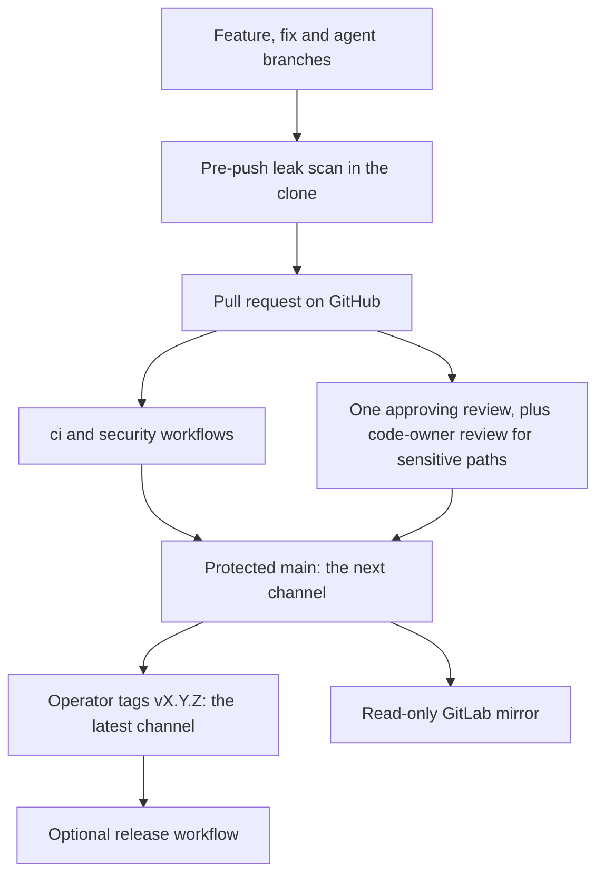

# Development and public releases

The public GitHub repository, `github.com/SATUNIX/pi-system`, is the authoritative source.
Development happens there: every change, from a person or an agent, is a branch and a pull
request against `main`, and releases are tags on that repository. GitLab holds a read-only
mirror kept as a backup. Nothing is developed or merged there, and nothing flows from it back to
GitHub.



| What | Where |
|---|---|
| Code, issues, pull requests, releases | GitHub `SATUNIX/pi-system` |
| `next` channel | every commit on `main` |
| `latest` and pinned channels | the `vX.Y.Z` tags ([Releasing](releasing.md)) |
| Backup | a read-only GitLab mirror of the GitHub repository |
| Private planning notes, review evidence and engagement examples | a separate private repository, never this one |

## Every pushed branch is public

There is no private staging copy: a branch is published the moment it is pushed. Install the
pre-push leak scan in every clone you push from:

```sh
node packages/core/prepush-scan.ts install
```

That writes `.git/hooks/pre-push` (it refuses to replace a different hook that is already there,
or to write through a dangling symlink at that path).
Before each push the hook scans the commits that are not yet on the remote: every added line of
each commit's diff, the commit message and the author and committer identities. It refuses the
push when it finds a private host name (`*.internal`, `*.lan`, `*.local`, `*.home.arpa`,
`*.ts.net`), a home-directory path (Linux, macOS, or Windows in any letter case), a private IPv4
or unique-local IPv6 address, a PEM or SSH2 private-key header or a GitHub or AWS access-key
shape, or a private review or roadmap item ID (`SR` and a number, or an upper-case `R`, `P`, `M`
or `D`, a hyphen and one or two digits as a whole word; a public file describes the item
instead), and when a
commit adds or changes a file under `internal/`, `reviews/` or `examples/engagement/`. It scans
history, not only the final tree, so a value added and removed again within one push is still
refused. Findings name the commit, file and line, never the value. `tests/prepush-scan-smoke.ts`
pins each of these through real pushes to a temporary bare repository.

A synthetic fixture that has to contain such a value is admitted by an exception in
`packages/core/leak-scan-exceptions.json`: it pins the SHA-256 of the exact match and of the
whole line in one file, so any edit to the line is refused again. The hook says so when a push
changes that file, and `.github/CODEOWNERS` gives it to the owner for review. To scan by hand:
`node packages/core/prepush-scan.ts range origin/main..HEAD`.

The hook is a guard against mistakes, not a boundary: `git push --no-verify` skips it. The
`leak-scan` pull-request job in `security.yml` runs the same scan over the pull request's commits
with the same rules, exceptions read from the base branch: a match admitted only by an exception
the pull request itself adds fails, and so does a change to the exceptions file mixed with other
files. A new exception therefore lands in its own pull request first, and the content it admits
follows once it is on `main` (`tests/prepush-scan-smoke.ts`). The other public gates are gitleaks
over the full history in `security.yml` and GitHub secret scanning with push protection
([CI security](ci-security.md)). If something private is pushed, delete the branch at
once and treat the value as disclosed: rotate a secret, and do not rely on history rewriting.

## Agents

Agents work like any other contributor: they push branches and open pull requests. They use a
non-admin bot identity with contents and pull-request write access only, `main` requires one
approving review, and only the operator creates release tags, so an agent cannot merge its own
pull request or cut a release. These are repository settings: `.github/expected-settings.json`
declares them, GitHub enforces them, and a maintainer drift check compares the two with read-only
requests ([CI security](ci-security.md#repository-settings)). No test in the repository can see the
live settings.

## Contributions

Open a pull request on GitHub; see `CONTRIBUTING.md` in the repository root. Do not push changes
to the GitLab mirror: it follows GitHub and nothing is read back from it.

## How a release reaches this repository

Development of the kit also happens in a private lineage, which holds material that is never
published (planning notes, review evidence, engagement examples). Public content leaves it only
as an export:

1. The export is an exact-file allowlist: every tracked file is listed as public or private, and
   an unlisted file stops the export. It is read from the tagged commit's Git objects, not from a
   working tree, and refuses symbolic links and submodules.
2. The exported bytes are scanned for secrets and private identifiers, and the public checks and
   the strict docs build run inside the export before anything is published.
3. A protected, manual publication job re-derives the export from the tag, refuses unless it
   matches what was checked, and pushes it to a `release/<tag>` branch here with a short-lived,
   repository-scoped GitHub App token, opening a **draft** pull request whose body records the
   export's tree hash and digest. When the release changes the scan exceptions, it first opens an
   exceptions-only `release/<tag>-exceptions` pull request and stacks the release on it, so the
   `leak-scan` check passes on the release only after the exceptions have merged
   ([Releasing](releasing.md#releases-that-change-scan-exceptions)). It never overwrites a
   differing branch, merges, tags or changes settings.
4. That pull request is reviewed and merged here like any other; the operator then tags the merge.

The tooling and tests for steps 1 to 3 live with the private lineage and are not part of this
tree. Within this repository, the same leak scan (`packages/core/prepush-scan.ts`), gitleaks and
`check:all` run on the pull request.

## History

The public history is this repository's own. Earlier development happened in a private GitLab
project; its public changes arrived here as reviewed release commits, and its private history,
branches and agent identities were never published.
