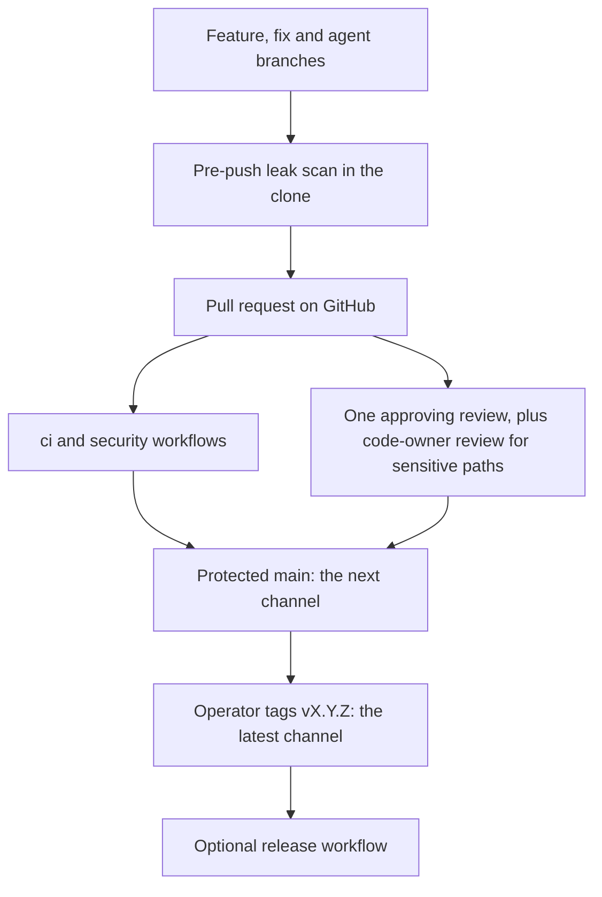

# Development and public releases

GitHub `github.com/SATUNIX/luna` is the only repository. Development happens here: every change,
from a person or an agent, is a branch and a pull request against `main`. Releases are prepared
here with a release branch and pull request, then tagged by the operator using the existing
`release.ts` flow ([Releasing](releasing.md); `tests/release-plan-smoke.ts`). The GitLab mirror
and private-lineage export pipeline are archived and no longer feed this repository.



| What | Where |
|---|---|
| Code, issues, pull requests, releases | GitHub `SATUNIX/luna` |
| `next` channel | every commit on `main` |
| `latest` and pinned channels | the `vX.Y.Z` tags ([Releasing](releasing.md)) |
| Private planning notes, review evidence and engagement examples | outside this public repository |

## Every pushed branch is public

There is no private staging copy: a branch is published the moment it is pushed. Install the
pre-push leak scan in every clone you push from:

```sh
node packages/core/prepush-scan.ts install
```

That writes `.git/hooks/pre-push` (it refuses to replace a different hook that is already there,
or to write through a dangling symlink at that path).
Before each push the hook scans the commits that are not yet on the remote: every added line of
each commit's diff, the commit message and the author and committer identities. It refuses the
push when it finds a private host name (`*.internal`, `*.lan`, `*.local`, `*.home.arpa`,
`*.ts.net`), a home-directory path (Linux, macOS, or Windows in any letter case), a private IPv4
or unique-local IPv6 address, a PEM or SSH2 private-key header or a GitHub or AWS access-key
shape, or a private review or roadmap item ID (`SR` and a number, or an upper-case `R`, `P`, `M`
or `D`, a hyphen and one or two digits as a whole word; a public file describes the item
instead), and when a
commit adds or changes a file under `internal/`, `reviews/` or `examples/engagement/`. It scans
history, not only the final tree, so a value added and removed again within one push is still
refused. Findings name the commit, file and line, never the value. `tests/prepush-scan-smoke.ts`
pins each of these through real pushes to a temporary bare repository.

A synthetic fixture that has to contain such a value is admitted by an exception in
`packages/core/leak-scan-exceptions.json`: it pins the SHA-256 of the exact match and of the
whole line in one file, so any edit to the line is refused again. The hook says so when a push
changes that file, and `.github/CODEOWNERS` gives it to the owner for review. To scan by hand:
`node packages/core/prepush-scan.ts range origin/main..HEAD`.

The hook is a guard against mistakes, not a boundary: `git push --no-verify` skips it. The
`leak-scan` pull-request job in `security.yml` runs the same scan over the pull request's commits
with the same rules, exceptions read from the base branch: a match admitted only by an exception
the pull request itself adds fails, and so does a change to the exceptions file mixed with other
files. A new exception therefore lands in its own pull request first, and the content it admits
follows once it is on `main` (`tests/prepush-scan-smoke.ts`). The other public gates are gitleaks
over the full history in `security.yml` and GitHub secret scanning with push protection
([CI security](ci-security.md)). If something private is pushed, delete the branch at
once and treat the value as disclosed: rotate a secret, and do not rely on history rewriting.

## Agents

Agents work like any other contributor: they push branches and open pull requests. They use a
non-admin bot identity with contents and pull-request write access only, `main` requires one
approving review, and only the operator creates release tags, so an agent cannot merge its own
pull request or cut a release. These are repository settings: `.github/expected-settings.json`
declares them, GitHub enforces them, and a maintainer drift check compares the two with read-only
requests ([CI security](ci-security.md#repository-settings)). No test in the repository can see the
live settings.

## Contributions

Open a pull request on GitHub; see `CONTRIBUTING.md` in the repository root. The archived GitLab
projects and export pipeline take no contributions and publish no releases here.

## History

Earlier development happened in a private GitLab project, now archived. Its public changes
arrived here as reviewed release commits; its private history, branches and agent identities
were never published. The former GitLab mirror and private-lineage export pipeline are also
archived.
