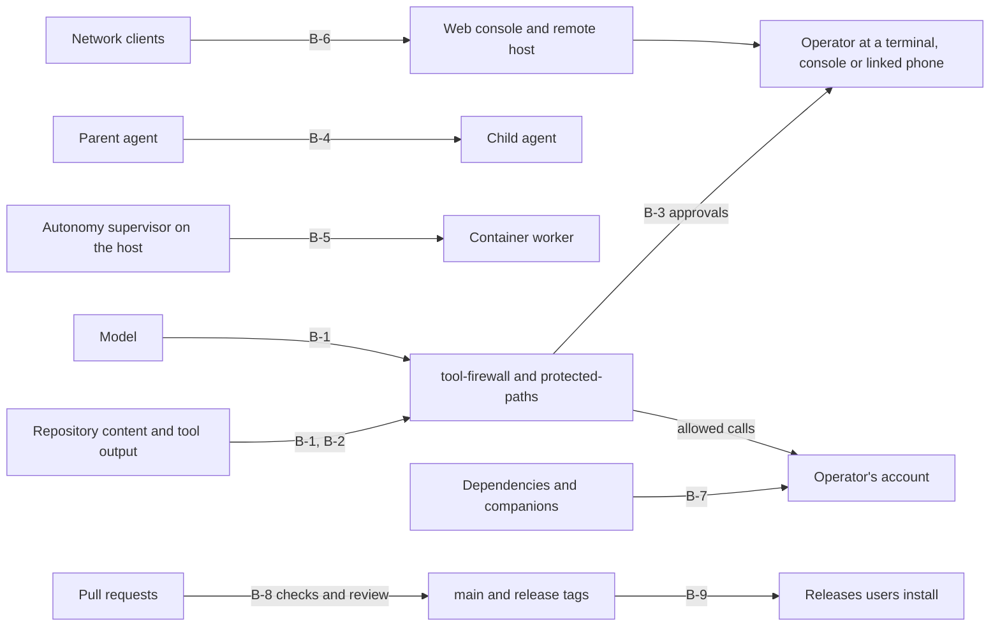

# Threat model

This page says what pi-system protects, from whom, where the trust boundaries are and which
control holds each one. The controls are catalogued, with their code, tests and CI jobs, in
[Security controls](security-controls.md); the IDs below (`C-01` and so on) refer to that page.
What each layer guarantees, and what it does not, is in the [Security model](security.md).

The kit is a **guard rail, not a sandbox**. It decides whether an agent's tool call runs; once a
call runs, it has the operating-system rights of the user who started pi. Containment is the job
of a container or operating-system boundary, such as the one [autonomous runs](autonomy.md) use.

## Assets

| Asset | Why it matters |
|---|---|
| The operator's files and processes | An allowed tool call can read, change or delete anything the user can |
| Credentials | pi's `auth.json` and `models.json`, provider keys in the environment, the web console token, the remote host's control secret, TLS key and device list, the human console's response key |
| The safety configuration | The firewall policy, remembered approvals, the unattended-run contract, and everything pi loads without a trust prompt (agent-directory extensions, skills, prompts, settings and packages) |
| `main` and the release tags | Every commit on `main` is the `next` channel and every `vX.Y.Z` tag a release that `/update` installs |
| The release credentials | The GitHub App key and bot tokens that open release pull requests, and the operator's account |
| Autonomous run results | The integration branch a run merges into, and the promotion target |
| Model-provider spend | Inference is paid for; a run has a budget |

## Attackers

Each row names the boundary the attacker starts outside and the controls that hold it. A row
whose residual risk is "accepted" is a [non-goal](#non-goals).

| ID | Attacker | What they control | Boundary | Controls | Residual risk |
|---|---|---|---|---|---|
| A-1 | A hostile repository | Files the agent opens, committed symbolic links, `.pi/` content, project skills and agents, regular expressions in skill triggers and workflow gates | B-1, B-2 | C-01, C-02, C-04, C-06, C-15, C-18, C-61 | A wrapper script the agent runs is judged by name; project skills still reach the model as text |
| A-2 | Prompt-injected tool output | Text the model reads from web pages, files, MCP servers or tool results | B-1, B-3 | C-01, C-03, C-04, C-05, C-07, C-08, C-13 | Low-tier actions run unasked; an operator who approves a card without reading it approves the action |
| A-3 | A malicious dependency, companion or MCP package | Code that runs inside pi or during install | B-7 | C-38, C-39, C-40, C-41, C-42, C-43, C-44 | In-process extension code is not isolated and can do I/O directly; a companion's own dependency tree is resolved at install time |
| A-4 | Another local user | Shared temporary directories, world-readable files | B-2 | C-15, C-22, C-23, C-25 | On Windows the no-follow and owner checks do not run |
| A-5 | A process of the same account, including the agent's own shell | Everything the user's rights reach, `control.json`, the human-console request files, pseudo-terminals | B-3 | C-04, C-09, C-10, C-28, C-29 | A same-account process that does not go through a tool call is outside the firewall; a pseudo-terminal it creates passes the pairing terminal check, though the typed device-ID suffix is still needed |
| A-6 | A network client: someone on the LAN, a linked phone, a web-console browser tab | Requests to the remote host and the web console, a pairing code seen over a shoulder, an unlocked linked phone | B-6 | C-25, C-26, C-27, C-28, C-30 | The remote host listens on every interface by default (it warns); approval prompts are Yes-first by decision ([SEC-5](remote-control.md#the-yes-first-decision-sec-5)); the Android app lock is off by default |
| A-7 | An autonomy worker | Code and files inside its container, its own clone of the repository, what it writes into the cycle report and diff | B-5 | C-09, C-31, C-32, C-33, C-34, C-35, C-36 | An allowlisted egress host is an opaque channel; when the checks come from the worker's tree the merge review is the only independent control |
| A-8 | A compromised CI runner or workflow | A job's environment and its artefacts | B-8, B-9 | C-47, C-48, C-49, C-50, C-51, C-53, C-54, C-57 | Required checks run from the pull request's own workflow files; code review is what stops a pull request that weakens a gate |
| A-9 | A holder of a bot token, the App key or write access | Branches, pull requests, release branches | B-8, B-9 | C-50, C-53, C-54, C-55, C-56, C-57, C-58 | Review enforcement, required checks and tag protection are repository settings that `.github/expected-settings.json` declares and an administrator applies; no test can see the live settings |

## Trust boundaries

| ID | Boundary | What crosses it | Controls | Not covered |
|---|---|---|---|---|
| B-1 | Model to tool execution | Every tool call | C-01 to C-08, C-13, C-14 | Static classification sees command text, not what a script does when it runs |
| B-2 | Workspace content to kit state | Files the kit writes under the workspace, patterns the kit compiles, the install marker a repository commits | C-06, C-15, C-18, C-34, C-61 | A local process racing the checks between `lstat` and `open` |
| B-3 | Agent session to operator authority | Approval answers, human-console answers, phone pairing decisions, unattended mode | C-04, C-08, C-09, C-10, C-28 | The person answering decides; a card is only as careful as its reader |
| B-4 | Parent agent to child agent | Delegated tasks | C-11, C-12 | Effort budgets are accounting, not a boundary |
| B-5 | Host to autonomy container | The run contract, mounts, network, the merge decision | C-31 to C-34 | The firewall's unattended mode trusts the supervisor's claim that the container exists |
| B-6 | Network to the consoles | HTTP requests, pairing claims, phone answers | C-25 to C-30 | A linked phone in someone else's hand acts as you |
| B-7 | Third-party code to the kit | npm packages, companions, images, actions | C-38 to C-46, C-54 | Native and WebAssembly components of companions are opaque |
| B-8 | Pull request to `main` | Code, tests, workflows, scanner configuration | C-47 to C-56 | Review enforcement is a repository setting |
| B-9 | `main` to a release | Tags, release notes, the npm package when enabled | C-45, C-57, C-58 | Tags are not signed; a tag is the release even if a later workflow fails |

## Non-goals

- **Not a sandbox.** An allowed tool call runs with the user's full rights. Use a container for
  untrusted work; recommended for an untrusted repository is also the strict
  [security level](security-level.md).
- **Not proof against the user's own account.** A process running as the operator, outside a tool
  call, can edit the approvals file, the effort ledger, the firewall audit log and the kit's
  sources. The firewall protects these from the agent's tools, not from the account.
- **Not proof against root, or code inside the pi process.** In-process extension code and anyone
  who can mount filesystems or run as root can present an unattended contract, read memory or
  change the kit.
- **Not a data-loss-prevention system.** Secret detection and redaction are heuristic; a novel
  secret shape, a split secret or an encoded one passes.
- **Not a network policy.** The firewall rates network sends but does not enforce destinations;
  the pentest governance layer and the container network do that.
- **Not a judge of intent.** An operator who approves an action has authorised it.

## Related pages

- [Security model](security.md): the layers, their guarantees and their limits.
- [Secure development standard](security-standard.md): the rules every change follows.
- [Incident response](incident-response.md) and [Vulnerability management](vulnerability-management.md).
- The design proposal that preceded this page, with its own threat discussion:
  [Agentic security, alignment and autonomy](proposals/agentic-security-and-alignment.md).
