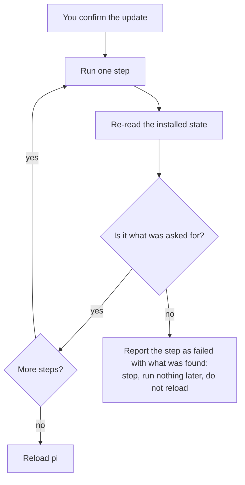

# Updates

A pi setup has three parts that update separately:

| Part | What it is | Where it comes from |
|---|---|---|
| **pi** | The agent binary, TUI and session model | `@earendil-works/pi-coding-agent` on npm |
| **Luna** | The package: extensions, skills, prompts, profiles, themes | Its public git repository, `github.com/SATUNIX/luna`, on a channel |
| **Linked packages** | Other pi packages in your settings, including Luna's companions (`pi-lens`, `pi-readseek`, ...) | npm |

A **profile** is not a part: it is a setting that chooses what loads from Luna (see
[Profiles](profiles.md)). Updates keep your profile and your hand edits.

## `/update`

The `kit-update` extension, loaded in every profile, checks all three parts.

- **In the background**: at most once a day at session start. It never delays startup and never
  prompts for git credentials. When something can be updated you get one notice, and the status
  bar shows `updates: /update`.
- **On demand**: `/update` checks now and lists what can be updated.

When the kit is installed from git and its `main` branch has moved ahead of your checked-out
commit, the check adds one line: `trunk is N commits ahead — /update channel next`. It appears at
start-up (subject to the once-a-day background throttle), on `/update`, and under `/update status`.
`next` is the channel that follows `main`, so the suggested command actually moves your copy to
the newer commits; naming the installed release channel (`latest`, or an exact version) would not.
The line shows even when the release channel you follow is otherwise current, and it is silent
when your copy is in sync or ahead and when the remote could not be reached (offline, or no git
credentials). When the trunk gap exists, this trunk line is the whole start-up kit notice: the
generic `Updates available: ...` summary is not stacked on it. pi's own built-in update notice is
separate and may still appear.

| Command | What it does |
|---|---|
| `/update` | Check now, then pick: everything, Luna, pi, linked packages, or a channel switch |
| `/update status` | Installed and available versions for every part |
| `/update all` | Update Luna and linked packages, re-apply your profile, reload; then update pi, up to the tested version (below) |
| `/update kit`, `/update pi`, `/update packages` | Update one part |
| `/update channel latest` / `next` / `trunk` / `X.Y.Z` | Follow the other channel, or pin a release |

Every update asks for confirmation first. A new pi version needs a restart of pi; everything
else reloads in place.

### pi stays within the tested version

`/update` moves pi only up to the version the installed Luna release is tested with. That is
the pi version its `package.json` pins for the test suite ([Support](support.md) lists the tested
and supported versions).

- A newer pi still shows in `/update status`, together with the tested version.
- `/update pi` and `/update all` leave pi where it is and say why. They cannot stop part-way,
  because `pi update --self` always installs the newest pi.
- To go past the tested version, update Luna first (a newer release may be tested with the
  newer pi), or run `pi update --self` yourself.
- If pi is already newer than the tested version, `/update status` says so.
- A Luna release whose `package.json` has no exact pin keeps offering the newest pi.

`tests/kit-update-smoke.ts` pins each of these cases.

### Updates are verified

An update is only reported as done when the result is what was asked for. After each step
`/update` re-reads the installed state and checks it: Luna is registered at the expected
release or commit, a linked package is at the version it was moved to, pi reports the new version,
and the profile has been re-applied. A step that ran but left the old state behind is reported as
**failed**, with what it found, and the run stops there: nothing later runs and pi is not
reloaded. Without a terminal UI (for example under `pi -p`) the progress and the failure go to
standard error, prefixed `[update]`, so a script sees them.



If the repository cannot be reached, the message says so and names the checks to make; it never
reports "up to date" for a lookup that did not happen.

After Luna updates, your recorded profile is re-applied, so extensions a new release adds to
your profile load, and companions move to Luna's newly reviewed pins.

Verification stops a failed update; it does not undo successful earlier package installs or
restore an updated checkout. When the run stops after Luna was replaced and before the profile
was re-applied, the message says the new Luna is running with the previous profile's settings,
names the version (and commit) Luna was at with the command that goes back to it where one
exists (`/update channel <version>`, or `git -C <checkout> reset --keep <commit>` for a local
checkout), and prints the exact installer command that re-applies the profile
(`tests/kit-update-smoke.ts`). Save a copy of your agent directory before changing releases, keep
the previous tag, and reinstall that tag and re-apply your profile if recovery is needed.
`smoke:kit-update` checks the stop-on-failure behaviour; whole-update crash recovery is not
covered. Avoid simultaneous updates or profile switches from multiple sessions.

Uninstall uses the installation marker to identify managed companion packages. If any removal
fails, it returns a nonzero exit status and keeps the marker so the same command can be retried
after fixing the error. The marker is removed only after all removals succeed; `--dry-run`
changes nothing. `smoke:install-marker` checks partial failure, marker preservation and retry.

## Channels

| Channel | Registered in pi as | Gets |
|---|---|---|
| `latest` | `git:github.com/SATUNIX/luna@v<newest release>` | The newest release tag. Betas count until the first stable release; after that, only stable releases |
| `next` | `git:github.com/SATUNIX/luna` (no tag) | Every commit on `main` |
| `trunk` | `git:github.com/SATUNIX/luna@integration/luna` | The head of the kit's integration branch (`git.trunkBranch` in `packages/core/distribution.json`). A canary, opt-in: use it to dogfood a merged cycle before it reaches `main`. Never selected by default |
| pinned | `git:github.com/SATUNIX/luna@v<version>` | Exactly that release, never moved automatically |

`latest` and a pin look the same in pi's settings (a tag). The installer records which one you
chose in `~/.pi/agent/.pi-kit.json`, and `/update` follows that record.

Switch with `/update channel <name>`. The switch keeps your profile and is verified like any
other step. Moving from `next` back to `latest` can install an older commit than you have now;
that is expected. `latest` needs at least one release tag on the repository: before the first
release is tagged, `/update channel latest` fails with a message saying so.

## Settings

| Variable | Effect |
|---|---|
| `PI_KIT_UPDATE_CHECK=0` | No background check (`/update` still works) |
| `PI_KIT_UPDATE_CHECK_HOURS` | Hours between background checks (default 24) |
| `PI_SYSTEM_GIT_SOURCE` | Git source of the kit, for example `git:git@github.com:SATUNIX/luna` to use SSH. A value that still names a retired private source is ignored and reported |
| `PI_KIT_DELIVERY` | `git` or `npm`: override the kit's delivery on this machine |
| `PI_KIT_NPM_REGISTRY` | Registry to query for pi and linked packages (default `https://registry.npmjs.org`) |
| `PI_OFFLINE` | pi's offline mode: no background check |

## Without the extension

The same updates from a shell:

```sh
pi update --self                                                    # pi
pi install git:github.com/SATUNIX/luna@v<version>             # Luna, to a new release (latest or a pin)
pi update git:github.com/SATUNIX/luna                         # Luna, on next
pi update --extensions                                              # every unpinned package
node ~/.pi/agent/git/github.com/SATUNIX/luna/packages/core/install.mjs --profile balanced --yes --settings-only
                                                                    # re-apply a profile (and companion pins)
```

To find the newest release tag: `git ls-remote --tags https://github.com/SATUNIX/luna.git`.

## Checkouts

A **checkout** registered in place for development: `/update kit` runs `git pull --ff-only`,
re-applies the profile and reloads. Uncommitted work blocks nothing: a fast-forward either
applies cleanly or fails without changing anything. It is reported as behind only when its
upstream branch has commits the checkout does not contain.

`/update channel latest` (or `next`) from a checkout registers the released Luna instead of the
checkout. The installer keeps exactly one registered copy of Luna: any other copy (another
checkout, the npm package) would load every extension twice.

## Delivery

Where releases come from is set in `packages/core/distribution.json` (`"delivery": "git"`). npm
delivery (`@satunix/pi-system` dist-tags) is built but the package is not published; see
[Releasing](releasing.md#npm-publication-optional). When a Luna release changes the delivery,
`/update kit` moves each install over, keeping its channel and profile.

`git.previousSources` lists former public delivery sources. Registrations from those
repositories are recognised as Luna, ignoring transport and ref. When one differs from the
current `git.source`, `/update kit` offers to move it using the installer, keeping its channel,
profile and project scope. An exact version remains an exact version. This list is separate from
`git.legacySources`, whose retired private sources must never be contacted. Malformed
`previousSources` metadata is refused. The shipped list retains the former public repository location
(`tests/kit-update-smoke.ts`, `tests/distribution-smoke.ts` and
`tests/distribution-contract-smoke.ts`).

Luna also recognises itself under the package name `@satunix/luna` and the repository
`github.com/SATUNIX/luna` (any ref, any URL form), as well as every `pi-system` form. A repository
named `luna` under another owner or host is not Luna, so a fork of it is recognised only
through an explicit `previousSources` entry. The unrelated npm package `luna` is never touched by
duplicate-registration cleanup (`tests/install-profile-filter-smoke.ts`,
`tests/profile-command-smoke.ts`).

## Coming from the private GitLab source

An install registered from the earlier private GitLab source runs that checkout's old code, which
cannot move itself. Install the public Luna package and run its installer ([Migration](migration.md), Route 1);
from then on `/update` follows the public repository. Where a retired registration or a local
checkout with a retired `origin` is seen by this release's `/update`, it reports it and never
contacts that host (`/update kit` moves a registration; a checkout is left for you to re-point).
