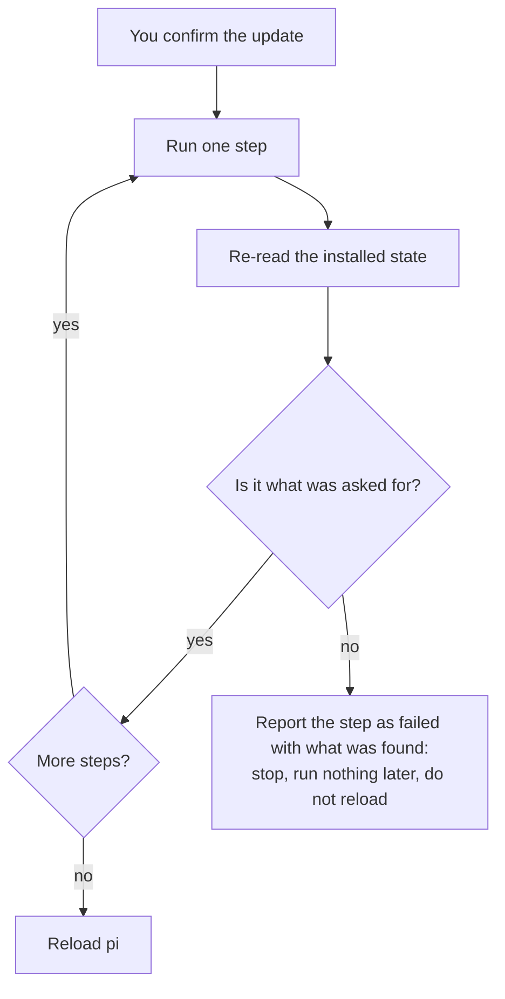

# Updates

A pi setup has three parts that update separately:

| Part | What it is | Where it comes from |
|---|---|---|
| **pi** | The agent binary, TUI and session model | `@earendil-works/pi-coding-agent` on npm |
| **Luna** | The package: extensions, skills, prompts, profiles, themes | Its public git repository, `github.com/SATUNIX/luna`, on a channel |
| **Linked packages** | Other pi packages in your settings, including Luna's companions (`pi-lens`, `pi-readseek`, ...) | npm |

A **profile** is not a part: it is a setting that chooses what loads from Luna (see
[Profiles](profiles.md)). Updates keep your profile and your hand edits.

## `/update`

The `kit-update` extension, loaded in every profile, checks all three parts.

- **In the background**: at most once a day at session start. It never delays startup and never
  prompts for git credentials. When something can be updated you get one notice, and the status
  bar shows `updates: /update`.
- **On demand**: `/update` checks now and lists what can be updated.

When the kit is installed from git and its `main` branch has moved ahead of your checked-out
commit, the check adds one line: `main is N commits ahead — /update channel next`. It appears at
start-up (subject to the once-a-day background throttle), on `/update`, and under `/update status`.
`next` is the channel that follows `main`, so the suggested command actually moves your copy to
the newer commits; naming the installed release channel (`latest`, or an exact version) would not.
The line shows even when the release channel you follow is otherwise current, and it is silent
when your copy is in sync or ahead and when the remote could not be reached (offline, or no git
credentials). When this gap exists, this line is the whole start-up kit notice: the
generic `Updates available: ...` summary is not stacked on it. pi's own built-in update notice is
separate and may still appear.

| Command | What it does |
|---|---|
| `/update` | Check now, then pick: everything, Luna, pi, linked packages, or a channel switch |
| `/update status` | Installed and available versions for every part |
| `/update all` | Update Luna and linked packages, re-apply your profile, reload; then update pi, up to the tested version (below) |
| `/update kit`, `/update pi`, `/update packages` | Update one part |
| `/update kit latest` / `next` / `trunk` | Move a local checkout that cannot be pulled to that ref of its origin ([Checkouts](#checkouts)) |
| `/update undo` | Return Luna and its configuration files to how they were before the last update |
| `/update channel latest` / `next` / `trunk` / `X.Y.Z` | Follow the other channel, or pin a release |

Every update asks for confirmation first. A new pi version needs a restart of pi; everything
else reloads in place.

### pi stays within the tested version

`/update` moves pi only up to the version the installed Luna release is tested with. That is
the pi version its `package.json` pins for the test suite ([Support](support.md) lists the tested
and supported versions).

- A newer pi still shows in `/update status`, together with the tested version.
- `/update pi` and `/update all` leave pi where it is and say why. They cannot stop part-way,
  because `pi update --self` always installs the newest pi.
- To go past the tested version, update Luna first (a newer release may be tested with the
  newer pi), or run `pi update --self` yourself.
- If pi is already newer than the tested version, `/update status` says so.
- A Luna release whose `package.json` has no exact pin keeps offering the newest pi.

`tests/kit-update-smoke.ts` pins each of these cases.

### Updates are verified

An update is only reported as done when the result is what was asked for. After each step
`/update` re-reads the installed state and checks it: Luna is registered at the expected
release or commit, a linked package is at the version it was moved to, pi reports the new version,
and the profile has been re-applied. A step that ran but left the old state behind is reported as
**failed**, with what it found, and the run stops there: nothing later runs and pi is not
reloaded. Without a terminal UI (for example under `pi -p`) the progress and the failure go to
standard error, prefixed `[update]`, so a script sees them.



If the repository cannot be reached, the message says so and names the checks to make; it never
reports "up to date" for a lookup that did not happen.

After Luna updates, your recorded profile is re-applied, so extensions a new release adds to
your profile load, and companions move to Luna's newly reviewed pins.

Verification stops a failed update; it does not by itself undo steps that already succeeded. Before the
first step runs, `/update` writes `<agent dir>/pi-kit/update-journal.json` (mode 0600): how Luna was
delivered, its source, version, commit and channel, the pi version, the recorded profile, and a copy of
the configuration files an update can change (`settings.json`, the install markers, `firewall.json`,
`security.json`, `overrides.json`, `profile-settings.json`; never `.env`). If the journal cannot be
written, the update does not start. `/update undo` reinstalls the recorded Luna version (or commit, or
returns a local checkout to its recorded branch and commit, see [Checkouts](#checkouts)) and then puts those files back byte for byte, removing
one the update created. It offers itself when a step fails, and after a successful update. When the run
stops after Luna was replaced and before the profile was re-applied, the message also names the exact
installer command that finishes the job instead. Pinned by `tests/kit-update-smoke.ts` (the journal
exists before the first step, the files and version come back, an unwritable journal stops the update).

What `/update undo` does not undo: pi itself (`pi update --self` only moves forward; the journal records
the version so you can see what it was) and linked packages a step updated. Changes made to those
files after the update (a `/profile` switch, a new package, your default model or theme) are lost when they are
restored; the confirm card says so. One journal is kept, for the last update: each update that finishes is replaced by the next one's journal, so
`/update undo` returns to the version just before the latest update. An update that did not finish keeps its
journal across a retry, so a retry after a partial failure still undoes to the original (pinned by
`tests/kit-update-smoke.ts`, which updates twice and undoes once). A crash in the middle of an update that left no journal is not covered. Avoid simultaneous
updates or profile switches from multiple sessions.

After an update, one line names any stored setting that was read under an old name and rewritten under
its new one (a renamed profile, firewall policy or extension, security level `relaxed`). That notice is
temporary: it exists only while those migrations do.

Uninstall uses the installation marker to identify managed companion packages. If any removal
fails, it returns a nonzero exit status and keeps the marker so the same command can be retried
after fixing the error. The marker is removed only after all removals succeed; `--dry-run`
changes nothing. `smoke:install-marker` checks partial failure, marker preservation and retry.

## Channels

| Channel | Registered in pi as | Gets |
|---|---|---|
| `latest` | `git:github.com/SATUNIX/luna@v<newest release>` | The newest release tag. Betas count until the first stable release; after that, only stable releases |
| `next` | `git:github.com/SATUNIX/luna` (no tag) | Every commit on `main` |
| `trunk` | `git:github.com/SATUNIX/luna@integration/luna` | The head of the kit's integration branch (`git.trunkBranch` in `packages/core/distribution.json`). A canary, opt-in: use it to dogfood a merged cycle before it reaches `main`. Never selected by default |
| pinned | `git:github.com/SATUNIX/luna@v<version>` | Exactly that release, never moved automatically |

`latest` and a pin look the same in pi's settings (a tag). The installer records which one you
chose in `~/.pi/agent/.pi-kit.json`, and `/update` follows that record.

Switch with `/update channel <name>`. The switch keeps your profile and is verified like any
other step. Moving from `next` back to `latest` can install an older commit than you have now;
that is expected. `latest` needs at least one release tag on the repository: before the first
release is tagged, `/update channel latest` fails with a message saying so.

## Settings

| Variable | Effect |
|---|---|
| `PI_KIT_UPDATE_CHECK=0` | No background check (`/update` still works) |
| `PI_KIT_UPDATE_CHECK_HOURS` | Hours between background checks (default 24) |
| `PI_SYSTEM_GIT_SOURCE` | Git source of the kit, for example `git:git@github.com:SATUNIX/luna` to use SSH. A value that still names a retired private source is ignored and reported |
| `PI_KIT_DELIVERY` | `git` or `npm`: override the kit's delivery on this machine |
| `PI_KIT_NPM_REGISTRY` | Registry to query for pi and linked packages (default `https://registry.npmjs.org`) |
| `PI_OFFLINE` | pi's offline mode: no background check |

## Without the extension

The same updates from a shell:

```sh
pi update --self                                                    # pi
pi install git:github.com/SATUNIX/luna@v<version>             # Luna, to a new release (latest or a pin)
pi update git:github.com/SATUNIX/luna                         # Luna, on next
pi update --extensions                                              # every unpinned package
node ~/.pi/agent/git/github.com/SATUNIX/luna/packages/core/install.mjs --profile balanced --yes --settings-only
                                                                    # re-apply a profile (and companion pins)
```

To find the newest release tag: `git ls-remote --tags https://github.com/SATUNIX/luna.git`.

## Checkouts

A **checkout** registered in place (`node packages/core/install.ts --mode local`) is updated in
one of two ways, depending on whether its branch has an upstream. Either way the kit root must be
the top level of its own git checkout (`git rev-parse --show-toplevel`). A copy of Luna without its
own `.git` inside another repository (for example `proj/vendor/luna`) is reported as not
updatable, naming the enclosing repository, and `/update` runs no git command against it: fetching,
checking out or pulling there would change the enclosing repository.

**On a branch with a configured upstream** (any name: `work` tracking `origin/main` counts).
`/update kit` runs `git pull --ff-only`, re-applies the profile and reloads. Uncommitted work
blocks nothing: a fast-forward either applies cleanly or fails without changing anything. It is
reported as behind only when the upstream branch has commits the checkout does not contain.

**On a detached HEAD, or on a branch with no upstream** (for example an installed copy kept as its
own git worktree on its own branch). A pull cannot move it, so `/update` moves it to a ref of
origin instead. The check reads origin's refs with `git ls-remote` and reports, under
`/update status`, the newest release tag, the head of `main` and the head of the trunk branch
(`git.tagPrefix`, `git.branch` and `git.trunkBranch` in `packages/core/distribution.json`). A ref
is offered only when moving to it goes forward:

- the checkout does not already contain it;
- for a release, its version is above the installed one (a lower or equal release is a downgrade,
  and is reported as not offered);
- for a branch head, it descends from the checkout's commit. When that commit is already in the
  checkout, a head off the checkout's line is reported as not offered; when it is not, the fetch
  step checks it and stops the plan, before anything moves, with the command to move anyway.

Pick the ref like this:

| Command | Moves the checkout to |
|---|---|
| `/update kit` (and `/update all`) | The newest release tag, the same default as the `latest` channel |
| `/update kit next` | The head of `main` |
| `/update kit trunk` | The head of the trunk branch (opt-in, never the default) |

The bare `/update` list offers each newer ref as its own entry. Only a newer release counts as an
available update for the start-up notice; a newer `main` or trunk head shows in `/update status`.
After one confirmation, the plan runs these steps in order, each checked before the next:

1. `git -C <checkout> fetch --no-tags origin <refspec>`: a release tag into the same local tag
   (never forced), a branch into its remote-tracking ref, so the commit moved to is always held by
   a ref (checked: the commit is now present and, for a branch head, descends from `HEAD`).
2. `git -C <checkout> checkout --no-overwrite-ignore --detach <commit>`, which refuses to
   overwrite local changes and untracked or ignored files the target tracks (checked: `HEAD` is
   that commit). The branch the checkout was on is not moved.
3. `npm ci` in the checkout (checked: it rewrote `node_modules/.package-lock.json`).
4. The moved checkout's own installer in local mode for the recorded profile,
   `node packages/core/install.ts --profile <profile> --yes --mode local` (with `--scope` when
   one is recorded): a full install, so the repository verify gate (`npm ci` installed what it
   needs), companions and pins all run (checked: the install marker was rewritten).

Nothing in the plan runs `git reset --hard`, `git checkout -f` or `git clean`. Instead of moving,
`/update` refuses, and says which commands are left for you, when:

- tracked files have uncommitted changes (commit or stash them; untracked files do not count);
- a rebase, merge, cherry-pick or revert (including one of several commits, mid-sequence), `am` or
  bisect is in progress (finish or abort it);
- the detached `HEAD` holds commits that no branch, tag or remote-tracking ref holds (the message
  names `git branch luna-rescue <commit>` to keep them);
- origin is a retired private source, in any URL or scp form (`git@host:path`, `user@host:path`,
  `host:path`, `ssh://` with a port): it is never contacted; see [Migration](migration.md);
- origin, or the remote a branch's upstream names, is not a URL, scp address or local path that
  `/update` can read: it is not contacted either;
- there is no `origin` remote (the message names the `git remote add origin` command);
- origin cannot be reached (offline, or no git credentials for it);
- the checkout already contains the chosen ref, or it is not offered (the message says why and
  names any other ref that is newer).

A newer release whose move is refused for a local reason (uncommitted changes, an operation in
progress, commits only the detached `HEAD` holds) is still reported as an update: the start-up
notice, the bare `/update` title and `/update status` name the release and say why it cannot be
applied yet, never "up to date".

Any well-formed URL (`scheme://host[/path]`, any number of path segments) or scp address
(`[user@]host:path`) that is not a retired source is an ordinary remote. A host is compared
without letter case and without a trailing dot, so `LEGACY.example.` still names a retired host.
An address `/update` does not cleanly understand is left uncontacted: one that cannot be read as a
URL, scp address or local path (`https://bad host/luna.git`, `ssh://`), git's
`<transport>::<address>` form, and a URL with a malformed percent-escape.

`/update undo` moves back only what the update moved. The journal records whether the update
pulled the branch or moved the checkout:

- after a move that started on a branch, undo checks that branch out again
  (`git switch --no-overwrite-ignore --no-guess <branch>`, which takes the name only as a branch, even
  when a tag shares it) and does not reset it: the move never changed
  it, so commits made on it since are kept;
- after a move that started on a detached `HEAD`, undo detaches at the recorded commit
  (`git checkout --no-overwrite-ignore --detach <commit>`) and resets no branch;
- after a pull, undo checks the branch out and returns it to the recorded commit with
  `git reset --keep`. It refuses when the branch has commits
  since that commit that no remote-tracking ref or tag holds (they would be dropped), naming
  `git branch luna-rescue <branch>` to keep them; the pulled commits came from the remote, so they
  never block;
- for a journal written before the branch was recorded (no `branch` entry), undo does what it
  always did: `git reset --keep <commit>` on the checked-out branch.

Undo also refuses, changing nothing, while an operation is in progress or while the detached
`HEAD` holds commits no ref holds, naming `git branch luna-rescue <commit>`. The journal's branch
must be a valid git branch name and its commit a commit id; anything else is dropped, so the undo
cannot run a git option. Undo does not run `npm ci` again: run it yourself if
the dependencies changed. Pinned by `tests/kit-update-local-smoke.ts`, which uses a real temporary
git repository as origin and a worktree of a clone as the installed copy.

`/update channel latest` (or `next`) from a checkout registers the released Luna instead of the
checkout. The installer keeps exactly one registered copy of Luna: any other copy (another
checkout, the npm package) would load every extension twice.

## Delivery

Where releases come from is set in `packages/core/distribution.json` (`"delivery": "git"`). npm
delivery (`@satunix/pi-system` dist-tags) is built but the package is not published; see
[Releasing](releasing.md#npm-publication-optional). When a Luna release changes the delivery,
`/update kit` moves each install over, keeping its channel and profile.

`git.previousSources` lists former public delivery sources. Registrations from those
repositories are recognised as Luna, ignoring transport and ref. When one differs from the
current `git.source`, `/update kit` offers to move it using the installer, keeping its channel,
profile and project scope. An exact version remains an exact version. This list is separate from
`git.legacySources`, whose retired private sources must never be contacted. Malformed
`previousSources` metadata is refused. The shipped list retains the former public repository location
(`tests/kit-update-smoke.ts`, `tests/distribution-smoke.ts` and
`tests/distribution-contract-smoke.ts`).

Luna also recognises itself under the package name `@satunix/luna` and the repository
`github.com/SATUNIX/luna` (any ref, any URL form), as well as every `pi-system` form. A repository
named `luna` under another owner or host is not Luna, so a fork of it is recognised only
through an explicit `previousSources` entry. The unrelated npm package `luna` is never touched by
duplicate-registration cleanup (`tests/install-profile-filter-smoke.ts`,
`tests/profile-command-smoke.ts`).

## Coming from the private GitLab source

An install registered from the earlier private GitLab source runs that checkout's old code, which
cannot move itself. Install the public Luna package and run its installer ([Migration](migration.md), Route 1);
from then on `/update` follows the public repository. Where a retired registration or a local
checkout with a retired `origin` is seen by this release's `/update`, it reports it and never
contacts that host (`/update kit` moves a registration; a checkout is left for you to re-point).
